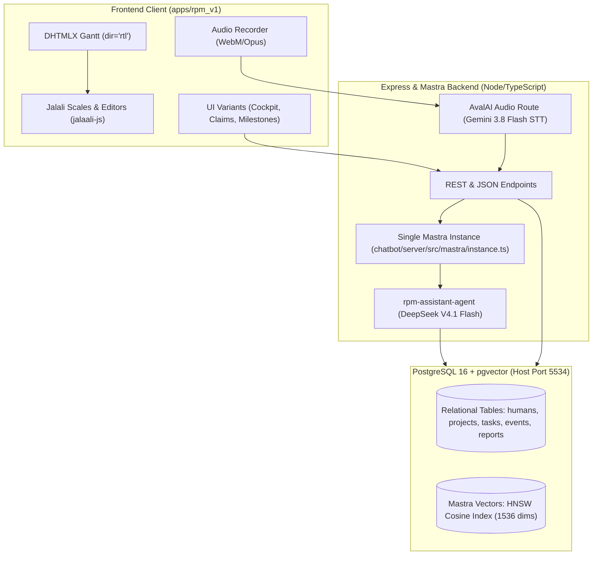
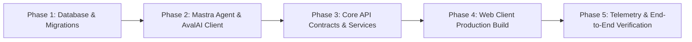

# rpm_V1 Platform: Architecture Blueprint & Implementation Plan

**Project**: `rpm_V1` — AI-Driven Resource & Project Management Platform  
**Status**: Approved & Verified Architecture Blueprint  
**Map Reference**: Concludes [aubed9/gantt#1](https://github.com/aubed9/gantt/issues/1)  
**Domain Terminology**: Conforms strictly to [`GLOSSARY.md`](../GLOSSARY.md)  
**Architecture Decisions**: [`ADR 0001`](./adr/0001-task-claim-lifecycle-and-governance.md), [`ADR 0002`](./adr/0002-eoj-report-review-and-status-propagation.md)

---

## 1. System Overview & Invariants

The `rpm_V1` platform is an AI-augmented organizational orchestration system integrating **DHTMLX Gantt (MIT Edition)**, **Mastra Agent & Knowledge Framework**, **PostgreSQL 16 with `pgvector`**, and **AvalAI** (providing OpenAI-compatible DeepSeek V4.1 Flash reasoning and multimodal Gemini 3.8 Flash voice transcription) tailored for first-class Persian right-to-left (RTL) and Solar Hijri (Jalali) operations.



### Core Architectural Invariants:
1. **Single Mastra Instance Invariant**: Exactly one `new Mastra({ ... })` instance lives across the backend (`chatbot/server/src/mastra/instance.ts`), providing database-free and key-free boots during unit tests with call-time dynamic model resolution.
2. **Pure Gregorian Timestamp Invariant**: All internal Gantt task dates (`start_date`, `end_date`), dependency link calculation offsets, and database timestamp columns (`TIMESTAMPTZ`) remain 100% standard Gregorian JavaScript `Date` / Unix timestamps. Persian Jalali dates are projected strictly at the presentation and editor boundary.
3. **Zero Core Library Drift**: The DHTMLX Gantt MIT bundle in `src/` remains completely dependency-free. All Persian RTL and Jalali modifications are delivered via documented extension seams (`gantt.date`, `gantt.form_blocks`, `gantt.config.editor_types`, `gantt.config.layout`).
4. **Permanent Institutional Memory**: Every completed Task must possess an approved, pgvector-indexed End-of-Job (EOJ) Report, forming the semantic corpus that powers candidate claim rankings and rolling executive summaries.

---

## 2. Data Models & Database Schema

The database runs on PostgreSQL 16 with the `vector` extension enabled (`vector v0.8.7`) under port `5534`.

```sql
-- Core Extensions & Schemas
CREATE EXTENSION IF NOT EXISTS vector;
CREATE SCHEMA IF NOT EXISTS mastra;
CREATE SCHEMA IF NOT EXISTS mastra_vectors;

-- 1. Humans (HM)
CREATE TABLE humans (
    id VARCHAR(64) PRIMARY KEY, -- e.g., 'HM-1'
    name VARCHAR(255) NOT NULL,
    email VARCHAR(255) UNIQUE NOT NULL,
    role VARCHAR(100) NOT NULL,
    is_internal BOOLEAN NOT NULL DEFAULT TRUE,
    skills TEXT[] DEFAULT '{}',
    active_tasks_count INT DEFAULT 0,
    created_at TIMESTAMPTZ DEFAULT NOW(),
    updated_at TIMESTAMPTZ DEFAULT NOW()
);

-- 2. Projects (PR)
CREATE TABLE projects (
    id VARCHAR(64) PRIMARY KEY, -- e.g., 'PR-100'
    code VARCHAR(50) UNIQUE NOT NULL,
    name VARCHAR(255) NOT NULL,
    description TEXT,
    manager_id VARCHAR(64) REFERENCES humans(id), -- PM
    owner_id VARCHAR(64) REFERENCES humans(id),   -- PO
    cto_id VARCHAR(64) REFERENCES humans(id),     -- CTO
    status VARCHAR(50) DEFAULT 'IN_PROGRESS',
    progress NUMERIC(5,4) DEFAULT 0.0000, -- Duration-weighted [0.0 - 1.0]
    rolling_summary_fa TEXT,
    rolling_summary_en TEXT,
    created_at TIMESTAMPTZ DEFAULT NOW(),
    updated_at TIMESTAMPTZ DEFAULT NOW()
);

-- 3. Tasks (TS)
CREATE TYPE task_state_enum AS ENUM (
    'DRAFT', 'OPEN_FOR_CLAIM', 'CLAIM_REVIEW', 'ASSIGNED',
    'IN_PROGRESS', 'IN_REVIEW', 'COMPLETED', 'BLOCKED', 'CANCELLED'
);

CREATE TABLE tasks (
    id SERIAL PRIMARY KEY,
    project_id VARCHAR(64) NOT NULL REFERENCES projects(id) ON DELETE CASCADE,
    parent_id INT REFERENCES tasks(id) ON DELETE CASCADE,
    text VARCHAR(255) NOT NULL,
    type VARCHAR(50) DEFAULT 'task',
    start_date TIMESTAMPTZ NOT NULL,
    duration INT NOT NULL DEFAULT 1, -- in days
    end_date TIMESTAMPTZ NOT NULL,
    progress NUMERIC(5,4) DEFAULT 0.0000,
    state task_state_enum DEFAULT 'DRAFT',
    assignee_id VARCHAR(64) REFERENCES humans(id),
    skills_needed TEXT[] DEFAULT '{}',
    eoj_report_id VARCHAR(64),
    created_at TIMESTAMPTZ DEFAULT NOW(),
    updated_at TIMESTAMPTZ DEFAULT NOW()
);

-- 4. Task Claims
CREATE TYPE claim_state_enum AS ENUM ('PENDING', 'APPROVED', 'REJECTED', 'WITHDRAWN');

CREATE TABLE task_claims (
    id VARCHAR(64) PRIMARY KEY,
    task_id INT NOT NULL REFERENCES tasks(id) ON DELETE CASCADE,
    human_id VARCHAR(64) NOT NULL REFERENCES humans(id) ON DELETE CASCADE,
    status claim_state_enum DEFAULT 'PENDING',
    match_score NUMERIC(5,2),
    ai_candidate_assessment TEXT,
    created_at TIMESTAMPTZ DEFAULT NOW(),
    updated_at TIMESTAMPTZ DEFAULT NOW(),
    UNIQUE(task_id, human_id)
);

-- 5. Events (EV)
CREATE TABLE events (
    id VARCHAR(64) PRIMARY KEY, -- e.g., 'EV-201'
    project_id VARCHAR(64) NOT NULL REFERENCES projects(id) ON DELETE CASCADE,
    title VARCHAR(255) NOT NULL,
    description TEXT,
    event_date TIMESTAMPTZ NOT NULL,
    is_milestone BOOLEAN DEFAULT TRUE,
    created_at TIMESTAMPTZ DEFAULT NOW()
);

-- 6. Reports (RP) & End-of-Job (EOJ) Reports
CREATE TYPE report_state_enum AS ENUM ('DRAFT', 'SUBMITTED', 'REVISION_REQUESTED', 'APPROVED');

CREATE TABLE reports (
    id VARCHAR(64) PRIMARY KEY, -- e.g., 'RP-501'
    project_id VARCHAR(64) NOT NULL REFERENCES projects(id),
    task_id INT REFERENCES tasks(id),
    event_id VARCHAR(64) REFERENCES events(id),
    author_id VARCHAR(64) NOT NULL REFERENCES humans(id),
    report_type VARCHAR(50) NOT NULL, -- 'EOJ', 'EVENT', 'EXECUTIVE'
    title VARCHAR(255) NOT NULL,
    content_markdown TEXT NOT NULL,
    status report_state_enum DEFAULT 'SUBMITTED',
    reviewer_id VARCHAR(64) REFERENCES humans(id),
    reviewer_feedback TEXT,
    submitted_at TIMESTAMPTZ DEFAULT NOW(),
    approved_at TIMESTAMPTZ
);

-- 7. Mastra Knowledge Vector Store Table
CREATE TABLE mastra_vectors.report_chunks (
    id UUID PRIMARY KEY DEFAULT gen_random_uuid(),
    report_id VARCHAR(64) NOT NULL REFERENCES reports(id) ON DELETE CASCADE,
    chunk_index INT NOT NULL,
    content TEXT NOT NULL,
    embedding vector(1536), -- text-embedding-3-small (1536 dims)
    metadata JSONB NOT NULL DEFAULT '{}',
    created_at TIMESTAMPTZ DEFAULT NOW()
);

-- Indexes for sub-5ms hybrid queries
CREATE INDEX idx_report_chunks_embedding_hnsw 
ON mastra_vectors.report_chunks USING hnsw (embedding vector_cosine_ops)
WITH (m = 16, ef_construction = 64);

CREATE INDEX idx_report_chunks_metadata_gin 
ON mastra_vectors.report_chunks USING gin (metadata);
```

---

## 3. Mastra Agent & Knowledge Pipeline

### 3.1 Model Integration via AvalAI
- **Base URL**: `https://api.avalai.ir/v1`
- **Reasoning LLM**: `deepseek-v4.1-flash` (552B MoE, 1M context window) via `@ai-sdk/openai`.
- **Speech-to-Text**: `gemini-3.8-flash` multimodal audio transcription injected with `GLOSSARY.md` domain grounding and Persian zero-width non-joiner (ZWNJ) rules.
- **Embeddings**: `text-embedding-3-small` (1536 dimensions) for cosine semantic similarity.
- **Resilience**: Exponential backoff with 10–25% full jitter handling HTTP 429 and transient 5xx errors.

### 3.2 Report Chunking & Knowledge Ingestion
- Uses `MDocument` from `@mastra/rag` with markdown strategy, `maxSize: 512` tokens, and `overlap: 64` tokens.
- Injects standard semantic breadcrumbs (`[Context Breadcrumbs: Project > Task > Human]`) into each chunk to preserve entity provenance during vector queries.

### 3.3 Candidate Ranking & Executive Synthesis
1. **Candidate Claim Scoring**: When a task is in `CLAIM_REVIEW`, the agent evaluates:
   - Declared skill match percentage against `skills_needed`.
   - Current active task load and bandwidth from `humans`.
   - Cosine semantic similarity of deliverables and positive sentiment in prior EOJ reports retrieved from `report_chunks`.
2. **Rolling Executive Summary**: Upon EOJ approval, the agent recalculates duration-weighted progress and updates `projects.rolling_summary_fa` with milestones accomplished, active blockers, and timeline projection.

---

## 4. DHTMLX Gantt RTL & Persian Jalali Integration

1. **RTL Display Mode**: Activated via `gantt.config.rtl = true` with right-docked grid layout:
   ```javascript
   gantt.config.layout = {
     css: "gantt_container",
     rows: [
       {
         cols: [
           { view: "scrollbar", id: "scrollVer" },
           { view: "timeline", scrollX: "scrollHor", scrollY: "scrollVer" },
           { resizer: true, width: 1 },
           { view: "grid", scrollX: "scrollHor", scrollY: "scrollVer" }
         ]
       },
       { view: "scrollbar", id: "scrollHor", height: 18 }
     ]
   };
   ```
2. **Jalali Scales**: `jalali_year` and `jalali_month` units registered using `jalaali-js` algorithms, aligning with Saturday week start (`شنبه`).
3. **Custom UI Form Blocks**:
   - `jalali_date` inline grid editor parsing Jalali input (`۱۴۰۵/۰۱/۱۲`) to UTC `Date`.
   - `jalali_time` lightbox block providing Persian select dropdowns.
   - Lightbox modal RTL style injection on `onLightbox` event.

---

## 5. Implementation Roadmap & Next Steps



1. **Phase 1: Database & Migrations**: Apply PostgreSQL DDL with `pgvector` and Prisma/Kysely migrations for relational and vector tables.
2. **Phase 2: Mastra Agent & AvalAI Client**: Implement typed accessors in `chatbot/server/src/mastra/instance.ts`, candidate evaluation tools, and Gemini STT voice ingestion routes.
3. **Phase 3: Core API Contracts & Services**: Implement REST/RPC routes for Task Claim lifecycle, EOJ Report review, and duration-weighted progress roll-up.
4. **Phase 4: Web Client Production Build**: Move verified prototype components from `prototype/rpm-v1-rtl-gantt` into production application structure under `apps/rpm_v1`.
5. **Phase 5: Telemetry & End-to-End Verification**: Configure OpenTelemetry trace export to Mastra Studio (`http://localhost:4111`) and verify end-to-end user journeys with Reticle.
