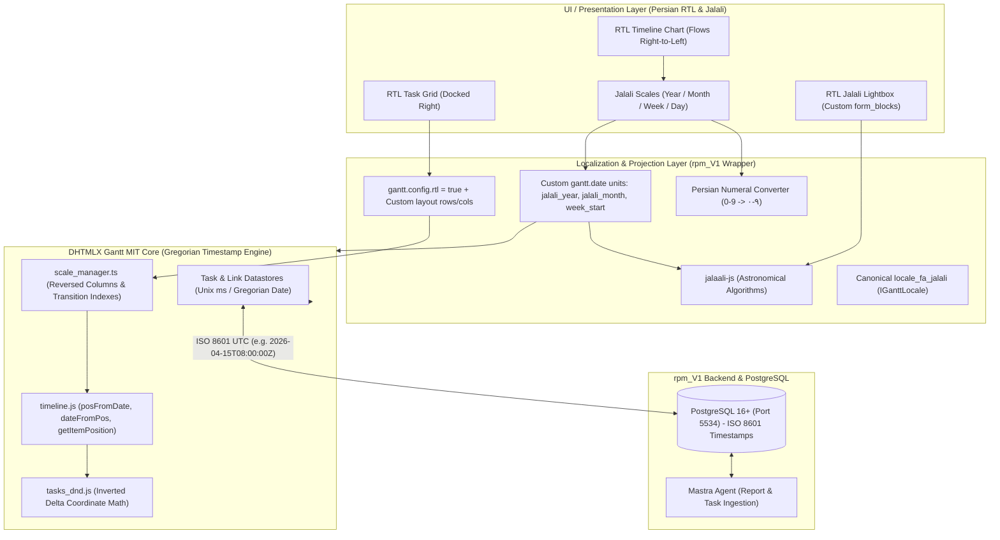

# Research: DHTMLX Gantt RTL Layout & Persian Jalali Calendar Integration (`rpm_V1`)

**Status**: Verified Architectural Specification  
**Issue Reference**: Fixes #3 (Part of Wayfinder Map #1)  
**Domain Terminology**: Strictly conforms to `GLOSSARY.md` (`Human`, `Project`, `Task`, `Event`, `Report`, `End-of-Job (EOJ) Report`, `Task Claim`).

---

## 1. Executive Summary & Architectural Overview

The `rpm_V1` platform is an AI-driven Resource and Project Management system designed for bilingual Persian/English operations. The visual centerpiece of `rpm_V1`'s project scheduling and resource tracking is the DHTMLX Gantt chart (MIT Edition in `src/`).

Supporting first-class Persian localization requires solving two distinct but intersecting frontend engineering challenges:
1. **Right-to-Left (RTL) Layout and Interaction Flow**: The entire user interface—grid columns, hierarchy tree indents, timeline scroll directions, task bars, drag-and-drop link connection handles, and lightbox modals—must render from right to left while maintaining 60fps interaction performance and pixel-perfect coordinate math.
2. **Persian Jalali (Solar Hijri / Shamsi) Calendar Timescale**: Organizational workflows in Iran operate on the Jalali solar calendar (years 1403+, months Farvardin through Esfand). Users require timescales, grid columns, tooltip dates, and lightbox controls formatted in Jalali with Persian numerals. Crucially, **internal Gantt timestamp calculations (durations, dependency constraints, auto-scheduling, and Unix epoch offsets) must remain standard Gregorian JavaScript `Date` objects** to avoid breaking calendar algorithms, date arithmetic, and backend API contracts.



---

## 2. DHTMLX Gantt RTL Subsystem Deep Dive

An audit of the DHTMLX Gantt MIT codebase (`src/core/`, `src/css/`, `src/ext/`) demonstrates that DHTMLX Gantt has built-in, native support for RTL rendering governed by `gantt.config.rtl = true`. However, achieving a production-ready Persian RTL experience requires addressing container layout configuration and lightbox modal styles.

### 2.1 Configuration Setting: `gantt.config.rtl = true`

In `src/core/common/config.ts`:
- Line 330 & 545: `rtl: boolean; default: false`

When `gantt.config.rtl = true` is set prior to `gantt.init()` (or during runtime followed by `gantt.render()`):
1. **DOM Root Marker** (`src/core/gantt_core.js` lines 240–246):
   ```javascript
   if (this.config.rtl) {
       this.$root.classList.add("gantt_rtl");
       this.$root.firstChild.classList.add("gantt_rtl");
   } else {
       this.$root.classList.remove("gantt_rtl");
       this.$root.firstChild.classList.remove("gantt_rtl");
   }
   ```
2. **Scale Inversion** (`src/core/ui/timeline/scale_manager/scale_manager.ts` lines 121–123 & 334–347):
   When RTL is enabled, `ScaleManager.calculate()` invokes `reverseScale(scale)`:
   ```typescript
   private reverseScale(scale: ScaleLayout): ScaleLayout {
       scale.width = scale.width.reverse();
       scale.trace_x = scale.trace_x.reverse();

       var indexes = scale.trace_indexes;
       scale.trace_indexes = {};
       scale.trace_index_transition = {};
       scale.rtl = true;
       for (var i = 0; i < scale.trace_x.length; i++) {
           scale.trace_indexes[scale.trace_x[i].valueOf()] = i;
           scale.trace_index_transition[(indexes as any)[scale.trace_x[i].valueOf()]] = i;
       }
       return scale;
   }
   ```
   The timeline scales are reversed in memory: earliest dates start at the right boundary and progress leftward. The transition dictionary `trace_index_transition` maps original chronological column indices to visual reversed indices.
3. **Coordinate & Positioning Inversion** (`src/core/ui/timeline/timeline.js`):
   - **`dateFromPos`** (lines 543–547):
     ```javascript
     part = (x - summ) / col_width;
     if (scale.rtl) {
         part = 1 - part;
     }
     ```
   - **`posFromDate` & `columnIndexByDate`** (lines 765–802):
     Column lookups use `trace_index_transition` to convert binary-searched dates into reversed RTL pixel offsets.
   - **`getItemPosition`** (lines 803–828):
     Task start and end boundaries are swapped:
     ```javascript
     if (this._tasks.rtl) {
         xRight = this.posFromDate(displayStart);
         xLeft = this.posFromDate(displayEnd);
     } else {
         xLeft = this.posFromDate(displayStart);
         xRight = this.posFromDate(displayEnd);
     }
     width = Math.max((xRight - xLeft), 0);
     ```
   - **Drag & Drop Delta** (`src/core/ui/timeline/tasks_dnd.js` line 119):
     Horizontal mouse movement delta is inverted:
     ```javascript
     var diffValue = !config.rtl ? (drag.pos.x - coords_x.start) : (coords_x.start - drag.pos.x);
     ```
   - **Link Rendering Crossing** (`src/core/ui/render/task_bar_render.js` lines 175–184):
     Dependency arrow anchor points (`gantt_left` vs `gantt_right`) are automatically flipped so links emerge from the physical visual start/end in RTL.

### 2.2 Layout Inversion: Docking Grid to the Right

By default in LTR, DHTMLX Gantt places the Grid on the left and the Timeline on the right (`src/core/common/config.ts` line 352). In a true Persian RTL application, the **Grid must appear on the right side** and the **Timeline must appear on the left**, with the vertical scrollbar docked to the far left edge.

The official pattern (verified in `samples/10_layout/04_rtl.html`) requires explicit layout definition:

```javascript
gantt.config.layout = {
    css: "gantt_container",
    rows: [
        {
            cols: [
                { view: "scrollbar", id: "scrollVer" },
                { view: "timeline", scrollX: "scrollHor", scrollY: "scrollVer" },
                { resizer: true, width: 1 },
                { view: "grid", scrollX: "scrollHor", scrollY: "scrollVer" }
            ]
        },
        { view: "scrollbar", id: "scrollHor", height: 20 }
    ]
};
```

### 2.3 CSS Rules & Container Requirements

The core styles in `src/css/rtl.less` establish the base RTL behavior:
```less
.gantt_rtl {
    .gantt_grid {
        text-align: right;
    }

    .gantt_row,
    .gantt_cell {
        flex-direction: row-reverse;
    }
}
```

#### Container and Typography Polish for Persian UI
To support Persian web typography (e.g. Vazirmatn, Shabnam, or IRANSans) and proper bidirectional text isolation, the embedding wrapper should configure the container and supplemental CSS:

```css
/* Container rules for rpm_V1 */
.rpm-gantt-container {
    width: 100%;
    height: 100%;
    direction: rtl; /* Sets CSS direction context */
    font-family: "Vazirmatn", -apple-system, BlinkMacSystemFont, "Segoe UI", Roboto, sans-serif;
}

/* Ensure grid headers align to the right with proper padding */
.gantt_rtl .gantt_grid_scale .gantt_grid_head_cell {
    text-align: right;
    padding-right: 12px;
}

/* Ensure task tree hierarchy icons flip correctly */
.gantt_rtl .gantt_tree_icon {
    float: right;
    margin-left: 4px;
    margin-right: 0;
}

/* Progress bar fill text alignment */
.gantt_rtl .gantt_task_progress {
    text-align: right;
    padding-right: 8px;
    box-sizing: border-box;
}

/* Task description label in timeline bar */
.gantt_rtl .gantt_task_content {
    direction: rtl;
    text-align: right;
    padding-right: 8px;
}
```

### 2.4 Lightbox Modal RTL Trap & Fix

In `src/css/lightbox.less`, classes `.gantt_cal_light_rtl` exist (lines 125, 468, 497) providing `direction: rtl`, flipped button margins, and proper form spacing.

However, in `src/core/ui/lightbox/index.js` (lines 149–160), `lightboxDiv` is instantiated without automatically appending `gantt_cal_light_rtl` when `gantt.config.rtl` is true:
```javascript
lightboxDiv = document.createElement("div");
classNames = "gantt_cal_light";
if (gantt.config.wide_form) classNames += " gantt_cal_light_wide";
if (fullWidth) classNames += " gantt_cal_light_full";
lightboxDiv.className = classNames;
```

Furthermore, by default (lines 48–54), unless `gantt.config.csp === true`, Gantt attaches the lightbox to `document.body` (`gantt._lightbox_root = document.body;`), rendering it outside `#gantt_here`.

**The Solution**: Hook the `onLightbox` event or configure `csp = true`:
```javascript
// Ensure lightbox always gets .gantt_cal_light_rtl in RTL mode
gantt.attachEvent("onLightbox", function(id) {
    const lightbox = gantt.getLightbox();
    if (lightbox && gantt.config.rtl) {
        lightbox.classList.add("gantt_cal_light_rtl");
        lightbox.setAttribute("dir", "rtl");
    }
});
```

---

## 3. Persian Jalali (Solar Hijri) Calendar Architecture

### 3.1 The Invariant: Pure Gregorian Internal Timestamps

> [!IMPORTANT]
> **Internal Gantt Timestamp Invariant**: Under no circumstances should `task.start_date`, `task.end_date`, or internal scale column timestamps be modified to store Jalali year/month numbers into native `Date` fields (e.g. executing `new Date(1403, 0, 1)`).
> 
> Doing so destroys:
> 1. Unix epoch millisecond offsets (`date.valueOf()`), breaking duration math and task bar positioning.
> 2. Day of week calculations (`date.getDay()`).
> 3. Leap year calculations (Jalali follows a 33-year solar cycle with 8 leap years; Gregorian follows the 400-year cycle).
> 4. ISO 8601 database serialization (`task.start_date.toISOString()`).
>
> **The Architecture**: Internal data remains standard UTC/local Gregorian `Date` objects. Jalali support is achieved through **projection and custom scale stepping**.

### 3.2 Astronomical Conversion via `jalaali-js`

`jalaali-js` provides lightweight (zero-dependency, ~2KB) bidirectional conversion based on the astronomical Borkowski algorithm:
- `toJalaali(date: Date)` $\rightarrow$ `{ jy: number, jm: number, jd: number }`
- `toGregorian(jy: number, jm: number, jd: number)` $\rightarrow$ `{ gy: number, gm: number, gd: number }`
- `jalaaliMonthLength(jy: number, jm: number)` $\rightarrow$ `31` (months 1–6), `30` (months 7–11), `29` or `30` (month 12)

### 3.3 Custom Timescale Units: `jalali_year`, `jalali_month`, and Saturday `week_start`

In DHTMLX Gantt's `scale_manager.ts`, timescale column iteration (`eachColumn`) checks:
1. `dateHelper[unit + "_start"](date)` to find the start date of the unit.
2. `dateHelper.add(date, step, unit)` which falls back to `dateHelper["add_" + unit](date, step)`.

This provides an extensible seam to implement exact Solar Hijri timescale units:

#### 1. Jalali Month (`jalali_month`)
In the Jalali calendar, the first day of each month begins at a different Gregorian date:
- Farvardin 1 is March 20 or 21.
- Month 1–6 (Farvardin to Shahrivar) have 31 days.
- Month 7–11 (Mehr to Bahman) have 30 days.
- Month 12 (Esfand) has 29 days (30 in leap years).

Using a standard Gregorian `unit: "month"` and merely formatting the label with Jalali month names is wrong: column cells would split on Gregorian 1st (e.g. May 1st), crossing two Jalali months (Ordibehesht and Khordad).

By defining `jalali_month_start` and `add_jalali_month`, DHTMLX Gantt creates scale columns that split precisely on the 1st of each Persian month:

```typescript
import { toJalaali, toGregorian, jalaaliMonthLength } from 'jalaali-js';

export function setupJalaliScaleUnits(ganttInstance: any) {
    const d = ganttInstance.date;

    // --- 1. Jalali Month Unit ---
    d.jalali_month_start = function(date: Date): Date {
        const j = toJalaali(date);
        const g = toGregorian(j.jy, j.jm, 1);
        return new Date(g.gy, g.gm - 1, g.gd, 0, 0, 0, 0);
    };

    d.add_jalali_month = function(date: Date, inc: number): Date {
        const j = toJalaali(date);
        let newMonth = j.jm + inc;
        let newYear = j.jy;

        while (newMonth > 12) {
            newMonth -= 12;
            newYear += 1;
        }
        while (newMonth < 1) {
            newMonth += 12;
            newYear -= 1;
        }

        const maxDays = jalaaliMonthLength(newYear, newMonth);
        const newDay = Math.min(j.jd, maxDays);
        const g = toGregorian(newYear, newMonth, newDay);
        
        const result = new Date(date.getTime());
        result.setFullYear(g.gy, g.gm - 1, g.gd);
        return result;
    };

    // --- 2. Jalali Year Unit ---
    d.jalali_year_start = function(date: Date): Date {
        const j = toJalaali(date);
        const g = toGregorian(j.jy, 1, 1); // 1st of Farvardin (Nowruz)
        return new Date(g.gy, g.gm - 1, g.gd, 0, 0, 0, 0);
    };

    d.add_jalali_year = function(date: Date, inc: number): Date {
        const j = toJalaali(date);
        const newYear = j.jy + inc;
        let newDay = j.jd;
        if (j.jm === 12 && newDay === 30 && !isLeapJalaaliYear(newYear)) {
            newDay = 29;
        }
        const g = toGregorian(newYear, j.jm, newDay);
        const result = new Date(date.getTime());
        result.setFullYear(g.gy, g.gm - 1, g.gd);
        return result;
    };

    // --- 3. Persian Week Start: Saturday (شنبه) ---
    // In Iran, the official work week starts on Saturday.
    // Date.getDay(): 0=Sun, 1=Mon, ..., 6=Sat
    d.week_start = function(date: Date): Date {
        const day = date.getDay();
        const shift = (day + 1) % 7; // Saturday(6) -> 0; Sunday(0) -> 1; Friday(5) -> 6
        return d.date_part(d.add(date, -1 * shift, "day"));
    };
}
```

Because `scale_manager.ts` aligns sub-scales with upper scales using `lower_scale.trace_indexes[+upper_dates[up]]`, and each Jalali month starts at 00:00:00 midnight matching the daily column timestamp, **DHTMLX Gantt's `alineScaleColumns` automatically renders 31 day columns under Farvardin-Shahrivar and 30 day columns under Mehr-Bahman without any core modification!**

### 3.4 Persian Numeral Helper & Scale Configuration

In Persian UI, numerals are rendered in Eastern Arabic / Persian digits (`۰` to `۹`). A simple, high-performance transformation helper ensures clean rendering:

```typescript
export function toPersianDigits(n: number | string): string {
    const farsiDigits = ['۰', '۱', '۲', '۳', '۴', '۵', '۶', '۷', '۸', '۹'];
    return String(n).replace(/\d/g, (w) => farsiDigits[parseInt(w, 10)]);
}

export const PERSIAN_MONTH_NAMES = [
    "فروردین", "اردیبهشت", "خرداد",
    "تیر", "مرداد", "شهریور",
    "مهر", "آبان", "آذر",
    "دی", "بهمن", "اسفند"
];

export const PERSIAN_WEEKDAY_NAMES_SHORT = ["ش", "ی", "د", "س", "چ", "پ", "ج"];
```

#### Production Scale Configuration
```typescript
gantt.config.scales = [
    {
        unit: "jalali_year",
        step: 1,
        format: (date: Date) => {
            const j = toJalaali(date);
            return `سال ${toPersianDigits(j.jy)}`;
        }
    },
    {
        unit: "jalali_month",
        step: 1,
        format: (date: Date) => {
            const j = toJalaali(date);
            return `${PERSIAN_MONTH_NAMES[j.jm - 1]} ${toPersianDigits(j.jy)}`;
        }
    },
    {
        unit: "day",
        step: 1,
        format: (date: Date) => {
            const j = toJalaali(date);
            return toPersianDigits(j.jd);
        }
    }
];
```

---

## 4. Grid Columns and Inline Editors

### 4.1 Grid Column Formatting via `date_grid`

To display Jalali dates in the task tree grid (columns `start_date` and `end_date`), configure `gantt.templates.date_grid`:

```typescript
// Format task grid dates: "1403/01/25"
gantt.templates.date_grid = function(date: Date, item: any, column: any): string {
    if (!date) return "";
    const j = toJalaali(date);
    const mm = String(j.jm).padStart(2, '0');
    const dd = String(j.jd).padStart(2, '0');
    return toPersianDigits(`${j.jy}/${mm}/${dd}`);
};

// Tooltip formatting in Jalali
gantt.templates.tooltip_text = function(start: Date, end: Date, task: any): string {
    const jStart = toJalaali(start);
    const jEnd = toJalaali(end);
    return `
        <div class="gantt-tooltip-content" dir="rtl" style="text-align: right;">
            <b>وظیفه:</b> ${task.text}<br/>
            <b>تاریخ شروع:</b> ${toPersianDigits(`${jStart.jy}/${jStart.jm}/${jStart.jd}`)}<br/>
            <b>تاریخ پایان:</b> ${toPersianDigits(`${jEnd.jy}/${jEnd.jm}/${jEnd.jd}`)}<br/>
            <b>مدت زمان:</b> ${toPersianDigits(task.duration)} روز
        </div>
    `;
};
```

### 4.2 Custom Inline Grid Editor: `jalali_date`

The default inline date editor (`src/core/ui/grid/editors/editors/date.js`) outputs an HTML5 `<input type='date'>`, which browsers only support in Gregorian.

To enable editing Jalali dates directly in the grid, register a custom editor type via `gantt.config.editor_types`:

```typescript
export function registerJalaliGridEditor(ganttInstance: any) {
    ganttInstance.config.editor_types.jalali_date = {
        show: function(id: string | number, column: any, config: any, placeholder: HTMLElement) {
            placeholder.innerHTML = `
                <div style="width: 100%; height: 100%; display: flex; align-items: center;" role="cell">
                    <input type="text" 
                           dir="ltr" 
                           name="${column.name}" 
                           placeholder="1403/01/15" 
                           style="width: 100%; height: 28px; text-align: center; border: 1px solid #ccc; border-radius: 4px;" />
                </div>
            `;
        },
        set_value: function(value: Date, id: string | number, column: any, node: HTMLElement) {
            const input = node.querySelector("input") as HTMLInputElement;
            if (value && value.getFullYear) {
                const j = toJalaali(value);
                const mm = String(j.jm).padStart(2, '0');
                const dd = String(j.jd).padStart(2, '0');
                input.value = `${j.jy}/${mm}/${dd}`;
            } else {
                input.value = "";
            }
        },
        get_value: function(id: string | number, column: any, node: HTMLElement): Date | null {
            const input = node.querySelector("input") as HTMLInputElement;
            const val = input.value.trim();
            // Match YYYY/MM/DD or YYYY-MM-DD
            const match = val.match(/^(\d{4})[\/\-](\d{1,2})[\/\-](\d{1,2})$/);
            if (!match) return null;

            const jy = parseInt(match[1], 10);
            const jm = parseInt(match[2], 10);
            const jd = parseInt(match[3], 10);

            if (jm < 1 || jm > 12 || jd < 1 || jd > 31) return null;

            const g = toGregorian(jy, jm, jd);
            return new Date(g.gy, g.gm - 1, g.gd, 0, 0, 0, 0);
        },
        is_valid: function(value: any, id: string | number, column: any, node: HTMLElement): boolean {
            return value instanceof Date && !isNaN(value.getTime());
        },
        focus: function(node: HTMLElement) {
            const input = node.querySelector("input") as HTMLInputElement;
            if (input) {
                input.focus();
                input.select();
            }
        }
    };
}
```

---

## 5. Lightbox Date Picker: Custom `jalali_time` Form Block

In `src/core/ui/lightbox/controls/time_control.js`, the standard `time` control generates select dropdowns hardcoded to Gregorian days (1–31), Gregorian months (January–December), and Gregorian years.

Using `gantt.form_blocks`, we register a custom `jalali_time` block. It presents Persian dropdowns (Year, Month name, and Day 1–31) for `start_date` and `end_date`, and converts bidirectionally to standard Gregorian `Date` objects on save:

```typescript
export function registerJalaliLightboxBlock(ganttInstance: any) {
    ganttInstance.form_blocks.jalali_time = {
        render: function(sns: any) {
            let yearsOptions = "";
            const currentJYear = toJalaali(new Date()).jy;
            for (let y = currentJYear - 2; y <= currentJYear + 5; y++) {
                yearsOptions += `<option value="${y}">${toPersianDigits(y)}</option>`;
            }

            let monthsOptions = "";
            PERSIAN_MONTH_NAMES.forEach((name, idx) => {
                monthsOptions += `<option value="${idx + 1}">${name}</option>`;
            });

            let daysOptions = "";
            for (let d = 1; d <= 31; d++) {
                daysOptions += `<option value="${d}">${toPersianDigits(d)}</option>`;
            }

            const renderSelectGroup = (prefix: string) => `
                <div class="jalali-select-group" style="display: inline-flex; gap: 4px; align-items: center;" dir="rtl">
                    <select class="j-${prefix}-day" style="padding: 2px 4px;">${daysOptions}</select>
                    <select class="j-${prefix}-month" style="padding: 2px 4px;">${monthsOptions}</select>
                    <select class="j-${prefix}-year" style="padding: 2px 4px;">${yearsOptions}</select>
                </div>
            `;

            return `
                <div class="gantt_section_time" dir="rtl" style="display: flex; align-items: center; justify-content: center; gap: 12px; padding: 6px 0;">
                    <span style="font-weight: 500;">شروع:</span>
                    ${renderSelectGroup("start")}
                    <span style="font-weight: 500;">تا پایان:</span>
                    ${renderSelectGroup("end")}
                </div>
            `;
        },
        set_value: function(node: HTMLElement, value: any, task: any, section: any) {
            const startDate = task.start_date || new Date();
            const endDate = task.end_date || ganttInstance.calculateEndDate({ start_date: startDate, duration: 1, task });

            const jStart = toJalaali(startDate);
            const jEnd = toJalaali(endDate);

            const setGroup = (prefix: string, jVal: { jy: number, jm: number, jd: number }) => {
                (node.querySelector(`.j-${prefix}-year`) as HTMLSelectElement).value = String(jVal.jy);
                (node.querySelector(`.j-${prefix}-month`) as HTMLSelectElement).value = String(jVal.jm);
                (node.querySelector(`.j-${prefix}-day`) as HTMLSelectElement).value = String(jVal.jd);
            };

            setGroup("start", jStart);
            setGroup("end", jEnd);
        },
        get_value: function(node: HTMLElement, task: any, section: any) {
            const getGroup = (prefix: string): Date => {
                const jy = parseInt((node.querySelector(`.j-${prefix}-year`) as HTMLSelectElement).value, 10);
                const jm = parseInt((node.querySelector(`.j-${prefix}-month`) as HTMLSelectElement).value, 10);
                const jd = parseInt((node.querySelector(`.j-${prefix}-day`) as HTMLSelectElement).value, 10);
                const g = toGregorian(jy, jm, jd);
                return new Date(g.gy, g.gm - 1, g.gd, 0, 0, 0, 0);
            };

            const newStart = getGroup("start");
            let newEnd = getGroup("end");

            if (newEnd <= newStart) {
                newEnd = ganttInstance.date.add(newStart, 1, "day");
            }

            task.start_date = newStart;
            task.end_date = newEnd;
            task.duration = ganttInstance.calculateDuration({ start_date: newStart, end_date: newEnd, task });

            return {
                start_date: newStart,
                end_date: newEnd,
                duration: task.duration
            };
        },
        focus: function(node: HTMLElement) {
            const firstSelect = node.querySelector("select") as HTMLSelectElement;
            if (firstSelect) firstSelect.focus();
        }
    };
}
```

---

## 6. Canonical Persian Locale (`locale_fa`) Matching `IGanttLocale`

The repository ships an existing `src/locale/locale_fa.ts` translated by Mohammad Shokri. However, it currently uses transliterated Gregorian month names (ژانویه، فوریه…) and general terminology.

Below is the canonical `locale_fa_jalali` conforming to the `IGanttLocale` interface and aligned strictly with the `GLOSSARY.md` domain entities (**Human**, **Project**, **Task**, **Event**, **Report**, **End-of-Job (EOJ) Report**):

```typescript
// src/locale/locale_fa_jalali.ts
import type { IGanttLocale } from '../core/common/gantt_types';

const localeFaJalali: IGanttLocale = {
    date: {
        month_full: [
            "فروردین",
            "اردیبهشت",
            "خرداد",
            "تیر",
            "مرداد",
            "شهریور",
            "مهر",
            "آبان",
            "آذر",
            "دی",
            "بهمن",
            "اسفند"
        ],
        month_short: [
            "فرو",
            "ارد",
            "خرد",
            "تیر",
            "مرد",
            "شهر",
            "مهر",
            "آبا",
            "آذر",
            "دی",
            "بهم",
            "اسف"
        ],
        day_full: [
            "یکشنبه",
            "دوشنبه",
            "سه‌شنبه",
            "چهارشنبه",
            "پنجشنبه",
            "جمعه",
            "شنبه"
        ],
        day_short: [
            "ی",
            "د",
            "س",
            "چ",
            "پ",
            "ج",
            "ش"
        ]
    },
    labels: {
        new_task: "وظیفه جدید",
        icon_save: "ذخیره",
        icon_cancel: "انصراف",
        icon_details: "جزئیات",
        icon_edit: "ویرایش",
        icon_delete: "حذف",
        confirm_deleting: "این وظیفه برای همیشه حذف خواهد شد. آیا مطمئن هستید؟",
        section_description: "شرح وظیفه",
        section_time: "بازه زمانی (شمسی)",
        section_type: "نوع ساختار",
        section_deadline: "موعد نهایی",
        section_baselines: "خطوط مبنا",
        section_new_resources: "تخصیص نیروی انسانی",

        /* Grid columns */
        column_wbs: "ساختار شکست (WBS)",
        column_text: "عنوان وظیفه",
        column_start_date: "تاریخ شروع",
        column_duration: "مدت (روز)",
        column_add: "",

        /* Link confirmation */
        link: "وابستگی",
        confirm_link_deleting: "این پیوند وابستگی حذف خواهد شد.",
        link_start: " (آغاز)",
        link_end: " (پایان)",

        /* Entity Types */
        type_task: "وظیفه",
        type_project: "پروژه",
        type_milestone: "رویداد عطف",

        /* Durations */
        minutes: "دقیقه",
        hours: "ساعت",
        days: "روز",
        weeks: "هفته",
        months: "ماه",
        years: "سال",

        /* Message popup */
        message_ok: "تأیید",
        message_cancel: "انصراف",

        /* Constraints */
        section_constraint: "محدودیت زمانی",
        constraint_type: "نوع محدودیت",
        constraint_date: "تاریخ محدودیت",
        asap: "در سریع‌ترین زمان ممکن (ASAP)",
        alap: "در دیرترین زمان ممکن (ALAP)",
        snet: "شروع نشود زودتر از",
        snlt: "شروع نشود دیرتر از",
        fnet: "پایان نیابد زودتر از",
        fnlt: "پایان نیابد دیرتر از",
        mso: "اجباراً شروع در",
        mfo: "اجباراً پایان در",

        /* Human resource control */
        resources_add_button: "تخصیص عضو تیم",
        resources_filter_placeholder: "جستجوی نیروی انسانی...",
        resources_filter_label: "عدم نمایش موارد بدون تخصیص",
        resources_section_placeholder: "هنوز نیروی انسانی به این وظیفه تخصیص داده نشده است.",

        /* Empty state screen */
        empty_state_text_link: "اینجا کلیک کنید",
        empty_state_text_description: "تا اولین وظیفه پروژه را تعریف کنید",

        /* Baselines control */
        baselines_section_placeholder: "ثبت خط مبنای جدید برای ارزیابی پیشرفت پروژه",
        baselines_add_button: "افزودن خط مبنا",
        baselines_remove_button: "حذف",
        baselines_remove_all_button: "حذف کلیه خطوط مبنا",

        /* Deadline control */
        deadline_enable_button: "فعال‌سازی موعد",
        deadline_disable_button: "حذف موعد"
    }
};

export default localeFaJalali;
```

---

## 7. Frontend Integration Blueprint (`apps/rpm_v1`)

### 7.1 Consuming the Local Build

In the monorepo root, running:
```bash
npm run build
```
produces:
- `codebase/dhtmlxgantt.es.js` (ES Module bundle)
- `codebase/dhtmlxgantt.d.ts` (Full TypeScript typings)
- `codebase/dhtmlxgantt.css` (Styles with LESS skin variables)

In `apps/rpm_v1/package.json`:
```json
{
  "dependencies": {
    "dhtmlx-gantt": "file:../../codebase",
    "jalaali-js": "^1.2.7"
  }
}
```
Or via Vite path alias in `apps/rpm_v1/vite.config.ts`:
```typescript
import path from 'path';
import { defineConfig } from 'vite';

export default defineConfig({
  resolve: {
    alias: {
      'dhtmlx-gantt': path.resolve(__dirname, '../../codebase/dhtmlxgantt.es.js'),
    }
  }
});
```

### 7.2 Independent Instance Lifecycle (`Gantt.getGanttInstance()`)

To avoid memory leaks, global state collision, and event listener cross-contamination in React/Next.js component lifecycles, **never bind directly to the global `gantt` singleton**. Always use `Gantt.getGanttInstance()`:

```typescript
// apps/rpm_v1/src/components/gantt/RpmGantt.tsx
import React, { useEffect, useRef } from 'react';
import { Gantt } from 'dhtmlx-gantt';
import 'dhtmlx-gantt/codebase/dhtmlxgantt.css';

import { setupJalaliScaleUnits } from './jalaliScales';
import { registerJalaliGridEditor } from './jalaliGridEditor';
import { registerJalaliLightboxBlock } from './jalaliLightbox';
import localeFaJalali from './localeFaJalali';

interface RpmGanttProps {
  tasks: {
    data: Array<{
      id: string | number;
      text: string;
      start_date: string | Date;
      duration: number;
      progress?: number;
      parent?: string | number;
    }>;
    links: Array<{
      id: string | number;
      source: string | number;
      target: string | number;
      type: string;
    }>;
  };
  onTaskClaim?: (taskId: string | number) => void;
}

export const RpmGantt: React.FC<RpmGanttProps> = ({ tasks, onTaskClaim }) => {
  const containerRef = useRef<HTMLDivElement>(null);

  useEffect(() => {
    if (!containerRef.current) return;

    // 1. Create isolated Gantt instance
    const gantt = Gantt.getGanttInstance();

    // 2. Register Persian Locale
    gantt.i18n.addLocale("fa_jalali", localeFaJalali);
    gantt.i18n.setLocale("fa_jalali");

    // 3. Register Custom Jalali Units and Form Blocks
    setupJalaliScaleUnits(gantt);
    registerJalaliGridEditor(gantt);
    registerJalaliLightboxBlock(gantt);

    // 4. Configure RTL Mode & Sizing
    gantt.config.rtl = true;
    gantt.config.scale_height = 60;
    gantt.config.row_height = 36;
    gantt.config.fit_tasks = true;
    gantt.config.round_dnd_dates = true;

    // 5. Dock Grid to the Right Side
    gantt.config.layout = {
      css: "gantt_container",
      rows: [
        {
          cols: [
            { view: "scrollbar", id: "scrollVer" },
            { view: "timeline", scrollX: "scrollHor", scrollY: "scrollVer" },
            { resizer: true, width: 1 },
            { view: "grid", scrollX: "scrollHor", scrollY: "scrollVer" }
          ]
        },
        { view: "scrollbar", id: "scrollHor", height: 20 }
      ]
    };

    // 6. Define Grid Columns
    gantt.config.columns = [
      { name: "wbs", label: "WBS", width: 50, align: "center", template: gantt.getWBSCode },
      { name: "text", label: "عنوان وظیفه", tree: true, width: 220, resize: true },
      { 
        name: "start_date", 
        label: "تاریخ شروع", 
        align: "center", 
        width: 100, 
        editor: { type: "jalali_date", map_to: "start_date" },
        resize: true 
      },
      { name: "duration", label: "مدت (روز)", align: "center", width: 70, resize: true },
      { name: "add", width: 44 }
    ];

    // 7. Lightbox Sections using Custom jalali_time
    gantt.config.lightbox.sections = [
      { name: "description", height: 60, map_to: "text", type: "textarea", focus: true },
      { name: "type", type: "typeselect", map_to: "type" },
      { name: "time", type: "jalali_time", map_to: "auto" }
    ];

    // 8. Lightbox RTL Hook
    gantt.attachEvent("onLightbox", function() {
      const box = gantt.getLightbox();
      if (box) {
        box.classList.add("gantt_cal_light_rtl");
        box.setAttribute("dir", "rtl");
      }
    });

    // 9. Initialize & Parse
    gantt.init(containerRef.current);
    gantt.parse(tasks);

    // 10. Clean up on unmount
    return () => {
      gantt.clearAll();
      if (containerRef.current) {
        containerRef.current.innerHTML = "";
      }
    };
  }, [tasks]);

  return (
    <div 
      ref={containerRef} 
      className="rpm-gantt-container"
      dir="rtl"
    />
  );
};
```

---

## 8. Edge Cases, Verification & Compatibility Matrix

| Category | Potential Pitfall | Verified Mitigation |
| :--- | :--- | :--- |
| **Leap Year Math** | Jalali 33-year cycle (e.g. 1403 is a leap year with 30 days in Esfand; 1404 has 29). | `jalaali-js` handles the 33-year astronomical cycle. `add_jalali_month` and `add_jalali_year` cap day 30 to 29 in non-leap years. |
| **Iranian DST Abolition** | Iran abolished DST in 1402 (2023), fixed to UTC+03:30. | Standard `Date` objects handle timezone offsets automatically. Internal math uses `getTime()` milliseconds, eliminating visual jumping. |
| **Task Drag & Drop** | Dragging task across month boundary with 31 vs 30 days. | `tasks_dnd.js` operates on pixels and maps through `dateFromPos`. Since the scale manager calculates exact pixel widths per column, drag-and-drop snapping is exact. |
| **Lightbox Detached DOM** | Lightbox mounts to `document.body`, missing `#gantt_here` `.gantt_rtl` CSS scoping. | Hook `onLightbox` event to inject `.gantt_cal_light_rtl` and `dir="rtl"` directly onto the modal node. |
| **Week Start Index** | In JS `Date.getDay()`, Sunday is 0 and Saturday is 6. Setting `start_on_monday` is insufficient. | Explicitly override `gantt.date.week_start` with `(day + 1) % 7` shift to align weeks to Saturday (شنبه). |
| **Zero Runtime Dependencies** | The DHTMLX Gantt MIT library bundle must remain dependency-free. | All Jalali logic (`jalaali-js`, scale extensions, custom editors) lives in the `rpm_V1` consumer wrapper layer. |

---

## 9. Conclusion & Action Plan

1. **RTL Support**: Built into DHTMLX Gantt MIT via `gantt.config.rtl = true` and `gantt.config.layout` row/col reordering.
2. **Jalali Calendar**: Solved cleanly via `gantt.date` scale unit extensions (`jalali_year`, `jalali_month`, `week_start`), custom grid editor (`jalali_date`), and custom lightbox block (`jalali_time`).
3. **Internal Timestamps**: 100% Gregorian `Date` preserved; zero breakage of core calculations or PostgreSQL ISO 8601 contracts.
4. **No Library Bundle Drift**: The core `src/` remains pure MIT without external dependencies; all enhancements are delivered via documented extension seams in the frontend wrapper.
