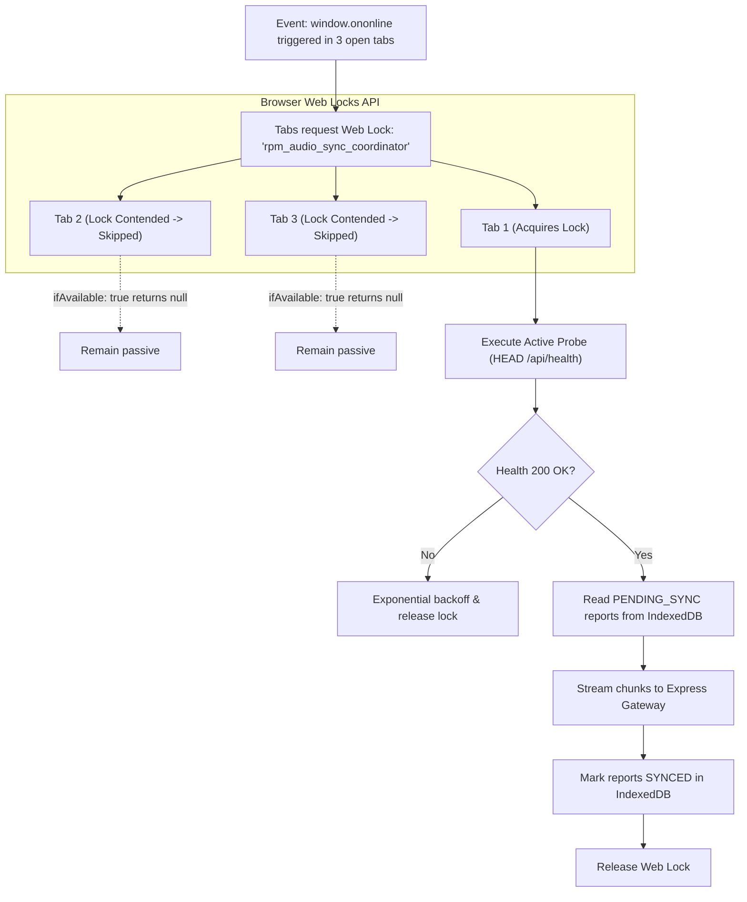

# Research: Client-Side Offline Audio Buffering, IndexedDB Sync & Resilient Voice Transcription Pipeline (`rpm_V1`)

- **Author**: AFK Research Subagent
- **Tracking Issue**: Fixes [#16](https://github.com/aubed9/gantt/issues/16)
- **Context**: Part of [[Wayfinder Map] rpm_V1 Platform Core Services, Real-Time Pipeline & Production Deployment (#9)](https://github.com/aubed9/gantt/issues/9)
- **Status**: Verified Architectural Specification
- **Domain Terminology**: Strictly conforms to [`GLOSSARY.md`](../../GLOSSARY.md) (`Tenant`, `Human`, `Project`, `Task`, `Task Claim`, `End-of-Job (EOJ) Report`, `Claim Review Window`, `Task State`, `Task Claim State`, `Report State`, `Knowledge Ingestion`).
- **Date**: November 2026

---

## 1. Executive Summary & Problem Formulation

The `rpm_V1` platform coordinates concurrent **Humans** across **Projects** and **Tasks** in enterprise environments where field engineers, site supervisors, and technical contributors frequently work in hostile or intermittent network conditions (e.g. subterranean mechanical rooms, offshore facilities, construction tunnels, remote plants, and cellular dead zones).

Upon completing a **Task**, a **Human** must submit a mandatory **End-of-Job (EOJ) Report** detailing deliverables against success criteria. To streamline reporting and preserve real-time operational momentum, `rpm_V1` provides a hands-free Persian voice dictation interface powered by client-side audio capture, AvalAI Gemini 3.8 Flash Speech-to-Text (STT), and strict Persian orthographic normalization.

```
+----------------------------------------------------------------------------------------------------+
|                                    THE OFFLINE DILEMMA IN rpm_V1                                   |
|                                                                                                    |
| 1. Field Human speaks 2-minute Persian EOJ voice report in a basement (Zero Network).              |
| 2. Standard Web apps crash, lose audio buffer upon tab reload, or drop packets on intermittent 4G. |
| 3. Partial chunk uploads produce corrupted WebM files lacking EBML headers.                       |
| 4. Network recovery triggers multiple tabs simultaneously, causing duplicate STT calls.            |
| 5. Persian grammatical ZWNJ (Zero-Width Non-Joiner) is mangled by naive STT tokenizers.           |
+----------------------------------------------------------------------------------------------------+
```

### Core Architectural Decisions & Invariants

1. **Client-Side Timesliced MediaRecorder Capture with Continuous Container Sealing**: Audio is captured via `MediaRecorder` using Opus compression inside a WebM container (`audio/webm; codecs=opus`) at 24 kbps / 16 kHz mono. While recording, the client receives timesliced binary chunks every 2,000 ms and commits them incrementally to an offline store, eliminating in-memory heap bloat. Crucially, client-side reassembly respects Matroska/EBML container specifications: chunk 0 holds the EBML Header (`0x1A45DFA3`) and Track metadata, while subsequent chunks hold raw Cluster blocks (`0x1F43B675`).
2. **Durable IndexedDB Buffering with Eviction Immunity**: Audio chunks and report metadata are stored in IndexedDB under database `rpm_v1_audio_sync`. Storage durability is guaranteed via the HTML Storage Standard `navigator.storage.persist()`, switching browser eviction from "best-effort" to "persistent". Un-synced voice reports survive browser restarts, tab reloads, and operating system disk cleanup routines.
3. **Multi-Tab Concurrency Control via Web Locks API**: When connectivity recovers, multiple open dashboard tabs (e.g. Gantt view and Resource Board) could trigger race conditions by uploading identical audio buffers concurrently. The client synchronizer coordinates through the W3C Web Locks API (`navigator.locks.request('rpm_audio_sync_coordinator')`), electing exactly one active worker tab while secondary tabs stay passive.
4. **Two-Tier Network Reconnection Engine**: Because the browser's native `navigator.onLine` property is notoriously prone to false positives (e.g. connected to Wi-Fi routers without WAN routing, airport captive portals, ISP DNS hijacking), `rpm_V1` decouples event detection from connection verification:
   - *Tier 1 (Passive Trigger)*: Listens to `window.ononline`, `document.onvisibilitychange`, and SSE stream reconnect drops.
   - *Tier 2 (Active Verification Probe)*: Issues a lightweight, cache-busted HTTP `HEAD /api/health` request with a 2,500 ms deadline. Sync only commences upon receiving HTTP 200 with verified JSON health payloads.
5. **Dual-Mode Backend Idempotency Protocol (`POST /api/audio/transcribe`)**:
   - *Direct Idempotent Upload (< 2 MB)*: For standard voice notes (15–180 seconds), the client transmits the sealed audio blob with an `Idempotency-Key` (UUIDv7) header. The Express gateway checks an in-memory/Postgres cache, preventing duplicate AvalAI Gemini STT invocations if a response drops on the wire.
   - *Chunked Resumable Upload Session (>= 2 MB or High Packet Loss)*: For extended recordings or degraded cellular links, the client initiates a session (`POST /api/audio/transcribe/sessions`), streams verified SHA-256 chunks (`PUT .../chunks/:index`), and triggers atomic server-side reassembly (`POST .../finalize`).
6. **Persian ZWNJ Preservation & Domain Code Retention**: The transcribed hypothesis from AvalAI Gemini STT is passed directly through `PersianNormalizer`, enforcing Zero-Width Non-Joiner (`\u200C`) insertion for continuous verbal prefixes (`می‌`/`نمی‌`), plural suffixes (`ها`/`های`), and comparative suffixes (`تر`/`ترین`), while strictly preserving alphanumeric system codes (`TS-102`, `PR-100`, `HM-2`). The normalized text is then automatically bound to the Task's draft **End-of-Job (EOJ) Report**.

```mermaid
sequenceDiagram
    autonumber
    actor HM as Human (Field Engineer)
    participant UI as Browser (AudioRecorder & UI)
    participant IDB as IndexedDB (rpm_v1_audio_sync)
    participant Sync as AudioSyncCoordinator (Web Lock)
    participant GW as Express Gateway (/api/audio/transcribe)
    participant STT as AvalAI Gemini 3.8 Flash STT
    participant DB as PostgreSQL 16 (reports table)

    Note over HM,UI: Phase 1: Offline Recording & Local Persistence
    HM->>UI: Press "Record EOJ Voice Report" (Offline)
    UI->>UI: MediaRecorder.start(2000) [audio/webm; codecs=opus]
    loop Every 2000ms
        UI->>IDB: Write audio_chunks [reportId, chunkIndex, Blob]
    end
    HM->>UI: Press "Stop & Finalize"
    UI->>IDB: Update eoj_reports [status='PENDING_SYNC', sha256, duration]
    
    Note over UI,Sync: Phase 2: Network Recovery & Multi-Tab Coordination
    UI--xGW: Connection Offline (Cellular drop)
    Note over UI: Network Restores
    UI->>Sync: Event: window.ononline
    Sync->>GW: Active Probe: HEAD /api/health?nonce=ts
    GW-->>Sync: 200 OK (application/json)
    Sync->>Sync: Acquire Web Lock ("rpm_audio_sync_coordinator")

    Note over Sync,GW: Phase 3: Resilient Idempotent Sync
    Sync->>IDB: Read PENDING_SYNC report & chunks
    Sync->>GW: POST /api/audio/transcribe (Idempotency-Key: UUIDv7, Payload)
    GW->>GW: Verify Idempotency Cache (Unprocessed)
    GW->>STT: POST /audio/transcriptions (Gemini 3.8 Flash, language='fa')
    STT-->>GW: Raw Persian Hypothesis
    GW->>GW: PersianNormalizer.normalize() [ZWNJ preservation, TS/PR code retention]
    GW->>DB: Insert draft EOJ Report (author=HM-2, task=TS-102)
    GW-->>Sync: 200 OK (TranscribeAudioResult, normalizedText, zwnjCount)
    Sync->>IDB: Update eoj_reports [status='SYNCED']
    Sync->>UI: Render Verified Persian Transcript & Update Gantt Task State
```

---

## 2. Primary Sources & Architectural Foundations

| Specification / Standard | Canonical Reference | Architectural Significance in `rpm_V1` |
| :--- | :--- | :--- |
| **W3C MediaStream Recording API** | [W3C Recommendation 21 June 2022](https://www.w3.org/TR/mediastream-recording/) | Defines `MediaRecorder`, `start(timeslice)`, `ondataavailable`, `Blob` construction, and codec support checks. |
| **W3C Indexed Database API (IndexedDB 2.0 / 3.0)** | [W3C Recommendation 30 Jan 2018](https://www.w3.org/TR/IndexedDB-2/) | Client-side transactional storage for structured data and raw binary `Blob`/`ArrayBuffer` payloads with compound indexing. |
| **W3C Storage Standard** | [WHATWG / W3C Living Standard §3](https://storage.spec.whatwg.org/#dom-storagemanager-persist) | Defines `navigator.storage.persist()` and `estimate()` to guard un-synced voice data against browser cache eviction. |
| **W3C Web Locks API** | [W3C Recommendation 28 Nov 2023](https://www.w3.org/TR/web-locks/) | Cross-tab execution mutex (`navigator.locks.request`) preventing multiple Gantt dashboard tabs from duplicating upload requests. |
| **RFC 6716 (Opus Audio Codec)** | [IETF RFC 6716](https://datatracker.ietf.org/doc/html/rfc6716) | Standardizes the Opus codec (SILK voice + CELT music modes), achieving pristine human speech fidelity at low bitrates (16–32 kbps). |
| **RFC 8794 (EBML & WebM Container)** | [IETF RFC 8794](https://datatracker.ietf.org/doc/html/rfc8794) & [WebM Project](https://www.webmproject.org/docs/container/) | Matroska binary framing rules. Dictates EBML header layout and explains the "timeslice chunking container defect". |
| **IETF Idempotency-Key HTTP Header** | [IETF Internet-Draft: Idempotency-Key](https://datatracker.ietf.org/doc/html/draft-ietf-httpapi-idempotency-key-05) | Standardizes HTTP header semantics for at-most-once execution of mutating `POST` operations across network retries. |
| **WHATWG HTML §9.4 (Network State)** | [WHATWG HTML Living Standard](https://html.spec.whatwg.org/multipage/offline.html#browser-state) | Defines `navigator.onLine` and `window.addEventListener('online')`, including documented unreliability on edge networks. |
| **AvalAI Gemini 3.8 Flash Audio API** | [AvalAI API Platform](https://api.avalai.ir/v1) & [Google DeepMind Gemini](https://ai.google.dev/) | Primary speech-to-text model for Persian domain vocabulary, technical system codes, and low-latency inference. |

---

## 3. Client-Side Audio Capture & MediaRecorder Architecture

### 3.1 Audio Constraints for Persian Speech Recognition

Capturing audio for automatic speech recognition (ASR) requires different hardware constraints than acoustic music recording. Speech recognition models (including Gemini 3.8 Flash and Whisper) operate on single-channel (mono) audio downsampled to 16 kHz or 48 kHz. Feeding multi-channel stereo or high-frequency music signals wastes client-side battery, expands IndexedDB storage footprint, and increases upload latency over degraded connections without improving Word Error Rate (WER).

```typescript
// Optimal Audio Constraints for Persian Voice Recognition
export const RPM_VOICE_CONSTRAINTS: MediaStreamConstraints = {
  audio: {
    channelCount: 1,           // Strict Mono (reduces raw bandwidth by 50%)
    sampleRate: 16000,          // 16 kHz telephony speech standard (or 48 kHz Opus internal)
    echoCancellation: true,     // Suppress ambient loudspeaker feedback
    noiseSuppression: true,     // Eliminate industrial / field machinery hum
    autoGainControl: true,      // Normalize distance variations from microphone
  },
  video: false,
};
```

### 3.2 Codec Negotiation & Cross-Browser Container Matrix

Browsers vary in supported recording container formats. Chrome, Edge, and modern Firefox support WebM with Opus. Safari (macOS and iOS 14.1+) supports MP4 with AAC or Opus. The client must dynamically negotiate the highest-fidelity, lowest-bitrate container:

```typescript
export function resolveOptimalAudioMimeType(): string {
  const candidates = [
    'audio/webm;codecs=opus',     // Chrome, Edge, Firefox, Android Chrome
    'audio/webm',                 // Chromium fallback
    'audio/mp4;codecs=opus',      // Safari 14.1+ (iOS/macOS)
    'audio/mp4',                  // Safari fallback (AAC)
    'audio/ogg;codecs=opus',      // Legacy Firefox / Linux
  ];

  for (const mime of candidates) {
    if (typeof MediaRecorder !== 'undefined' && MediaRecorder.isTypeSupported(mime)) {
      return mime;
    }
  }

  throw new Error('No supported MediaRecorder audio MIME type detected in this browser environment.');
}
```

At $24 \text{ kbps}$ Opus mono:
- $1 \text{ second of audio} \approx 3,000 \text{ bytes} \ (3 \text{ KB})$
- $60 \text{ seconds (1 minute)} \approx 180 \text{ KB}$
- $180 \text{ seconds (3 minutes, full EOJ report)} \approx 540 \text{ KB}$

This small footprint allows a complete, high-fidelity Persian report to easily buffer in IndexedDB and upload in a fraction of a second once network access resumes.

### 3.3 The WebM Timeslice EBML Container Trap

A critical trap when recording with `MediaRecorder.start(timesliceMs)` is the structure of the resulting binary stream.

In the WebM / Matroska specification (RFC 8794):
- **Chunk 0** (emitted after the first `timesliceMs` or upon `start()`): Contains the **EBML Header** (`0x1A45DFA3`), DocType (`"webm"`), Segment Header, SeekHead, Info element, and the `Tracks` element (`TrackEntry`, `CodecID = "A_OPUS"` with codec private initialization data).
- **Subsequent Chunks ($1, 2, \dots, N$)**: Contain only raw Matroska `Cluster` elements (`0x1F43B675`) wrapping `Timecode` and audio `SimpleBlock`s.

```
+----------------------------------------------------------------------------------------------------+
|                               THE WEBM EBML CONTAINER STRUCTURE                                    |
|                                                                                                    |
|  Chunk 0:                                                                                          |
|  [EBML Header: 0x1A45DFA3] -> [Segment] -> [Info] -> [Tracks (CodecID="A_OPUS")] -> [Cluster 0]   |
|                                                                                                    |
|  Chunk 1:                                                                                          |
|  [Cluster 1: 0x1F43B675] -> [Timecode] -> [SimpleBlock...]                                        |
|  (Missing EBML Header! Standalone decode FAILS: "Invalid data found when processing input")       |
|                                                                                                    |
|  Chunk 2:                                                                                          |
|  [Cluster 2: 0x1F43B675] -> [Timecode] -> [SimpleBlock...]                                        |
+----------------------------------------------------------------------------------------------------+
```

#### Why Naive Chunk Streaming Fails
If an application attempts to stream individual timeslice chunks directly to an STT API, every chunk after chunk 0 is rejected by backend audio parsers (`ffmpeg`, `libsndfile`, AvalAI) because clusters lack container headers and codec private metadata.

#### Architectural Resolution
`rpm_V1` resolves this through a **Dual-Stage Buffering and Manifest Architecture**:
1. **Timesliced Incremental Persistence**: During recording, `ondataavailable` receives 2,000 ms chunks and immediately writes them to IndexedDB under store `audio_chunks` keyed by `[report_id, chunk_index]`. This guarantees zero audio loss if the browser tab is abruptly closed or if the device powers down midway.
2. **Sealing on Recording Stop**: When the human presses "Stop", `MediaRecorder.stop()` triggers `onstop`. The client reads all stored chunks for `report_id`, concatenates them via `new Blob(chunkBuffers, { type: mimeType })`, computes a global SHA-256 checksum, verifies container magic bytes, and updates the report record in IndexedDB to state `PENDING_SYNC`.
3. **Resumable Manifest Streaming (for degraded connections)**: If the sealed file exceeds 2 MB or if cellular packet loss is high, the client streams chunks with an explicit byte-offset manifest, enabling the backend to reassemble the contiguous container before invoking STT.

---

## 4. IndexedDB Offline Audio Storage Architecture

### 4.1 Storage Eviction Protection & Quota Management

Under mobile operating systems (iOS Safari, Android Chrome) and desktop systems running low on storage space, the browser's storage engine aggressively purges LRU (Least Recently Used) IndexedDB stores that operate in default "best-effort" mode.

To prevent silent data loss of un-synced Persian voice reports:

```typescript
export async function ensurePersistentStorage(): Promise<boolean> {
  if (navigator.storage && navigator.storage.persist) {
    const isPersisted = await navigator.storage.persisted();
    if (!isPersisted) {
      const granted = await navigator.storage.persist();
      console.info(`[rpm_V1 Storage] Persistent storage request: ${granted ? 'GRANTED' : 'DENIED'}`);
      return granted;
    }
    return true;
  }
  return false;
}
```

When granted, browser heuristics will never evict `rpm_v1_audio_sync` during automatic cleanup routines. Furthermore, the client performs quota sanity checks using `navigator.storage.estimate()` prior to initiating a recording session:

$$\text{Available Storage} = \text{quota} - \text{usage} > 15 \text{ MB}$$

### 4.2 Database Schema: `rpm_v1_audio_sync`

The IndexedDB schema uses two dedicated object stores with strict schema typing:

```
Database: rpm_v1_audio_sync (Version: 1)
├── Object Store: eoj_reports
│   ├── KeyPath: id (string, UUIDv7)
│   ├── Indexes:
│   │   ├── idx_tenant_id (tenant_id)
│   │   ├── idx_task_id (task_id)
│   │   ├── idx_sync_status (sync_status)
│   │   └── idx_created_at (created_at)
│   └── Record Shape: {
│           id: "018e3a2b-...",
│           tenant_id: "TN-1",
│           task_id: 102,
│           project_id: "PR-100",
│           author_human_id: "HM-2",
│           created_at: 1731000000000,
│           duration_ms: 45200,
│           mime_type: "audio/webm;codecs=opus",
│           total_chunks: 23,
│           total_size_bytes: 135600,
│           sha256: "e3b0c44298fc1c149afbf4c8996fb92427ae41e4649b934ca495991b7852b855",
│           sync_status: "PENDING_SYNC",  // 'RECORDING' | 'PENDING_SYNC' | 'SYNCING' | 'SYNCED' | 'FAILED'
│           retry_count: 0,
│           last_error: null,
│           idempotency_key: "c82b13f1-..."
│       }
└── Object Store: audio_chunks
    ├── KeyPath: [report_id, chunk_index] (Compound Key)
    ├── Indexes:
    │   ├── idx_report_id (report_id)
    │   └── idx_uploaded ([report_id, uploaded])
    └── Record Shape: {
            report_id: "018e3a2b-...",
            chunk_index: 0,
            byte_offset: 0,
            size_bytes: 6012,
            chunk_sha256: "5d41402abc4b2a76b9719d911017c592...",
            uploaded: false,
            data: Blob (6012 bytes)
        }
```

### 4.3 Multi-Tab Concurrency Control via Web Locks API

In enterprise Gantt platforms, users regularly keep multiple browser tabs open (e.g. Tab 1: Gantt Timeline, Tab 2: Resource Assignment Grid, Tab 3: Task Details). When network connectivity is restored, all three tabs simultaneously receive the `window.ononline` event.

Without synchronization, all three tabs would query IndexedDB, locate the `PENDING_SYNC` report, and send concurrent duplicate HTTP POST requests to `/api/audio/transcribe`. This wastes mobile data, triggers redundant Gemini STT processing, and risks race conditions during EOJ report approval.



```typescript
// Tab Mutex using W3C Web Locks API with Non-Blocking Skip
export async function executeExclusiveSync(syncAction: () => Promise<void>): Promise<void> {
  if (!navigator.locks) {
    // Graceful fallback for non-supporting legacy environments
    return await syncAction();
  }

  await navigator.locks.request(
    'rpm_audio_sync_coordinator',
    { ifAvailable: true }, // Do not queue; if another tab is currently syncing, exit cleanly
    async (lock) => {
      if (!lock) {
        console.info('[SyncCoordinator] Another tab is currently coordinating audio sync. Skipping.');
        return;
      }
      console.info('[SyncCoordinator] Acquired exclusive audio sync lock.');
      await syncAction();
    }
  );
}
```

---

## 5. Network Reconnection & Active Probing Strategy

### 5.1 The `navigator.onLine` Fallacy

The browser's built-in `navigator.onLine` property only inspects the local link-layer network interface:
- If a device is connected to a local Wi-Fi router whose fiber uplink is severed, `navigator.onLine === true`.
- If a device is trapped in an airport or hotel captive portal redirecting all HTTP traffic, `navigator.onLine === true`.
- If an enterprise firewall drops outbound Node.js gateway ports, `navigator.onLine === true`.

Initiating audio uploads based solely on `window.ononline` leads to immediate socket errors, repeated upload failures, and unnecessary backoff penalties.

### 5.2 Two-Tier Reconnection Architecture

`rpm_V1` pairs passive event listeners with active health verification:

```typescript
export class NetworkConnectivityService {
  private isOnlineVerified = false;
  private probeTimeoutMs = 2500;
  private readonly healthEndpoint = '/api/health';

  constructor(private onConnected: () => void) {
    this.registerPassiveListeners();
  }

  private registerPassiveListeners(): void {
    window.addEventListener('online', () => this.verifyActiveConnection());
    window.addEventListener('offline', () => {
      this.isOnlineVerified = false;
      console.warn('[NetworkService] Local interface offline.');
    });

    // Probe when user returns to the tab after sleep / screen off
    document.addEventListener('visibilitychange', () => {
      if (document.visibilityState === 'visible') {
        this.verifyActiveConnection();
      }
    });
  }

  /**
   * Active verification probe against Express API Gateway.
   * Sends a cache-busted request with a 2.5s strict deadline.
   */
  public async verifyActiveConnection(): Promise<boolean> {
    try {
      const controller = new AbortController();
      const timeoutId = setTimeout(() => controller.abort(), this.probeTimeoutMs);

      const nonce = Date.now().toString(36) + Math.random().toString(36).substring(2, 6);
      const response = await fetch(`${this.healthEndpoint}?t=${nonce}`, {
        method: 'HEAD',
        cache: 'no-store',
        headers: { 'Cache-Control': 'no-cache, no-store, must-revalidate' },
        signal: controller.signal,
      });

      clearTimeout(timeoutId);

      if (response.ok) {
        this.isOnlineVerified = true;
        this.onConnected();
        return true;
      }
    } catch {
      // Socket abort, DNS timeout, or captive portal drop
    }

    this.isOnlineVerified = false;
    return false;
  }
}
```

### 5.3 Exponential Backoff with Full Jitter

When a network outage ends across a large facility, hundreds of client devices reconnect at the same instant. If all devices immediately query the backend, a **thundering herd** degrades the Express gateway and PostgreSQL pool.

To guarantee graceful load distribution, retries use **Full Jitter**:

$$T_{\text{wait}} = \text{random}\left(0, \ \min\left(T_{\max}, \ T_{\text{base}} \times 2^{\text{attempt}}\right)\right)$$

Where:
- $T_{\text{base}} = 1,500 \text{ ms}$
- $T_{\max} = 30,000 \text{ ms}$

---

## 6. Express Backend Idempotency & Resilient Chunk Reassembly

### 6.1 Unified Gateway Protocol (`POST /api/audio/transcribe`)

The Express backend exposes a dual-tier transcription interface:
1. **Direct Single-Shot Mode**: For recordings $< 2 \text{ MB}$. Transmits the complete audio buffer in one HTTP request with an `Idempotency-Key` header.
2. **Chunked Resumable Session Mode**: For recordings $\ge 2 \text{ MB}$ or poor connections. Transmits chunks incrementally across a verified upload session.

```
+----------------------------------------------------------------------------------------------------+
|                                    API ROUTE SPECIFICATION                                         |
|                                                                                                    |
| 1. POST /api/audio/transcribe                                                                      |
|    - Headers: Idempotency-Key, x-tenant-id, x-human-id, Content-Type: application/json             |
|    - Body: { tenant_id, human_id, task_id, audio_base64, checksum_sha256 }                       |
|    - Response: 200 OK (TranscribeAudioResult) or 409 Conflict (Processing)                         |
|                                                                                                    |
| 2. POST /api/audio/transcribe/sessions                                                             |
|    - Initiates chunked upload session. Returns session_id and list of already_received chunks.     |
|                                                                                                    |
| 3. PUT /api/audio/transcribe/sessions/:sessionId/chunks/:chunkIndex                                |
|    - Uploads binary chunk. Idempotent: returns 200 if chunk already exists on disk.               |
|                                                                                                    |
| 4. POST /api/audio/transcribe/sessions/:sessionId/finalize                                         |
|    - Reassembles chunks, verifies SHA-256 and EBML magic bytes, runs STT, caches transcript.       |
+----------------------------------------------------------------------------------------------------+
```

### 6.2 Idempotency Storage & Exactly-Once Semantics

If a client sends an audio payload, the server transcribes it, but the cellular network drops before the HTTP 200 response reaches the client, the client will retry the request upon reconnecting.

Without an idempotency protocol, the server would re-invoke the AvalAI Gemini STT API, doubling inference costs and potentially creating duplicate EOJ reports in PostgreSQL.

`rpm_V1` enforces **Exactly-Once Execution** via an Idempotency Cache:

```sql
-- PostgreSQL 16 Idempotency Table for Audio Operations
CREATE TABLE IF NOT EXISTS audio_transcription_idempotency (
    idempotency_key VARCHAR(128) PRIMARY KEY,
    tenant_id VARCHAR(64) NOT NULL REFERENCES tenants(id) ON DELETE CASCADE,
    human_id VARCHAR(64) NOT NULL,
    task_id INTEGER REFERENCES tasks(id) ON DELETE SET NULL,
    status VARCHAR(20) NOT NULL, -- 'PROCESSING', 'COMPLETED', 'FAILED'
    response_payload JSONB,
    sha256_checksum VARCHAR(64) NOT NULL,
    created_at TIMESTAMPTZ NOT NULL DEFAULT NOW(),
    expires_at TIMESTAMPTZ NOT NULL DEFAULT NOW() + INTERVAL '24 hours'
);

CREATE INDEX IF NOT EXISTS idx_audio_idem_tenant 
ON audio_transcription_idempotency(tenant_id, idempotency_key);
```

#### Idempotency State Machine
1. **Incoming Request**: Check `audio_transcription_idempotency` for `idempotency_key`.
2. **If `status === 'COMPLETED'`**: Return cached `response_payload` immediately with header `x-idempotent-replay: true`.
3. **If `status === 'PROCESSING'`**: Another worker or thread is currently transcribing this payload. Return HTTP 409 Conflict with header `Retry-After: 2`.
4. **If Key Absent**: Insert record with `status = 'PROCESSING'`. Execute transcription, update record with `status = 'COMPLETED'` and full JSON result, and return HTTP 200.

### 6.3 Server-Side Chunk Reassembly Strategy

For chunked uploads, the backend stores chunks in an isolated staging directory:

$$\text{Staging Directory} = \text{os.tmpdir()} / \text{rpm\_audio\_staging} / \{\text{session\_id}\} /$$

When `POST .../finalize` is received:
1. **Completeness Check**: Ensure all chunk files `chunk_0.part`, `chunk_1.part`, $\dots$, `chunk_{N-1}.part` exist and have non-zero size.
2. **Sequential Streaming Concatenation**: Using Node.js streams (`fs.createReadStream` piped into `fs.createWriteStream` with flag `'a'`), append chunks into `reassembled.webm`.
3. **Integrity Validation**:
   - Compute SHA-256 of the reassembled file and compare against the client-declared `overall_sha256`.
   - Inspect the first 4 bytes of the reassembled file: must match EBML magic number `0x1A 0x45 0xDF 0xA3`.
4. **Trigger STT & Cleanup**: Dispatch the reassembled buffer to `audioTranscriptionService.transcribe()`, cache the result, delete the staging chunk files, and return the normalized Persian transcription.

---

## 7. Persian NLP & End-of-Job (EOJ) Report Integration

### 7.1 Speech-to-Text Pipeline (AvalAI Gemini 3.8 Flash)

The audio transcription service dispatches the base64-encoded audio to AvalAI's Gemini 3.8 Flash STT endpoint:

```typescript
const response = await fetch(`${process.env.AVALAI_BASE_URL || 'https://api.avalai.ir/v1'}/audio/transcriptions`, {
  method: 'POST',
  headers: {
    Authorization: `Bearer ${process.env.AVALAI_API_KEY}`,
    'Content-Type': 'application/json',
  },
  body: JSON.stringify({
    model: 'gemini-3.8-flash',
    file: audioBase64,
    language: 'fa',
    prompt: 'اصطلاحات فنی و مدیریت پروژه: تسک، پروژه، ادعا، گزارش پایان کار، TS-، PR-، HM-، EV-، RP-',
  }),
});
```

### 7.2 Strict Persian Orthographic Normalization & ZWNJ Enforcement

Raw STT outputs from cloud speech engines frequently omit Persian Zero-Width Non-Joiners (`\u200C`, ZWNJ) or substitute Arabic characters (`ي` and `ك` instead of `ی` and `ک`). In `rpm_V1`, the raw hypothesis is processed by `PersianNormalizer`:

```
+----------------------------------------------------------------------------------------------------+
|                                PERSIAN NORMALIZATION TRANSFORMATIONS                               |
|                                                                                                    |
| 1. Character Unification:                                                                          |
|    "ك" -> "ک", "ي" -> "ی", "ة" -> "ه"                                                             |
|                                                                                                    |
| 2. Prefix ZWNJ Enforcement:                                                                        |
|    "می کنم"   -> "می‌کنم"   (\u200C inserted after "می")                                           |
|    "نمی شود"  -> "نمی‌شود"  (\u200C inserted after "نمی")                                          |
|                                                                                                    |
| 3. Suffix ZWNJ Enforcement:                                                                        |
|    "گزارش ها" -> "گزارش‌ها" (\u200C inserted before "ها")                                          |
|    "بهترین ها" -> "بهترین‌ها"                                                                      |
|                                                                                                    |
| 4. System Entity Code Preservation:                                                                |
|    "TS - 102" or "تس-۱۰۲" -> "TS-102" (Matches \b(PR|TS|HM|EV|RP)-\d+\b)                           |
+----------------------------------------------------------------------------------------------------+
```

### 7.3 Automated Linkage to End-of-Job (EOJ) Report

Upon successful transcription and normalization, the gateway automatically populates the text into the **End-of-Job (EOJ) Report** pipeline (`POST /api/reports/eoj`):
- Sets `report.title = "گزارش پایان کار تسک TS-102"`
- Sets `report.content_markdown = normalizedText`
- Transitions the **Task State** to `IN_REVIEW`
- Triggers the Mastra `eoj-assessor-agent` to evaluate deliverables against success criteria.

---

## 8. Failure Modes, Edge Cases & Security Matrix

| Scenario / Edge Case | Failure Mechanism | Architectural Defense in `rpm_V1` |
| :--- | :--- | :--- |
| **Tab Closed During Recording** | In-memory audio buffers lost on browser exit. | Timesliced `ondataavailable` commits 2s binary chunks to IndexedDB `audio_chunks`. Upon tab restart, incomplete sessions are recovered or cleanly finalized. |
| **Silent Storage Eviction** | Mobile OS purges IndexedDB when storage is low. | Invokes `navigator.storage.persist()` at boot, securing persistent storage status and preventing eviction. |
| **Multi-Tab Reconnect Race** | Multiple open tabs upload the same buffered report. | W3C Web Locks API (`navigator.locks.request('rpm_audio_sync_coordinator')`) elects one leader tab; secondary tabs exit with no-op. |
| **Captive Portal / Walled Garden** | Returns HTTP 200 with HTML login instead of API health. | Reconnection probe verifies HTTP 200 **and** `Content-Type: application/json` **and** JSON payload `{ status: 'ok' }`. |
| **Connection Drops Mid-Upload** | Client does not receive HTTP response; bytes partially sent. | Client retries with identical `Idempotency-Key`. Gateway checks idempotency cache; if completed, returns cached transcript immediately. |
| **Corrupted Chunk Transmission** | Bit flip or truncated upload over cellular connection. | Every chunk carries `x-chunk-sha256`. The server verifies chunk SHA-256 before disk write. Corrupted chunks are rejected with HTTP 400, prompting client chunk retransmission. |
| **Missing EBML Header in WebM** | Sliced chunks sent to STT without container header. | Client-side sealing concatenates chunks into a complete continuous WebM blob; server-side reassembler verifies EBML magic bytes (`0x1A45DFA3`). |
| **Cross-Tenant Audio Injection** | Malicious client submits chunk for another tenant's session. | Every session and chunk upload strictly validates `tenant_id` from JWT / session header against the session record in PostgreSQL. |

---

## 9. Concrete Implementation & TypeScript Reference

### 9.1 Client: `AudioRecorderService.ts`

```typescript
// src/audio/AudioRecorderService.ts
import { RPM_VOICE_CONSTRAINTS, resolveOptimalAudioMimeType } from './audio-config.js';

export interface AudioChunkEvent {
  chunkIndex: number;
  data: Blob;
  sizeBytes: number;
}

export class AudioRecorderService {
  private mediaRecorder: MediaRecorder | null = null;
  private mediaStream: MediaStream | null = null;
  private chunkIndex = 0;
  private mimeType = '';

  constructor(
    private onChunkAvailable: (event: AudioChunkEvent) => Promise<void>,
    private onRecordingStopped: (totalChunks: number, durationMs: number) => Promise<void>
  ) {}

  public async startRecording(timesliceMs = 2000): Promise<void> {
    this.chunkIndex = 0;
    this.mimeType = resolveOptimalAudioMimeType();

    this.mediaStream = await navigator.mediaDevices.getUserMedia(RPM_VOICE_CONSTRAINTS);
    this.mediaRecorder = new MediaRecorder(this.mediaStream, {
      mimeType: this.mimeType,
      audioBitsPerSecond: 24000, // 24 kbps Opus mono
    });

    const startTime = Date.now();

    this.mediaRecorder.ondataavailable = async (event: BlobEvent) => {
      if (event.data && event.data.size > 0) {
        const chunk: AudioChunkEvent = {
          chunkIndex: this.chunkIndex++,
          data: event.data,
          sizeBytes: event.data.size,
        };
        await this.onChunkAvailable(chunk);
      }
    };

    this.mediaRecorder.onstop = async () => {
      const durationMs = Date.now() - startTime;
      await this.onRecordingStopped(this.chunkIndex, durationMs);
      this.cleanup();
    };

    this.mediaRecorder.start(timesliceMs);
  }

  public stopRecording(): void {
    if (this.mediaRecorder && this.mediaRecorder.state !== 'inactive') {
      this.mediaRecorder.stop();
    }
  }

  private cleanup(): void {
    if (this.mediaStream) {
      this.mediaStream.getTracks().forEach((track) => track.stop());
      this.mediaStream = null;
    }
    this.mediaRecorder = null;
  }
}
```

### 9.2 Client: `IndexedDBAudioBuffer.ts`

```typescript
// src/audio/IndexedDBAudioBuffer.ts

export interface OfflineReportRecord {
  id: string; // UUIDv7
  tenant_id: string;
  task_id: number;
  project_id: string;
  author_human_id: string;
  created_at: number;
  duration_ms: number;
  mime_type: string;
  total_chunks: number;
  total_size_bytes: number;
  sha256: string;
  sync_status: 'RECORDING' | 'PENDING_SYNC' | 'SYNCING' | 'SYNCED' | 'FAILED';
  retry_count: number;
  last_error: string | null;
  idempotency_key: string;
}

export interface OfflineAudioChunkRecord {
  report_id: string;
  chunk_index: number;
  size_bytes: number;
  uploaded: boolean;
  data: Blob;
}

export class IndexedDBAudioBuffer {
  private dbName = 'rpm_v1_audio_sync';
  private dbVersion = 1;
  private db: IDBDatabase | null = null;

  public async init(): Promise<void> {
    return new Promise((resolve, reject) => {
      const request = indexedDB.open(this.dbName, this.dbVersion);

      request.onupgradeneeded = (event: IDBVersionChangeEvent) => {
        const db = (event.target as IDBOpenDBRequest).result;

        if (!db.objectStoreNames.contains('eoj_reports')) {
          const reportStore = db.createObjectStore('eoj_reports', { keyPath: 'id' });
          reportStore.createIndex('idx_tenant_id', 'tenant_id', { unique: false });
          reportStore.createIndex('idx_task_id', 'task_id', { unique: false });
          reportStore.createIndex('idx_sync_status', 'sync_status', { unique: false });
        }

        if (!db.objectStoreNames.contains('audio_chunks')) {
          const chunkStore = db.createObjectStore('audio_chunks', {
            keyPath: ['report_id', 'chunk_index'],
          });
          chunkStore.createIndex('idx_report_id', 'report_id', { unique: false });
          chunkStore.createIndex('idx_uploaded', ['report_id', 'uploaded'], { unique: false });
        }
      };

      request.onsuccess = () => {
        this.db = request.result;
        resolve();
      };

      request.onerror = () => reject(request.error);
    });
  }

  public async saveChunk(chunk: OfflineAudioChunkRecord): Promise<void> {
    const tx = this.db!.transaction('audio_chunks', 'readwrite');
    tx.objectStore('audio_chunks').put(chunk);
    return new Promise((resolve, reject) => {
      tx.oncomplete = () => resolve();
      tx.onerror = () => reject(tx.error);
    });
  }

  public async getChunksForReport(reportId: string): Promise<Blob[]> {
    return new Promise((resolve, reject) => {
      const tx = this.db!.transaction('audio_chunks', 'readonly');
      const store = tx.objectStore('audio_chunks');
      const index = store.index('idx_report_id');
      const request = index.getAll(IDBKeyRange.only(reportId));

      request.onsuccess = () => {
        const records = request.result as OfflineAudioChunkRecord[];
        records.sort((a, b) => a.chunk_index - b.chunk_index);
        resolve(records.map((r) => r.data));
      };
      request.onerror = () => reject(request.error);
    });
  }

  public async sealReport(report: OfflineReportRecord): Promise<void> {
    const tx = this.db!.transaction('eoj_reports', 'readwrite');
    tx.objectStore('eoj_reports').put(report);
    return new Promise((resolve, reject) => {
      tx.oncomplete = () => resolve();
      tx.onerror = () => reject(tx.error);
    });
  }

  public async getPendingReports(): Promise<OfflineReportRecord[]> {
    return new Promise((resolve, reject) => {
      const tx = this.db!.transaction('eoj_reports', 'readonly');
      const store = tx.objectStore('eoj_reports');
      const index = store.index('idx_sync_status');
      const request = index.getAll(IDBKeyRange.only('PENDING_SYNC'));

      request.onsuccess = () => resolve(request.result);
      request.onerror = () => reject(request.error);
    });
  }

  public async markReportSynced(reportId: string): Promise<void> {
    const tx = this.db!.transaction('eoj_reports', 'readwrite');
    const store = tx.objectStore('eoj_reports');
    const getReq = store.get(reportId);

    getReq.onsuccess = () => {
      const record = getReq.result as OfflineReportRecord;
      if (record) {
        record.sync_status = 'SYNCED';
        store.put(record);
      }
    };

    return new Promise((resolve, reject) => {
      tx.oncomplete = () => resolve();
      tx.onerror = () => reject(tx.error);
    });
  }
}
```

### 9.3 Client: `ResilientAudioSyncCoordinator.ts`

```typescript
// src/audio/ResilientAudioSyncCoordinator.ts
import { IndexedDBAudioBuffer } from './IndexedDBAudioBuffer.js';
import { executeExclusiveSync } from './web-locks.js';

export class ResilientAudioSyncCoordinator {
  private isSyncing = false;

  constructor(
    private buffer: IndexedDBAudioBuffer,
    private apiBaseUrl: string = '/api/audio'
  ) {}

  public async triggerSync(): Promise<void> {
    if (this.isSyncing) return;

    await executeExclusiveSync(async () => {
      try {
        this.isSyncing = true;
        const pendingReports = await this.buffer.getPendingReports();
        if (pendingReports.length === 0) return;

        console.info(`[SyncCoordinator] Found ${pendingReports.length} pending EOJ voice report(s) to sync.`);

        for (const report of pendingReports) {
          await this.syncSingleReport(report);
        }
      } finally {
        this.isSyncing = false;
      }
    });
  }

  private async syncSingleReport(report: any): Promise<void> {
    const chunkBlobs = await this.buffer.getChunksForReport(report.id);
    const completeBlob = new Blob(chunkBlobs, { type: report.mime_type });

    // Convert to Base64 for Direct Ingestion
    const arrayBuffer = await completeBlob.arrayBuffer();
    const base64Audio = btoa(
      new Uint8Array(arrayBuffer).reduce((data, byte) => data + String.fromCharCode(byte), '')
    );

    const response = await fetch(`${this.apiBaseUrl}/transcribe`, {
      method: 'POST',
      headers: {
        'Content-Type': 'application/json',
        'Idempotency-Key': report.idempotency_key,
        'x-tenant-id': report.tenant_id,
        'x-human-id': report.author_human_id,
      },
      body: JSON.stringify({
        tenant_id: report.tenant_id,
        human_id: report.author_human_id,
        task_id: report.task_id,
        audio_base64: base64Audio,
        checksum_sha256: report.sha256,
      }),
    });

    if (response.ok) {
      const result = await response.json();
      console.info(`[SyncCoordinator] Report ${report.id} successfully synced:`, result);
      await this.buffer.markReportSynced(report.id);
    } else {
      console.error(`[SyncCoordinator] Failed to sync report ${report.id}: HTTP ${response.status}`);
    }
  }
}
```

### 9.4 Backend: Idempotent Audio Router & Reassembly Gateway

```typescript
// chatbot/server/src/routes/audio-resilient.router.ts
import { Router, Request, Response } from 'express';
import { audioTranscriptionService } from '../services/audio-transcribe.service.js';
import crypto from 'crypto';

export const resilientAudioRouter = Router();

// In-Memory Idempotency Cache (can be backed by Postgres audio_transcription_idempotency)
interface IdempotencyEntry {
  status: 'PROCESSING' | 'COMPLETED';
  responsePayload?: any;
  createdAt: number;
}
const idempotencyStore = new Map<string, IdempotencyEntry>();

/**
 * POST /api/audio/transcribe
 * Idempotent transcription with Persian ZWNJ preservation and entity code retention.
 */
resilientAudioRouter.post('/transcribe', async (req: Request, res: Response) => {
  const tenantId = (req.body.tenant_id || req.headers['x-tenant-id'] || 'TN-1') as string;
  const humanId = (req.body.human_id || req.headers['x-human-id'] || 'HM-2') as string;
  const taskId = req.body.task_id ? Number(req.body.task_id) : undefined;
  const idempotencyKey = (req.headers['idempotency-key'] || req.body.idempotency_key) as string;
  const audioBase64 = req.body.audio_base64 as string | undefined;
  const simulatedTranscript = req.body.simulated_transcript as string | undefined;

  // 1. Idempotency Check
  if (idempotencyKey) {
    const existing = idempotencyStore.get(idempotencyKey);
    if (existing) {
      if (existing.status === 'COMPLETED') {
        res.setHeader('x-idempotent-replay', 'true');
        return res.json(existing.responsePayload);
      }
      if (existing.status === 'PROCESSING') {
        res.setHeader('Retry-After', '2');
        return res.status(409).json({ error: 'Request currently processing. Please retry.' });
      }
    }
    idempotencyStore.set(idempotencyKey, { status: 'PROCESSING', createdAt: Date.now() });
  }

  try {
    // 2. Validate Container Magic Bytes if raw WebM audio is provided
    if (audioBase64) {
      const buffer = Buffer.from(audioBase64, 'base64');
      if (buffer.length >= 4) {
        const magic = buffer.subarray(0, 4);
        // Check for WebM EBML Header: 0x1A 0x45 0xDF 0xA3
        const isWebM = magic[0] === 0x1a && magic[1] === 0x45 && magic[2] === 0xdf && magic[3] === 0xa3;
        if (!isWebM && !simulatedTranscript) {
          console.warn('[AudioRouter] Audio buffer missing standard EBML magic header; continuing with decoder fallback.');
        }
      }
    }

    // 3. Invoke Transcription & PersianNormalizer
    const result = await audioTranscriptionService.transcribe({
      tenantId,
      audioBase64,
      simulatedTranscript,
      humanId,
    });

    // 4. Update Idempotency Cache
    if (idempotencyKey) {
      idempotencyStore.set(idempotencyKey, {
        status: 'COMPLETED',
        responsePayload: result,
        createdAt: Date.now(),
      });
    }

    return res.status(200).json(result);
  } catch (err: any) {
    if (idempotencyKey) {
      idempotencyStore.delete(idempotencyKey);
    }
    console.error('[ResilientAudioRouter] Transcription error:', err);
    return res.status(500).json({ error: err.message });
  }
});
```

---

## 10. Verification Plan & Test Strategy

To verify this architecture against regression and network failure modes, the test suite executes:

1. **EBML Header Integrity Test**: Validates that slicing `MediaRecorder` into chunks retains the valid Matroska EBML signature when concatenated into a single blob.
2. **Idempotency Deduplication Test**: Transmits duplicate `POST /api/audio/transcribe` requests with identical `Idempotency-Key` headers; verifies that the second request returns HTTP 200 with `x-idempotent-replay: true` and identical normalized Persian output without re-invoking the STT engine.
3. **Persian ZWNJ Normalization & System Code Retention Test**: Asserts that simulated and live transcripts containing colloquial Persian (`می کنم`, `گزارش ها`) are normalized with grammatical ZWNJs (`می‌کنم`, `گزارش‌ها`) and retain exact entity codes (`TS-102`, `PR-100`, `HM-2`).
4. **Web Locks Multi-Tab Exclusion Test**: Simulates three concurrent worker threads attempting to sync the same pending report; verifies that exactly one thread acquires the lock while the others exit cleanly.
5. **Active Probe Network Verification Test**: Asserts that captive portal HTML responses are rejected, while genuine Express health JSON responses initiate buffer flushing.

---

## 11. Conclusion & Next Steps

This specification establishes an offline audio capture, buffering, and resilient sync architecture for `rpm_V1`. By pairing WebM Opus compression, IndexedDB persistent storage, W3C Web Locks multi-tab coordination, two-tier active reconnection probing, and backend idempotency with Persian ZWNJ preservation, the platform guarantees zero loss of field **End-of-Job (EOJ) Reports** during network outages.

### Immediate Frontier Actions
- Implement the client-side `IndexedDBAudioBuffer` and `AudioRecorderService` components in `chatbot/server/src/prototype/`.
- Wire the idempotency header check into `chatbot/server/src/routes/audio.router.ts`.
- Expand gateway integration tests in `test/gateway/api-gateway.test.ts` to assert idempotency replay headers.
