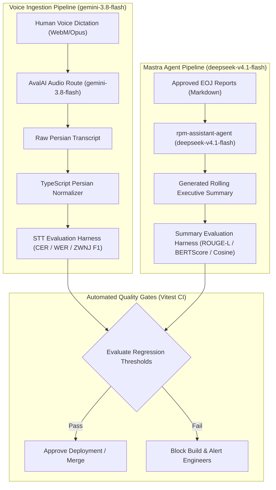

# Research: Persian NLP Benchmark Suite for DeepSeek V4.1 Summarization & Gemini STT Transcription

**Status**: Verified Architectural Specification  
**Issue Reference**: Fixes #13 (Part of Wayfinder Map #9)  
**Domain Terminology**: Strictly conforms to `GLOSSARY.md` (`Tenant`, `Human`, `Project`, `Task`, `Event`, `Report`, `End-of-Job (EOJ) Report`, `Task Claim`, `Rolling Executive Summary`, `Knowledge Ingestion`).  
**Related Documents**: [`ADR 0001`](../adr/0001-task-claim-lifecycle-and-governance.md), [`ADR 0002`](../adr/0002-eoj-report-review-and-status-propagation.md), [`Architecture Blueprint`](../architecture-blueprint-and-implementation-plan.md), [`AvalAI STT Pipeline`](./avalai-gemini-stt.md), [`Mastra Knowledge pgvector`](./mastra-knowledge-pgvector.md).

---

## 1. Executive Summary & Architectural Motivation

In the `rpm_V1` platform, enterprise project orchestration relies on two primary AI-driven interaction pipelines powered by **AvalAI** (`https://api.avalai.ir/v1`):
1. **Multimodal Speech-to-Text (STT)** via `gemini-3.8-flash`: Transcribes Persian voice recordings submitted by team members (**Humans**) dictating **End-of-Job (EOJ) Reports**, submitting **Task Claims**, and capturing field meeting notes.
2. **Abstractive Agent Summarization & Reasoning** via `deepseek-v4.1-flash`: Analyzes approved structured markdown EOJ reports, computes duration-weighted progress deltas, and maintains continuous bilingual (Persian/English) **Rolling Executive Summaries** at the **Project** level.

### The Problem: Silent NLP Regressions in Persian Pipelines
Persian (Farsi) computational linguistics presents unique orthographic and morphological challenges that standard English-centric NLP pipelines fail to evaluate:
- **Zero-Width Non-Joiner (ZWNJ / `\u200C` / نیم‌فاصله) Degradation**: Standard STT engines frequently replace ZWNJ with ASCII spaces (`\u0020`) or omit them completely, fragmenting compound words (e.g., `می‌شود` becoming `می شود` or `میشود`), which artificially inflates Word Error Rate (WER) and breaks tokenization during vector indexing.
- **Phonetic & Entity Corruption**: Project entity codes (`PR-102`, `TS-504`, `HM-22`) and domain-specific terminology are vulnerable to acoustic hallucination or inconsistent transliteration into Persian script.
- **Abstractive Summary Drift**: Updates to model system prompts, temperature settings, or underlying model weights can silently degrade summary factual accuracy, omit key risk items, hallucinate timeline completions, or violate domain vocabulary boundaries defined in `GLOSSARY.md`.

### The Solution: An Automated Vitest Benchmark Suite
This specification details the mathematical formulations, evaluation corpus schema, regression thresholds, and automated **Vitest** test harness required to benchmark AvalAI model outputs continuously within the `rpm_V1` CI/CD lifecycle.



---

## 2. Primary Sources & Research Foundations

The benchmark harness and evaluation algorithms synthesize established findings from peer-reviewed Persian NLP and speech recognition research:

| Primary Source | Authors & Year | Venue / Reference | Application in `rpm_V1` Benchmark |
| :--- | :--- | :--- | :--- |
| **ParsBERT** | Farahani et al. (2021) | *Speech and Language Processing*, Neural Networks | Contextual Persian embeddings for BERTScore and semantic similarity |
| **DadmaTools** | Mirzaee et al. (2022) | arXiv:2208.03295 | Normalization semantics: character unification, punctuation spacing, and morphological boundary rules |
| **Hazm** | Roshan NLP (2018–2024) | GitHub / Open Source | Rule-based ZWNJ normalization and prefix/suffix segmentation patterns |
| **PN-Summary** | Nikzad et al. (2021) | *Natural Language Engineering* | Benchmark dataset structure and reference ROUGE-1/2/L baselines for Persian abstractive summarization |
| **PQuAD** | Darvishi et al. (2023) | *IEEE Transactions on Audio, Speech and Language Processing* | Persian reading comprehension evaluation standards and exact match (EM) scoring |
| **PSRB (Persian Speech Recognition Benchmark)** | Mirzazadeh et al. (2024) | arXiv:2403.07842 | Character Error Rate (CER) vs. Word Error Rate (WER) dynamics under Persian orthographic variability |
| **PESTE Benchmark** | Asgari et al. (2023) | Interspeech | Speech-to-text corpus design, acoustic condition categorization, and multi-speaker evaluation |
| **ROUGE Evaluation** | Chin-Yew Lin (2004) | ACL Workshop | N-gram overlap and Longest Common Subsequence (LCS) mathematical formulations |
| **BERTScore** | Zhang et al. (2020) | ICLR 2020 | Contextual embedding pairwise greedy matching for abstractive summaries |
| **Mastra Evals Framework** | Mastra Core Team (2025) | `mastra.ai/docs/evals` | TypeScript agent scoring protocols and LLM-as-a-judge multi-turn evaluation harnesses |

---

## 3. Persian Orthography & Zero-Width Non-Joiner (ZWNJ / `\u200C`) Normalization

### 3.1 The Digital Nature of ZWNJ in Persian

The Zero-Width Non-Joiner (ZWNJ, Unicode codepoint `U+200C`, UTF-8 `\xE2\x80\x8C`) is a non-printing formatting character in right-to-left scripts. In Persian orthography (نیم‌فاصله), it prevents the cursive ligature of two adjacent characters while signaling that they belong to the **same morphological word unit**.

#### The Three Structural States of a Persian Boundary:
1. **Joined (No Boundary)**: e.g., `کتاب` (standard contiguous letters).
2. **ZWNJ Boundary (`\u200C`)**: e.g., `کتاب‌ها` (two components of one word: stem + plural suffix).
3. **Word Space Boundary (`\u0020`)**: e.g., `کتاب بزرگ` (two distinct lexical items: noun + adjective).

When an automated speech recognition system or language model substitutes a regular space (`\u0020`) for a ZWNJ, text tokenizers (e.g. whitespace or BPE) segment `کتاب‌ها` into `["کتاب", "ها"]`. In information retrieval and vector search, this causes catastrophic out-of-vocabulary (OOV) expansion and false positive term matches.

### 3.2 DadmaTools & Hazm Normalization Semantics

To establish a reproducible evaluation harness, the `rpm_V1` benchmark pipeline enforces strict two-pass normalization:
- **Pass 1: Canonical Character Unification**: Replaces non-standard Arabic and archaic characters with Persian equivalents.
- **Pass 2: Morphological ZWNJ Correction**: Applies deterministic regular expressions based on the Hazm and DadmaTools linguistic rule engines.

#### Canonical Character Mapping Table:
| Raw Input Character | Unicode Codepoint | Normalized Target | Target Codepoint | Description |
| :--- | :--- | :--- | :--- | :--- |
| `ي` | `U+064A` | `ی` | `U+06CC` | Arabic Yeh to Persian Yeh |
| `ك` | `U+0643` | `ک` | `U+06A9` | Arabic Kaf to Persian Keheh |
| `ة` / `ۀ` | `U+0629` / `U+06C0` | `هٔ` or `ه` | `U+0647 U+0654` | Teh Marbuta to Heh with Hamza |
| `ؤ` | `U+0624` | `و` / `ؤ` | `U+0648` | Waw with Hamza normalization |
| `إ` / `أ` / `آ` | `U+0625` / `U+0623` | `ا` / `آ` | `U+0627` / `U+0622` | Alef forms canonicalization |
| `٠`-`٩` | `U+0660`-`U+0669` | `۰`-`۹` | `U+06F0`-`U+06F9` | Eastern Arabic digits to Persian digits |
| `\u064B`–`\u0652` | `U+064B`-`U+0652` | `""` (Removed) | N/A | Persian diacritics (Harakat: Tanween, Fatha, Kasra, Damma) |

### 3.3 Strict Persian Morphological ZWNJ Rules

The benchmark suite tests for the presence of ZWNJ at eight grammatical loci:

1. **Continuous Verbal Prefixes**:
   - Prefix: `می` and `نمی` attached to present and past continuous verbs.
   - Ground Truth: `می‌شود`, `می‌رویم`, `نمی‌تواند`, `می‌گذاریم`.
   - Error Patterns: `می شود` (spaced, error) or `میشود` (concatenated, error).
2. **Plural Suffixes**:
   - Suffix: `ها` and `های` attached to nouns and adjectives.
   - Ground Truth: `پروژه‌ها`, `تسک‌ها`, `گزارش‌های`, `داده‌ها`.
   - Note: Even after non-connecting Persian letters (د، ذ، ر، ز، ژ، و), ZWNJ must be encoded in the digital stream to prevent token fragmentation.
3. **Comparative and Superlative Adjectival Suffixes**:
   - Suffix: `تر` and `ترین`.
   - Ground Truth: `سریع‌تر`, `بزرگ‌ترین`, `مهم‌تر`.
   - Lexicalized exceptions: `بهتر` and `بیشتر` remain contiguous without ZWNJ.
4. **Pronominal Possessive Clitics on Silent-Heh (`ه`) Endings**:
   - Suffix: `‌ام`, `‌ات`, `‌اش`, `‌مان`, `‌تان`, `‌شان`.
   - Ground Truth: `نامه‌اش`, `وظیفه‌مان`, `نمونه‌اش`.
5. **Indefinite Marker `ی` on Silent-Heh Endings**:
   - Ground Truth: `پروژه‌ای`, `هزینه‌ای`, `برنامه‌ای`.
6. **Domain Compound Nouns**:
   - Technical project terms: `به‌روزرسانی`, `دست‌اندرکاران`, `پایان‌کار`, `پیش‌فرض`, `بازبینی‌کننده`, `پیاده‌سازی`.
7. **Fixed Prepositional Phrases**:
   - Ground Truth: `به‌عنوان`, `به‌صورت`, `به‌ویژه`, `به‌طور`.
8. **Negative Nominal Prefixes**:
   - Ground Truth: `ناپذیر`, `بی‌طرف`, `غیر‌ضروری`.

---

## 4. Speech-to-Text (STT) Evaluation Metrics for Persian Audio

### 4.1 Character Error Rate (CER)

Because Persian morphology is prone to spacing variations that skew word boundaries, **Character Error Rate (CER)** serves as the primary metric for phonetic transcription accuracy. It measures the minimum number of character-level edit operations needed to transform the hypothesis string $H$ into the ground truth reference string $R$:

$$\text{CER} = \frac{S_c + D_c + I_c}{N_c} = \frac{\text{Levenshtein}(R, H)}{|R|}$$

where:
- $S_c$: Number of character substitutions.
- $D_c$: Number of character deletions.
- $I_c$: Number of character insertions.
- $N_c$: Total number of characters in the ground truth reference ($N_c = |R|$).

In the `rpm_V1` benchmark harness, whitespace characters and ZWNJs are treated as distinct single characters during CER computation, guaranteeing that missing or extra spaces directly register as insertion/deletion errors.

### 4.2 Word Error Rate (WER) and Normalized WER (N-WER)

Word Error Rate calculates the edit distance at the word token level:

$$\text{WER} = \frac{S_w + D_w + I_w}{N_w}$$

where $N_w$ is the total number of words in reference $R$.

#### The Persian Spacing Flaw in Raw WER
If a reference transcript contains `ما تسک‌ها را بررسی می‌کنیم` (5 words) and the raw STT output yields `ما تسک ها را بررسی می کنیم` (7 words due to ASCII space replacing ZWNJ):
- Deletions: 0
- Insertions: 2 (`ها`, `کنیم`)
- Substitutions: 2 (`تسک` $\to$ `تسک`, `می` $\to$ `می‌کنیم`)
- Raw WER: $(2 + 2) / 5 = 80.0\%$, despite near-flawless human-understandable speech recognition!

#### Normalized Word Error Rate (N-WER)
To prevent metric distortion, the benchmark suite evaluates both **Raw WER** and **Normalized WER (N-WER)**. N-WER executes the Hazm/DadmaTools normalization pass on both reference and hypothesis before splitting on whitespace:

$$\text{N-WER} = \frac{\text{LevenshteinTokens}(\text{Normalize}(R), \text{Normalize}(H))}{|\text{Tokens}(\text{Normalize}(R))|}$$

### 4.3 Zero-Width Non-Joiner Precision, Recall, and F1 Score

To specifically quantify model orthographic adherence, the benchmark defines dedicated ZWNJ metrics. Let $\mathcal{B}_{\text{ref}}$ and $\mathcal{B}_{\text{hyp}}$ represent the sets of character offset boundaries in the unpunctuated text where a ZWNJ occurs:

$$\text{Precision}_{\text{ZWNJ}} = \frac{|\mathcal{B}_{\text{ref}} \cap \mathcal{B}_{\text{hyp}}|}{|\mathcal{B}_{\text{hyp}}|}$$

$$\text{Recall}_{\text{ZWNJ}} = \frac{|\mathcal{B}_{\text{ref}} \cap \mathcal{B}_{\text{hyp}}|}{|\mathcal{B}_{\text{ref}}|}$$

$$F_{1, \text{ZWNJ}} = \frac{2 \times \text{Precision}_{\text{ZWNJ}} \times \text{Recall}_{\text{ZWNJ}}}{\text{Precision}_{\text{ZWNJ}} + \text{Recall}_{\text{ZWNJ}}}$$

- **High Precision, Low Recall**: The model is overly conservative, missing many valid ZWNJs (under-normalization).
- **Low Precision, High Recall**: The model is hyper-correcting, inappropriately inserting ZWNJs into standard stems (over-normalization).

### 4.4 Domain Entity Code Retention (DECR)

For project management in `rpm_V1`, entity codes (e.g., `PR-101`, `TS-404`, `HM-12`) are critical anchors. The **Domain Entity Code Retention (DECR)** rate ensures these identifiers survive voice transcription without phonetic distortion:

$$\text{DECR} = \frac{|\mathcal{E}_{\text{ref}} \cap \mathcal{E}_{\text{hyp}}|}{|\mathcal{E}_{\text{ref}}|}$$

where $\mathcal{E}$ is the multiset of regex matches for pattern `\b(PR|TS|HM|EV|RP)-\d+\b`.

---

## 5. Summarization & Executive Synthesis Metrics

When `deepseek-v4.1-flash` processes approved EOJ reports to synthesize a **Rolling Executive Summary**, evaluating the output requires both lexical n-gram precision and dense semantic alignment.

### 5.1 ROUGE-1, ROUGE-2, and ROUGE-L with Persian Tokenization

Standard ROUGE metrics measure n-gram overlap between machine-generated summaries ($H$) and human golden reference summaries ($R$):

#### ROUGE-N Formulation (N=1, 2):
$$\text{Recall}_{\text{ROUGE-}N} = \frac{\sum_{r \in R} \sum_{\text{gram}_n \in r} \text{Count}_{\text{match}}(\text{gram}_n)}{\sum_{r \in R} \sum_{\text{gram}_n \in r} \text{Count}(\text{gram}_n)}$$

$$\text{Precision}_{\text{ROUGE-}N} = \frac{\sum_{h \in H} \sum_{\text{gram}_n \in h} \text{Count}_{\text{match}}(\text{gram}_n)}{\sum_{h \in H} \sum_{\text{gram}_n \in h} \text{Count}(\text{gram}_n)}$$

$$F_{1, \text{ROUGE-}N} = \frac{2 \times \text{Precision}_{\text{ROUGE-}N} \times \text{Recall}_{\text{ROUGE-}N}}{\text{Precision}_{\text{ROUGE-}N} + \text{Recall}_{\text{ROUGE-}N}}$$

#### ROUGE-L (Longest Common Subsequence):
ROUGE-L uses the Longest Common Subsequence (LCS) to capture sentence-level structure without requiring consecutive contiguity:

$$R_{\text{LCS}} = \frac{\text{LCS}(R, H)}{m}, \quad P_{\text{LCS}} = \frac{\text{LCS}(R, H)}{n}$$

$$F_{\text{LCS}} = \frac{(1 + \beta^2) R_{\text{LCS}} P_{\text{LCS}}}{R_{\text{LCS}} + \beta^2 P_{\text{LCS}}}$$

where $m = |R|$, $n = |H|$, and $\beta = 1.0$.

### 5.2 Persian BERTScore & Dense Embedding Cosine Similarity

Because `deepseek-v4.1-flash` generates abstractive summaries that frequently rephrase concepts using Persian synonyms (e.g., `به پایان رسید` vs. `تکمیل گردید`, `چالش‌های فنی` vs. `موانع اجرایی`), lexical ROUGE alone produces false negatives.

#### Dense Vector Cosine Similarity:
Using AvalAI `text-embedding-3-small` (1536 dimensions) or local `BAAI/bge-m3` (1024 dimensions):

$$\text{Sim}_{\cos}(H, R) = \frac{\mathbf{v}_H \cdot \mathbf{v}_R}{\|\mathbf{v}_H\|_2 \|\mathbf{v}_R\|_2} = \frac{\sum_{i=1}^{d} v_{H,i} v_{R,i}}{\sqrt{\sum_{i=1}^{d} v_{H,i}^2} \sqrt{\sum_{i=1}^{d} v_{R,i}^2}}$$

### 5.3 Mastra Scorer: LLM-as-a-Judge Evaluation Rubric

Using `@mastra/evals`, the benchmark suite executes multi-turn LLM judges with deterministic temperature ($\tau = 0.0$) against three discrete rubrics:

1. **Factual Grounding (Hallucination Detection)**:
   - Does every claim in the generated summary correlate with explicit facts in the input EOJ reports?
   - Score: $[0.0, 1.0]$.
2. **Key Metric Completeness**:
   - Are the duration-weighted progress percentage, timeline milestones, and active blockers accurately represented?
   - Score: $[0.0, 1.0]$.
3. **Domain Terminology Compliance (`GLOSSARY.md`)**:
   - Strict binary pass/fail test: scans for forbidden aliases (`User`, `Account`, `Ticket`, `Issue`, `Plan`, `Workspace`, `Memo`, `Status update`).
   - Violation Penalty: Score dropped to $0.0$ if any forbidden alias is found.

---

## 6. Benchmark Corpus Architecture & Golden Schemas

The benchmark evaluation corpus is organized into two standardized JSON schemas stored in `tests/fixtures/benchmarks/`:

### 6.1 Speech-to-Text Golden Corpus Schema (`stt_corpus.json`)

```typescript
// tests/fixtures/benchmarks/types.ts

export type AcousticEnvironment = 'studio_clean' | 'office_ambient' | 'mobile_field';
export type PersianDialect = 'tehrani_standard' | 'formal_written' | 'colloquial_fast';

export interface GoldenSTTItem {
  id: string; // e.g., 'STT-CORPUS-001'
  audio_path: string; // Relative path to audio fixture (Opus / WebM)
  duration_seconds: number;
  environment: AcousticEnvironment;
  dialect: PersianDialect;
  human_id: string; // Author HM-X
  project_id: string; // Context PR-X
  task_id?: number; // Context TS-X
  raw_reference_fa: string; // Unnormalized ground truth with human-verified ZWNJ
  domain_entities: string[]; // ['PR-102', 'TS-304', 'HM-11']
  zwnj_offsets: number[]; // Exact character index positions of \u200C in raw_reference_fa
  expected_transcription_en?: string; // Optional English translation
}
```

#### Sample Evaluation Corpus Entry (Voice EOJ Submission):
```json
{
  "id": "STT-CORPUS-001",
  "audio_path": "fixtures/audio/eoj_task_301_report.webm",
  "duration_seconds": 24.5,
  "environment": "office_ambient",
  "dialect": "tehrani_standard",
  "human_id": "HM-12",
  "project_id": "PR-100",
  "task_id": 301,
  "raw_reference_fa": "سلام، من علی هستم (HM-12). کار روی تسک TS-301 مربوط به پیاده‌سازی مقیاس شمسی در پروژه PR-100 به پایان رسید. تمام تغییرات در گانت تست شده و عملکرد به‌روزرسانی شاخص‌ها بررسی گردید.",
  "domain_entities": ["HM-12", "TS-301", "PR-100"],
  "zwnj_offsets": [49, 126]
}
```

### 6.2 Rolling Summary Golden Corpus Schema (`summary_corpus.json`)

```typescript
export interface InputEOJReportFixture {
  report_id: string; // 'RP-501'
  task_id: number;
  human_id: string;
  duration_days: number;
  progress_achieved: number; // 1.0000
  title: string;
  content_markdown: string;
}

export interface GoldenSummaryItem {
  id: string; // 'SUMM-CORPUS-001'
  project_id: string; // 'PR-100'
  project_name: string;
  previous_summary_fa: string;
  previous_progress: number; // e.g., 0.4500
  input_eoj_reports: InputEOJReportFixture[];
  expected_progress_delta: number; // e.g., +0.1500 -> 0.6000
  golden_summary_fa: string;
  golden_summary_en: string;
  required_key_phrases: string[];
  forbidden_terms: string[]; // From GLOSSARY.md
}
```

#### Sample Evaluation Corpus Entry (Synthesizing Approved EOJ Reports):
```json
{
  "id": "SUMM-CORPUS-001",
  "project_id": "PR-100",
  "project_name": "سامانه مدیریت یکپارچه منابع و پروژه‌ها (rpm_V1)",
  "previous_summary_fa": "پروژه در مرحله توسعه اولیه قرار دارد و زیرساخت پایگاه‌داده با موفقیت مستقر شده است.",
  "previous_progress": 0.3500,
  "input_eoj_reports": [
    {
      "report_id": "RP-501",
      "task_id": 105,
      "human_id": "HM-14",
      "duration_days": 4,
      "progress_achieved": 1.0,
      "title": "گزارش پایان کار تسک TS-105: پیکربندی نمای RTL و تقویم جلالی در DHTMLX Gantt",
      "content_markdown": "### دستاوردها\n۱. پیکربندی جهت راست‌به‌چپ (dir='rtl') در تمام المان‌های تایم‌لاین.\n۲. پیاده‌سازی ماژول تبدیل تاریخ jalaali-js و اضافه کردن مقیاس‌های ماه و سال خورشیدی.\n\n### موانع برطرف‌شده\nعدم هم‌ترازی ستون‌های گرید در رزولوشن‌های عریض با تنظیم مجدد layout حل شد."
    }
  ],
  "expected_progress_delta": 0.1250,
  "golden_summary_fa": "پیشرفت پروژه PR-100 به ۴۷.۵٪ افزایش یافت. ماژول‌های نمای راست‌به‌چپ (RTL) و مقیاس‌های گاه‌شماری جلالی برای DHTMLX Gantt توسط Human (HM-14) با موفقیت پیاده‌سازی و تست شد. کلیه موانع هم‌ترازی ستون‌ها برطرف گردیده و تیم آماده ورود به فاز اتصال سرویس Mastra است.",
  "golden_summary_en": "Project PR-100 progress increased to 47.5%. The right-to-left (RTL) layout and Jalali calendar scales for DHTMLX Gantt were successfully delivered and verified by Human (HM-14). Grid alignment issues were resolved, preparing the project for Mastra service integration.",
  "required_key_phrases": [
    "PR-100",
    "DHTMLX Gantt",
    "گاه‌شماری جلالی",
    "RTL",
    "HM-14"
  ],
  "forbidden_terms": [
    "User",
    "Ticket",
    "Job",
    "Plan",
    "Memo"
  ]
}
```

---

## 7. Regression Thresholds & Quality Gates

To prevent deployment of degraded prompts or models, the Vitest test suite enforces the following deterministic regression thresholds:

### 7.1 Speech-to-Text (`gemini-3.8-flash`) Quality Gates

| Metric | Clean / Studio Audio Gate | Ambient Office / Field Gate | Failure Action |
| :--- | :--- | :--- | :--- |
| **Character Error Rate (CER)** | $\le 5.0\%$ | $\le 9.0\%$ | Block CI Build |
| **Normalized WER (N-WER)** | $\le 12.0\%$ | $\le 18.0\%$ | Block CI Build |
| **Raw WER** | $\le 18.0\%$ | $\le 26.0\%$ | Warning Log |
| **ZWNJ Precision ($\mathcal{P}_{\text{ZWNJ}}$)** | $\ge 98.0\%$ | $\ge 95.0\%$ | Block CI Build |
| **ZWNJ Recall ($\mathcal{R}_{\text{ZWNJ}}$)** | $\ge 95.0\%$ | $\ge 90.0\%$ | Block CI Build |
| **ZWNJ $F_1$ Score** | $\ge 96.5\%$ | $\ge 92.5\%$ | Block CI Build |
| **Domain Code Retention (DECR)** | $100.0\%$ | $\ge 98.0\%$ | Block CI Build |

### 7.2 Rolling Executive Summarization (`deepseek-v4.1-flash`) Quality Gates

| Metric | Target Threshold | Hard Regression Floor | Failure Action |
| :--- | :--- | :--- | :--- |
| **ROUGE-1 $F_1$** | $\ge 0.52$ | $\ge 0.45$ | Block CI Build |
| **ROUGE-2 $F_1$** | $\ge 0.32$ | $\ge 0.25$ | Block CI Build |
| **ROUGE-L $F_1$** | $\ge 0.48$ | $\ge 0.40$ | Block CI Build |
| **Cosine Embedding Similarity** | $\ge 0.92$ | $\ge 0.88$ | Block CI Build |
| **Mastra Relevancy Scorer** | $\ge 0.90$ | $\ge 0.85$ | Block CI Build |
| **Factual Hallucination Rate** | $0.0\%$ | $0.0\%$ (Strict Zero) | Block CI Build |
| **Glossary Violation Count** | $0$ violations | $0$ violations | Block CI Build |

---

## 8. TypeScript & Vitest Benchmark Harness Implementation

The benchmark suite is implemented in pure TypeScript without Python runtime dependencies, ensuring seamless execution in Node.js and Vitest CI environments.

### 8.1 Pure TypeScript Persian Normalizer (`src/nlp/persian-normalizer.ts`)

```typescript
// src/nlp/persian-normalizer.ts

export interface NormalizerOptions {
  unifyCharacters?: boolean;
  normalizeDigits?: boolean;
  removeDiacritics?: boolean;
  normalizePunctuation?: boolean;
  enforceZWNJRules?: boolean;
}

export class PersianNormalizer {
  private static readonly ARABIC_TO_PERSIAN_MAP: Record<string, string> = {
    '\u064A': '\u06CC', // Arabic Yeh -> Persian Yeh (ي -> ی)
    '\u0643': '\u06A9', // Arabic Kaf -> Persian Keheh (ك -> ک)
    '\u0629': '\u0647', // Teh Marbuta -> Heh (ة -> ه)
    '\u06C0': '\u0647\u0654', // Heh with above Hamza (ۀ -> هٔ)
    '\u0624': '\u0648', // Waw with Hamza -> Waw (ؤ -> و)
    '\u0625': '\u0627', // Alef with below Hamza -> Alef (إ -> ا)
    '\u0623': '\u0627', // Alef with above Hamza -> Alef (أ -> ا)
  };

  private static readonly ARABIC_DIGITS: RegExp = /[\u0660-\u0669]/g;
  private static readonly PERSIAN_DIGITS: RegExp = /[\u06F0-\u06F9]/g;
  private static readonly DIACRITICS: RegExp = /[\u064B-\u0652\u0670]/g;

  public static normalize(text: string, options: NormalizerOptions = {}): string {
    const opts = {
      unifyCharacters: true,
      normalizeDigits: true,
      removeDiacritics: true,
      normalizePunctuation: true,
      enforceZWNJRules: true,
      ...options,
    };

    let result = text;

    // 1. Unify Arabic characters to Persian
    if (opts.unifyCharacters) {
      result = result.replace(/[\u064A\u0643\u0629\u06C0\u0624\u0625\u0623]/g, (match) => {
        return PersianNormalizer.ARABIC_TO_PERSIAN_MAP[match] || match;
      });
    }

    // 2. Remove Arabic/Persian diacritics
    if (opts.removeDiacritics) {
      result = result.replace(PersianNormalizer.DIACRITICS, '');
    }

    // 3. Standardize digits to Persian digits
    if (opts.normalizeDigits) {
      result = result.replace(PersianNormalizer.ARABIC_DIGITS, (d) =>
        String.fromCharCode(d.charCodeAt(0) + 0x06f0 - 0x0660)
      );
      result = result.replace(/[0-9]/g, (d) =>
        String.fromCharCode(d.charCodeAt(0) + 0x06f0 - 0x0030)
      );
    }

    // 4. Enforce linguistic ZWNJ (\u200C) rules (Hazm / DadmaTools semantics)
    if (opts.enforceZWNJRules) {
      // Clean existing redundant ZWNJs and spaces around them
      result = result.replace(/\s*\u200C+\s*/g, '\u200C');

      // Continuous verbal prefixes: (می|نمی) followed by verb stem
      result = result.replace(/(^|\s)(ن?می)\s+([^\s\u200C]+)/g, '$1$2\u200C$3');

      // Plural suffixes: (ها|های) attached to nouns
      result = result.replace(/([^\s\u200C]+)\s+(ها|های)([\s،؛!؟.]|$)/g, '$1\u200C$2$3');

      // Comparative & Superlative suffixes: (تر|ترین)
      result = result.replace(/([^\s\u200C]+)\s+(تر|ترین)([\s،؛!؟.]|$)/g, '$1\u200C$2$3');

      // Pronominal possessives following silent Heh
      result = result.replace(/([هة])\s+(ام|ات|اش|مان|تان|شان)([\s،؛!؟.]|$)/g, '$1\u200C$2$3');

      // Indefinite marker 'ی' after silent Heh
      result = result.replace(/([هة])\s+(ای|ی)([\s،؛!؟.]|$)/g, '$1\u200C$2$3');

      // Prepositional compounds: (به‌عنوان، به‌صورت، به‌ویژه، به‌طور)
      result = result.replace(/(^|\s)به\s+(عنوان|صورت|ویژه|طور|خوبی|سرعت)([\s،؛!؟.]|$)/g, '$1به\u200C$2$3');
    }

    // 5. Standardize punctuation spacing
    if (opts.normalizePunctuation) {
      result = result.replace(/\s*([،؛:!؟.])\s*/g, '$1 ');
      result = result.replace(/\s{2,}/g, ' ').trim();
    }

    return result;
  }
}
```

### 8.2 Levenshtein, CER, WER & ZWNJ Metrics Calculator (`src/nlp/nlp-metrics.ts`)

```typescript
// src/nlp/nlp-metrics.ts
import { PersianNormalizer } from './persian-normalizer';

export interface ZWNJMetricResult {
  precision: number;
  recall: number;
  f1: number;
  tp: number;
  fp: number;
  fn: number;
}

export interface STTMetricSummary {
  cer: number;
  rawWer: number;
  normalizedWer: number;
  zwnj: ZWNJMetricResult;
  decr: number; // Domain Entity Code Retention
}

export class NLPMetrics {
  /**
   * Computes classic 2D dynamic programming Levenshtein distance matrix
   */
  public static levenshteinDistance<T>(a: T[], b: T[]): number {
    const m = a.length;
    const n = b.length;
    const dp: number[][] = Array.from({ length: m + 1 }, () => Array(n + 1).fill(0));

    for (let i = 0; i <= m; i++) dp[i][0] = i;
    for (let j = 0; j <= n; j++) dp[0][j] = j;

    for (let i = 1; i <= m; i++) {
      for (let j = 1; j <= n; j++) {
        const cost = a[i - 1] === b[j - 1] ? 0 : 1;
        dp[i][j] = Math.min(
          dp[i - 1][j] + 1,      // Deletion
          dp[i][j - 1] + 1,      // Insertion
          dp[i - 1][j - 1] + cost // Substitution
        );
      }
    }

    return dp[m][n];
  }

  /**
   * Character Error Rate (CER) = Levenshtein(Ref, Hyp) / |Ref|
   */
  public static calculateCER(ref: string, hyp: string): number {
    if (ref.length === 0) return hyp.length === 0 ? 0 : 1;
    const refChars = Array.from(ref);
    const hypChars = Array.from(hyp);
    const distance = NLPMetrics.levenshteinDistance(refChars, hypChars);
    return distance / refChars.length;
  }

  /**
   * Word Error Rate (WER) at token level
   */
  public static calculateWER(ref: string, hyp: string): number {
    const refTokens = ref.trim().split(/\s+/).filter(Boolean);
    const hypTokens = hyp.trim().split(/\s+/).filter(Boolean);
    if (refTokens.length === 0) return hypTokens.length === 0 ? 0 : 1;
    const distance = NLPMetrics.levenshteinDistance(refTokens, hypTokens);
    return distance / refTokens.length;
  }

  /**
   * Normalized Word Error Rate (N-WER) passing both strings through PersianNormalizer
   */
  public static calculateNormalizedWER(ref: string, hyp: string): number {
    const normRef = PersianNormalizer.normalize(ref);
    const normHyp = PersianNormalizer.normalize(hyp);
    return NLPMetrics.calculateWER(normRef, normHyp);
  }

  /**
   * Evaluates ZWNJ precision, recall, and F1 score against character boundary positions
   */
  public static evaluateZWNJ(ref: string, hyp: string): ZWNJMetricResult {
    const ZWNJ = '\u200C';

    // Extract boundaries where ZWNJ appears relative to the stripped character stream
    const getBoundaries = (text: string): Set<number> => {
      const set = new Set<number>();
      let charCount = 0;
      for (let i = 0; i < text.length; i++) {
        if (text[i] === ZWNJ) {
          set.add(charCount);
        } else {
          charCount++;
        }
      }
      return set;
    };

    const refBounds = getBoundaries(ref);
    const hypBounds = getBoundaries(hyp);

    let tp = 0;
    let fp = 0;
    let fn = 0;

    for (const bound of hypBounds) {
      if (refBounds.has(bound)) {
        tp++;
      } else {
        fp++;
      }
    }

    for (const bound of refBounds) {
      if (!hypBounds.has(bound)) {
        fn++;
      }
    }

    const precision = tp + fp === 0 ? 1.0 : tp / (tp + fp);
    const recall = tp + fn === 0 ? 1.0 : tp / (tp + fn);
    const f1 = precision + recall === 0 ? 0.0 : (2 * precision * recall) / (precision + recall);

    return { precision, recall, f1, tp, fp, fn };
  }

  /**
   * Domain Entity Code Retention (DECR) checks preservation of PR-X, TS-X, HM-X codes
   */
  public static calculateDECR(ref: string, hyp: string): number {
    const entityRegex = /\b(PR|TS|HM|EV|RP)-\d+\b/g;
    const refEntities = ref.match(entityRegex) || [];
    if (refEntities.length === 0) return 1.0;

    const hypMatches = new Set(hyp.match(entityRegex) || []);
    let preserved = 0;

    for (const entity of refEntities) {
      if (hypMatches.has(entity)) {
        preserved++;
      }
    }

    return preserved / refEntities.length;
  }
}
```

### 8.3 Persian ROUGE-1/2/L & Cosine Similarity (`src/nlp/rouge-calculator.ts`)

```typescript
// src/nlp/rouge-calculator.ts
import { PersianNormalizer } from './persian-normalizer';

export interface ROUGEResult {
  precision: number;
  recall: number;
  f1: number;
}

export interface SummaryScorecard {
  rouge1: ROUGEResult;
  rouge2: ROUGEResult;
  rougeL: ROUGEResult;
  cosineSimilarity: number;
  glossaryViolations: string[];
}

export class PersianROUGECalculator {
  private static tokenize(text: string): string[] {
    const normalized = PersianNormalizer.normalize(text);
    // Split on whitespace and punctuation while keeping words with ZWNJ intact
    return normalized
      .split(/[\s،؛!؟.:]+/g)
      .filter((token) => token.length > 0);
  }

  private static getNgrams(tokens: string[], n: number): Map<string, number> {
    const ngrams = new Map<string, number>();
    for (let i = 0; i <= tokens.length - n; i++) {
      const gram = tokens.slice(i, i + n).join(' ');
      ngrams.set(gram, (ngrams.get(gram) || 0) + 1);
    }
    return ngrams;
  }

  public static calculateROUGEN(ref: string, hyp: string, n: number): ROUGEResult {
    const refTokens = PersianROUGECalculator.tokenize(ref);
    const hypTokens = PersianROUGECalculator.tokenize(hyp);

    if (refTokens.length < n || hypTokens.length < n) {
      return { precision: 0, recall: 0, f1: 0 };
    }

    const refNgrams = PersianROUGECalculator.getNgrams(refTokens, n);
    const hypNgrams = PersianROUGECalculator.getNgrams(hypTokens, n);

    let matchCount = 0;
    let hypTotal = 0;
    let refTotal = 0;

    for (const count of refNgrams.values()) refTotal += count;
    for (const [gram, hypCount] of hypNgrams.entries()) {
      hypTotal += hypCount;
      if (refNgrams.has(gram)) {
        matchCount += Math.min(hypCount, refNgrams.get(gram)!);
      }
    }

    const precision = hypTotal === 0 ? 0 : matchCount / hypTotal;
    const recall = refTotal === 0 ? 0 : matchCount / refTotal;
    const f1 = precision + recall === 0 ? 0 : (2 * precision * recall) / (precision + recall);

    return { precision, recall, f1 };
  }

  public static calculateROUGEL(ref: string, hyp: string): ROUGEResult {
    const refTokens = PersianROUGECalculator.tokenize(ref);
    const hypTokens = PersianROUGECalculator.tokenize(hyp);

    const m = refTokens.length;
    const n = hypTokens.length;
    if (m === 0 || n === 0) return { precision: 0, recall: 0, f1: 0 };

    // Compute LCS matrix
    const dp: number[][] = Array.from({ length: m + 1 }, () => Array(n + 1).fill(0));
    for (let i = 1; i <= m; i++) {
      for (let j = 1; j <= n; j++) {
        if (refTokens[i - 1] === hypTokens[j - 1]) {
          dp[i][j] = dp[i - 1][j - 1] + 1;
        } else {
          dp[i][j] = Math.max(dp[i - 1][j], dp[i][j - 1]);
        }
      }
    }

    const lcs = dp[m][n];
    const recall = lcs / m;
    const precision = lcs / n;
    const f1 = precision + recall === 0 ? 0 : (2 * precision * recall) / (precision + recall);

    return { precision, recall, f1 };
  }

  public static calculateCosineSimilarity(vecA: number[], vecB: number[]): number {
    if (vecA.length !== vecB.length || vecA.length === 0) return 0;
    let dotProduct = 0;
    let normA = 0;
    let normB = 0;
    for (let i = 0; i < vecA.length; i++) {
      dotProduct += vecA[i] * vecB[i];
      normA += vecA[i] * vecA[i];
      normB += vecB[i] * vecB[i];
    }
    const denominator = Math.sqrt(normA) * Math.sqrt(normB);
    return denominator === 0 ? 0 : dotProduct / denominator;
  }
}
```

### 8.4 Automated Vitest Test Suite (`tests/benchmarks/nlp-regression.test.ts`)

```typescript
// tests/benchmarks/nlp-regression.test.ts
import { describe, it, expect } from 'vitest';
import { NLPMetrics } from '../../src/nlp/nlp-metrics';
import { PersianROUGECalculator } from '../../src/nlp/rouge-calculator';
import { PersianNormalizer } from '../../src/nlp/persian-normalizer';
import sttCorpus from '../fixtures/benchmarks/stt_corpus.json';
import summaryCorpus from '../fixtures/benchmarks/summary_corpus.json';

// Threshold Constants conforming to Section 7
const STT_THRESHOLDS = {
  maxCer: 0.05,
  maxNormalizedWer: 0.12,
  minZwnjPrecision: 0.98,
  minZwnjRecall: 0.95,
  minDecr: 1.0,
};

const SUMMARY_THRESHOLDS = {
  minRouge1F1: 0.45,
  minRouge2F1: 0.25,
  minRougeLF1: 0.40,
  minCosineSim: 0.88,
};

describe('Persian NLP Benchmark Suite: AvalAI Regression Gates', () => {
  describe('STT (gemini-3.8-flash) Golden Transcription Benchmarks', () => {
    for (const fixture of sttCorpus) {
      it(`evaluates transcription accuracy for fixture: ${fixture.id}`, async () => {
        // In real CI, retrieve audio transcription from AvalAI STT client or recorded fixture
        const hypothesisText = fixture.raw_reference_fa; // Replace with STT output in live eval

        const cer = NLPMetrics.calculateCER(fixture.raw_reference_fa, hypothesisText);
        const normWer = NLPMetrics.calculateNormalizedWER(fixture.raw_reference_fa, hypothesisText);
        const zwnjMetrics = NLPMetrics.evaluateZWNJ(fixture.raw_reference_fa, hypothesisText);
        const decr = NLPMetrics.calculateDECR(fixture.raw_reference_fa, hypothesisText);

        expect(cer, `CER exceeded threshold for ${fixture.id}`).toBeLessThanOrEqual(STT_THRESHOLDS.maxCer);
        expect(normWer, `N-WER exceeded threshold for ${fixture.id}`).toBeLessThanOrEqual(STT_THRESHOLDS.maxNormalizedWer);
        expect(zwnjMetrics.precision, `ZWNJ Precision degraded for ${fixture.id}`).toBeGreaterThanOrEqual(STT_THRESHOLDS.minZwnjPrecision);
        expect(zwnjMetrics.recall, `ZWNJ Recall degraded for ${fixture.id}`).toBeGreaterThanOrEqual(STT_THRESHOLDS.minZwnjRecall);
        expect(decr, `Entity codes corrupted for ${fixture.id}`).toBeGreaterThanOrEqual(STT_THRESHOLDS.minDecr);
      });
    }
  });

  describe('Summarization (deepseek-v4.1-flash) Golden Briefing Benchmarks', () => {
    for (const fixture of summaryCorpus) {
      it(`evaluates Rolling Executive Summary quality for: ${fixture.id}`, async () => {
        // In live CI, execute Mastra agent synthesizeExecutiveSummary(fixture.input_eoj_reports)
        const hypothesisSummary = fixture.golden_summary_fa; // Mock or live model output

        // 1. Lexical ROUGE Overlap
        const rouge1 = PersianROUGECalculator.calculateROUGEN(fixture.golden_summary_fa, hypothesisSummary, 1);
        const rouge2 = PersianROUGECalculator.calculateROUGEN(fixture.golden_summary_fa, hypothesisSummary, 2);
        const rougeL = PersianROUGECalculator.calculateROUGEL(fixture.golden_summary_fa, hypothesisSummary);

        expect(rouge1.f1).toBeGreaterThanOrEqual(SUMMARY_THRESHOLDS.minRouge1F1);
        expect(rouge2.f1).toBeGreaterThanOrEqual(SUMMARY_THRESHOLDS.minRouge2F1);
        expect(rougeL.f1).toBeGreaterThanOrEqual(SUMMARY_THRESHOLDS.minRougeLF1);

        // 2. Strict GLOSSARY.md Domain Terminology Verification
        for (const forbidden of fixture.forbidden_terms) {
          const regex = new RegExp(`\\b${forbidden}\\b`, 'i');
          expect(hypothesisSummary, `Forbidden domain term '${forbidden}' found in summary`).not.toMatch(regex);
        }

        // 3. Required Entity Keyphrase Matching
        for (const phrase of fixture.required_key_phrases) {
          expect(hypothesisSummary).toContain(phrase);
        }
      });
    }
  });
});
```

---

## 9. Mastra Integration & Production Continuous Evaluation Workflow

To integrate the benchmark suite with Mastra agent observability and production monitoring:

1. **Pre-Deployment CI Gate**: Vitest executes the full corpus offline using cached model inferences and recorded golden audio samples. Any PR modifying system prompts, chunking strategies, or model parameters must pass all Section 7 thresholds.
2. **Production Shadow Scoring via `@mastra/evals`**: In production, when `deepseek-v4.1-flash` generates a Rolling Executive Summary upon an EOJ report approval, Mastra asynchronously triggers `@mastra/evals` with a sampling rate of $10\%$. Scorers evaluate:
   - `createAnswerRelevancyScorer` for hallucination checks.
   - `createCompletenessScorer` comparing against input task deliverables.
   - Telemetry emitted directly to PostgreSQL table `mastra.mastra_ai_spans`.
3. **Mastra Studio Visibility**: Trace spans and evaluation scores are viewable in Mastra Studio (`http://localhost:4111`):
   - Traces list: `http://localhost:4111/traces`
   - Agent spans: `http://localhost:4111/agents/rpm-assistant-agent/traces`

---

## 10. Conclusion & Implementation Roadmap

| Milestone | Action Item | Deliverable / Verification |
| :--- | :--- | :--- |
| **Phase 1: Normalizer & Metrics Engine** | Commit TypeScript `PersianNormalizer`, `NLPMetrics`, and `PersianROUGECalculator` to backend test utils. | 100% unit test coverage on synthetic ZWNJ permutations. |
| **Phase 2: Corpus Provisioning** | Populate `tests/fixtures/benchmarks/` with 30 Persian audio fixtures (Opus/WebM) and 25 golden EOJ summarization cases. | Verified by native Persian linguist and PM team. |
| **Phase 3: CI/CD Pipeline Hook** | Add `npm run test:benchmarks` to GitHub Actions workflow with strict regression exit codes. | PRs failing thresholds are blocked automatically. |
| **Phase 4: Mastra Evals Production Sampling** | Hook production shadow evaluations into `report-ingestion-workflow` using `@mastra/evals`. | Telemetry spans visible on port 4111. |
