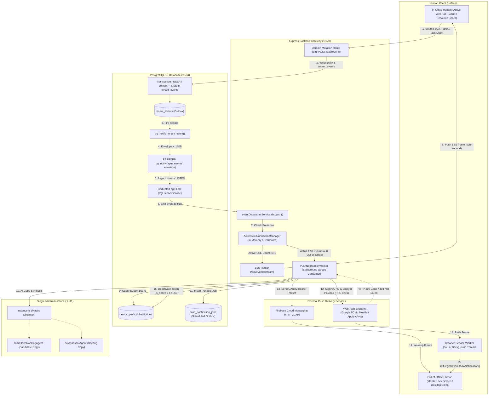
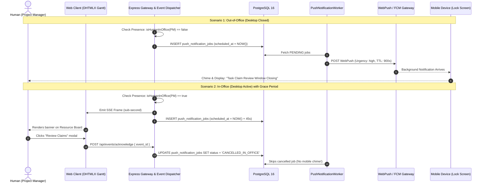
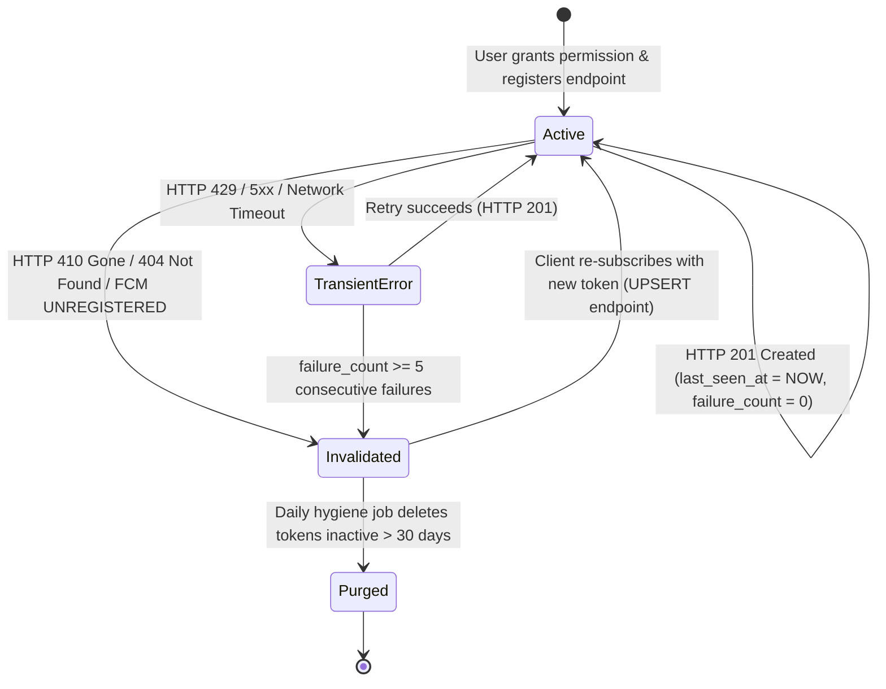

# Research: WebPush & FCM Push Notification Pipeline Architecture for Out-of-Office Human Alerts (`rpm_V1`)

- **Author**: AFK Research Subagent
- **Tracking Issue**: Fixes [#17](https://github.com/aubed9/gantt/issues/17)
- **Context**: Part of [[Wayfinder Map] rpm_V1 Platform Core Services, Real-Time Pipeline & Production Deployment (#9)](https://github.com/aubed9/gantt/issues/9)
- **Status**: Verified Architectural Specification
- **Domain Terminology**: Strictly conforms to [`GLOSSARY.md`](../../GLOSSARY.md) (`Tenant`, `Human`, `Project`, `Task`, `Task Claim`, `End-of-Job (EOJ) Report`, `Claim Review Window`, `Task State`, `Task Claim State`, `Report State`, `Rolling Executive Summary`, `Knowledge Ingestion`).
- **Architectural Invariants**: Single Mastra Instance Invariant (`chatbot/server/src/mastra/instance.ts`), PostgreSQL 16 + pgvector host port 5534, AvalAI bilingual pipeline (`https://api.avalai.ir/v1`).
- **Date**: November 2026

---

## 1. Executive Summary & Problem Formulation

The `rpm_V1` platform is an AI-augmented organizational project and resource management system coordinating concurrent **Humans** across **Projects**, **Tasks**, and **Events**. The system features real-time workflows governed by strict domain state machines:
1. **Task Claims** submitted by team members during pooled **Claim Review Windows**, where Project Managers (PMs) evaluate candidates ranked by the Mastra AI Agent (`task-claim-ranking-agent`).
2. **End-of-Job (EOJ) Reports** submitted upon task completion, triggering automated AI readiness assessment (`eoj-assessor-agent`), PM approval/revision cycles, duration-weighted progress roll-ups, and semantic knowledge ingestion into PostgreSQL `pgvector`.

In production, connected clients (DHTMLX Gantt timeline views and Resource Boards) receive real-time updates through persistent, unidirectional **Server-Sent Events (SSE)** over HTTP/2 (`/api/events/stream`), driven by PostgreSQL `LISTEN`/`NOTIFY` on the `rpm_events` channel.

### 1.1 The Out-of-Office Disconnection Gap

While SSE provides zero-framing-overhead, sub-second latency for active in-office web sessions, it creates a fatal vulnerability for out-of-office workflows:

```
Human Active on Web App  ──> SSE Stream Open    ──> Instant Event Delivery (< 100ms)
Human Closes Tab/Browser ──> SSE Stream Closed  ──> Complete Blind Spot (Events Missed)
```

When a **Human** closes their browser tab, locks their workstation, or commutes out-of-office:
- **Claim Review Window Expirations**: When a pooled **Claim Review Window** is closing (e.g. 15 minutes remaining) or has closed with pending candidate claims, an offline Project Manager receives no prompt. The task remains unassigned, stalling sprint velocity.
- **EOJ Report Review Bottlenecks**: When an engineer completes critical work and submits an **EOJ Report**, the Task transitions to `IN_REVIEW`. If the reviewing PM is away from their desk, the report languishes unapproved, blocking dependent tasks on the DHTMLX Gantt timeline.
- **Urgent Task Blockers**: Blocked tasks requiring immediate PM or CTO intervention fail to reach decision-makers.

### 1.2 Core Architectural Objectives

To eliminate this delivery gap while preventing notification fatigue and double-pings, `rpm_V1` establishes a dual-tier real-time pipeline:

1. **Dual-Tier Tiered Delivery**: 
   - **Tier 1 (In-Office / Connected)**: Real-time SSE stream (`text/event-stream`) over HTTP/2.
   - **Tier 2 (Out-of-Office / Disconnected)**: Asynchronous Push Notifications via W3C WebPush (VAPID / RFC 8291 / RFC 8292) and Firebase Cloud Messaging (FCM HTTP v1 API) delivered directly to desktop OS notification centers and mobile device lock screens.
2. **Presence-Aware Dispatch Arbitration**: An in-memory and database-backed `PresenceTracker` tracks active SSE connection counts per `(tenant_id, human_id)`. If active streams exist, push notifications are suppressed or delayed by a 45-second grace window to avoid audible duplication on mobile devices while sitting at a desk.
3. **Decoupled Asynchronous Outbox Worker**: Push delivery must never block the synchronous database transaction or the Express request cycle. Events emit an ultra-lightweight PostgreSQL `NOTIFY` envelope ($< 150$ bytes) and write to a durable `push_notification_jobs` table, processed by an asynchronous queue worker with jittered exponential backoff.
4. **Self-Healing Token Hygiene**: Automated detection and immediate invalidation (`is_active = FALSE`) of push subscription tokens upon receiving HTTP `410 Gone` or `404 Not Found` from push services (Google FCM, Mozilla Autopush, Apple WebPush), accompanied by scheduled purging of obsolete subscriptions.
5. **Single Mastra Instance Integration**: Automated synthesis of bilingual (English and Persian with Zero-Width Non-Joiner `\u200c` preservation) concise push notification copy via typed accessors (`getTaskClaimRankingAgent()`, `getEojAssessorAgent()`) from the singleton Mastra instance (`chatbot/server/src/mastra/instance.ts`).

---

## 2. Primary Sources & Canonical Specifications

| Specification / Standard | Canonical Reference | Architectural Significance for `rpm_V1` |
| :--- | :--- | :--- |
| **W3C Push API** | [W3C Recommendation 2023](https://www.w3.org/TR/push-api/) | Standardizes client-side `PushManager`, `PushSubscription`, and Service Worker `push` event dispatching in browsers. |
| **IETF RFC 8030** | [Generic Event Delivery Using HTTP Push](https://datatracker.ietf.org/doc/html/rfc8030) | Defines application server to push service wire protocol, including `TTL`, `Urgency`, and `Topic` (collapse key) headers. |
| **IETF RFC 8291** | [Message Encryption for Web Push](https://datatracker.ietf.org/doc/html/rfc8291) | Mandates `aes128gcm` payload encryption using ECDH over NIST P-256 curve and HKDF with 16-byte authentication secrets. |
| **IETF RFC 8292** | [VAPID for Web Push](https://datatracker.ietf.org/doc/html/rfc8292) | Voluntary Application Server Identification; allows backend servers to sign push requests using asymmetric P-256 JWTs without proprietary vendor accounts. |
| **FCM HTTP v1 API** | [Firebase Cloud Messaging v1](https://firebase.google.com/docs/reference/fcm/rest/v1/projects.messages) | OAuth2-secured push API for native Android/iOS shells and Chrome push delivery, handling high-priority wakeups and channel configuration. |
| **PostgreSQL 16 LISTEN/NOTIFY** | [PostgreSQL 16 Manual §43.7](https://www.postgresql.org/docs/16/sql-notify.html) | Asynchronous inter-process trigger notification bus emitting $< 150$-byte envelopes upon transaction commit. |
| **Kysely Query Builder** | [Kysely Documentation](https://kysely.dev/) | Type-safe SQL query generation and DDL migration runner with strict PostgreSQL schema isolation. |

---

## 3. End-to-End System Architecture

The following diagram illustrates the lifecycle of a domain mutation (e.g. submitting an EOJ Report or a Task Claim entering Claim Review), from PostgreSQL transaction outbox through presence arbitration to SSE and WebPush/FCM gateways:



---

## 4. PostgreSQL Relational Schema & Migration Design

To support device push subscriptions, outbox job queuing, and automated token invalidation without data leakage across tenants, two dedicated tables are established within the `rpm_V1` PostgreSQL schema.

### 4.1 Table: `device_push_subscriptions`

Stores cryptographically unique client push subscriptions tied to a specific **Tenant** and **Human**.

```sql
-- 1. Create Enums for Device Platforms & Job Statuses
DO $$ BEGIN
  CREATE TYPE push_device_type_enum AS ENUM (
    'WEB_BROWSER',     -- Standard Desktop/Mobile Chrome, Firefox, Edge, Safari
    'MOBILE_PWA',     -- Installed Progressive Web App (Standalone Display)
    'ANDROID_NATIVE', -- Android Native Shell via FCM v1
    'IOS_NATIVE'      -- iOS Native Shell via APNs / FCM v1
  );
EXCEPTION
  WHEN duplicate_object THEN null;
END $$;

DO $$ BEGIN
  CREATE TYPE push_job_status_enum AS ENUM (
    'PENDING',              -- Queued for delivery
    'DISPATCHING',          -- In flight to push gateway
    'DELIVERED',            -- Successfully accepted by gateway (HTTP 201)
    'CANCELLED_IN_OFFICE',  -- Cancelled due to SSE presence during grace window
    'FAILED_RETRYABLE',     -- Temporary network error or HTTP 429 / 5xx
    'INVALIDATED'           -- Token revoked via HTTP 410 Gone or 404 Not Found
  );
EXCEPTION
  WHEN duplicate_object THEN null;
END $$;

-- 2. Device Push Subscriptions Table
CREATE TABLE IF NOT EXISTS device_push_subscriptions (
  id VARCHAR(64) PRIMARY KEY,
  tenant_id VARCHAR(64) NOT NULL REFERENCES tenants(id) ON DELETE CASCADE,
  human_id VARCHAR(64) NOT NULL REFERENCES humans(id) ON DELETE CASCADE,
  endpoint TEXT NOT NULL,
  keys_p256dh VARCHAR(255) NOT NULL,
  keys_auth VARCHAR(255) NOT NULL,
  fcm_token TEXT,
  device_type push_device_type_enum NOT NULL DEFAULT 'WEB_BROWSER',
  user_agent TEXT,
  is_active BOOLEAN NOT NULL DEFAULT TRUE,
  failure_count INT NOT NULL DEFAULT 0,
  last_error TEXT,
  last_seen_at TIMESTAMPTZ NOT NULL DEFAULT NOW(),
  created_at TIMESTAMPTZ NOT NULL DEFAULT NOW(),
  updated_at TIMESTAMPTZ NOT NULL DEFAULT NOW(),
  
  -- Tenant-scoped uniqueness prevents duplicate endpoint registration
  CONSTRAINT uq_device_push_tenant_endpoint UNIQUE (tenant_id, endpoint)
);

-- High-performance indexes for targeted recipient lookups and maintenance
CREATE INDEX IF NOT EXISTS idx_push_sub_tenant_human_active 
  ON device_push_subscriptions(tenant_id, human_id) 
  WHERE is_active = TRUE;

CREATE INDEX IF NOT EXISTS idx_push_sub_endpoint 
  ON device_push_subscriptions(endpoint);

CREATE INDEX IF NOT EXISTS idx_push_sub_hygiene 
  ON device_push_subscriptions(is_active, last_seen_at);
```

### 4.2 Table: `push_notification_jobs` (Persistent Queue / Outbox)

Ensures that background push notifications are durably recorded, decoupled from user request threads, and auditable across sprints.

```sql
CREATE TABLE IF NOT EXISTS push_notification_jobs (
  id BIGSERIAL PRIMARY KEY,
  tenant_id VARCHAR(64) NOT NULL REFERENCES tenants(id) ON DELETE CASCADE,
  event_id BIGINT REFERENCES tenant_events(id) ON DELETE SET NULL,
  human_id VARCHAR(64) NOT NULL REFERENCES humans(id) ON DELETE CASCADE,
  subscription_id VARCHAR(64) REFERENCES device_push_subscriptions(id) ON DELETE CASCADE,
  notification_type VARCHAR(64) NOT NULL, -- e.g. 'TASK_CLAIM_REVIEW_WINDOW', 'EOJ_REPORT_APPROVAL'
  
  -- Bilingual Alert Content
  title_en VARCHAR(255) NOT NULL,
  title_fa VARCHAR(255) NOT NULL,
  body_en TEXT NOT NULL,
  body_fa TEXT NOT NULL,
  
  -- Navigation & Deep Linking Metadata
  data JSONB NOT NULL DEFAULT '{}',
  
  -- Lifecycle & Execution State
  status push_job_status_enum NOT NULL DEFAULT 'PENDING',
  attempts INT NOT NULL DEFAULT 0,
  max_attempts INT NOT NULL DEFAULT 3,
  scheduled_at TIMESTAMPTZ NOT NULL DEFAULT NOW(),
  dispatched_at TIMESTAMPTZ,
  completed_at TIMESTAMPTZ,
  error_message TEXT,
  created_at TIMESTAMPTZ NOT NULL DEFAULT NOW()
);

-- Partial index for fast FIFO queue polling by background workers
CREATE INDEX IF NOT EXISTS idx_push_jobs_pending_scheduled 
  ON push_notification_jobs(scheduled_at, id ASC) 
  WHERE status = 'PENDING';

CREATE INDEX IF NOT EXISTS idx_push_jobs_tenant_human 
  ON push_notification_jobs(tenant_id, human_id, created_at DESC);
```

### 4.3 Kysely TypeScript Schema Definition

To integrate with `packages/database/src/types.ts`:

```typescript
export interface DevicePushSubscriptionsTable {
  id: string;
  tenant_id: string;
  human_id: string;
  endpoint: string;
  keys_p256dh: string;
  keys_auth: string;
  fcm_token: string | null;
  device_type: 'WEB_BROWSER' | 'MOBILE_PWA' | 'ANDROID_NATIVE' | 'IOS_NATIVE';
  user_agent: string | null;
  is_active: boolean;
  failure_count: number;
  last_error: string | null;
  last_seen_at: Date;
  created_at: Date;
  updated_at: Date;
}

export interface PushNotificationJobsTable {
  id: Generated<string>;
  tenant_id: string;
  event_id: string | null;
  human_id: string;
  subscription_id: string;
  notification_type: string;
  title_en: string;
  title_fa: string;
  body_en: string;
  body_fa: string;
  data: Record<string, unknown>;
  status: 'PENDING' | 'DISPATCHING' | 'DELIVERED' | 'CANCELLED_IN_OFFICE' | 'FAILED_RETRYABLE' | 'INVALIDATED';
  attempts: number;
  max_attempts: number;
  scheduled_at: Date;
  dispatched_at: Date | null;
  completed_at: Date | null;
  error_message: string | null;
  created_at: Date;
}

// Update Database interface
export interface Database {
  tenants: TenantsTable;
  humans: HumansTable;
  projects: ProjectsTable;
  tasks: TasksTable;
  task_claims: TaskClaimsTable;
  events: EventsTable;
  reports: ReportsTable;
  'mastra_vectors.report_chunks': ReportChunksTable;
  tenant_events: TenantEventsTable;
  device_push_subscriptions: DevicePushSubscriptionsTable;
  push_notification_jobs: PushNotificationJobsTable;
}
```

---

## 5. Presence Detection & Out-of-Office Arbitration

A common failure mode in push systems is "double pinging"—delivering an aggressive audio chime and lock-screen vibration to an engineer's phone while they are actively reading the exact same event on their dual-monitor desktop workstation.

### 5.1 The `ActiveSSEConnectionManager`

The Express Gateway maintains an active presence registry mapping `tenant_id:human_id` to active HTTP response streams.

```typescript
// chatbot/server/src/services/presence/presence-tracker.service.ts
import { Response } from 'express';

export class PresenceTrackerService {
  // Key format: `${tenantId}:${humanId}` -> Set of open SSE Response objects
  private activeStreams: Map<string, Set<Response>> = new Map();

  public register(tenantId: string, humanId: string, res: Response): void {
    const key = `${tenantId}:${humanId}`;
    if (!this.activeStreams.has(key)) {
      this.activeStreams.set(key, new Set());
    }
    this.activeStreams.get(key)!.add(res);
  }

  public unregister(tenantId: string, humanId: string, res: Response): void {
    const key = `${tenantId}:${humanId}`;
    const streams = this.activeStreams.get(key);
    if (streams) {
      streams.delete(res);
      if (streams.size === 0) {
        this.activeStreams.delete(key);
      }
    }
  }

  /**
   * Determines if a Human is In-Office (has at least 1 active web client stream)
   */
  public isHumanInOffice(tenantId: string, humanId: string): boolean {
    const key = `${tenantId}:${humanId}`;
    const streams = this.activeStreams.get(key);
    return streams !== undefined && streams.size > 0;
  }

  public getActiveStreamCount(tenantId: string, humanId: string): number {
    return this.activeStreams.get(`${tenantId}:${humanId}`)?.size ?? 0;
  }
}

export const presenceTrackerService = new PresenceTrackerService();
```

### 5.2 The 45-Second Grace Period & Cancellation Window

To reconcile transient network drops, page refreshes, and multi-tab switching, alert dispatching uses a two-tier scheduling strategy:

1. **Immediate SSE Broadcast**: Whenever `eventDispatcherService.dispatch()` runs, the event is immediately emitted over SSE.
2. **Presence Evaluation**:
   - **Case A: Human is Out-of-Office (`isHumanInOffice === false`)**:
     The push notification job is scheduled with `scheduled_at = NOW()`. The push worker picks it up immediately.
   - **Case B: Human is In-Office (`isHumanInOffice === true`)**:
     For non-emergency events, push notifications are suppressed entirely.
     For high-urgency notifications (e.g. **Claim Review Window Closing in 15 mins** or **Blocker Alert**), the push job is enqueued with a **45-second grace window**:
     
     $$\text{scheduled\_at} = \text{NOW}() + 45\text{ seconds}$$
     
     If the user interacts with the web application (e.g., clicks the review banner or triggers `/api/events/acknowledge`), the job status updates to `CANCELLED_IN_OFFICE`. If 45 seconds elapse with no interaction, the user has likely walked away from their desk, and the push worker dispatches the alert to their mobile device.



---

## 6. WebPush (VAPID) & FCM HTTP v1 Integration Mechanics

### 6.1 WebPush (VAPID) Protocol Wire Mechanics

WebPush delivery adheres strictly to **RFC 8030**, **RFC 8291**, and **RFC 8292**.

#### 1. Cryptographic Key Derivation (RFC 8291)
The backend generates an ephemeral P-256 elliptic curve keypair $(sk_{\text{server}}, pk_{\text{server}})$ and computes the ECDH shared secret with the browser's stored `keys_p256dh` $(pk_{\text{client}})$:

$$Z = \text{ECDH}(sk_{\text{server}}, pk_{\text{client}})$$

The 16-byte authentication secret `keys_auth` ($auth$) is incorporated via HMAC-based Extract-and-Expand Key Derivation (HKDF):

$$\text{PRK} = \text{HKDF-Extract}(auth, Z)$$

From $\text{PRK}$, the 16-byte Content Encryption Key (CEK) and 12-byte Nonce are derived for `aes128gcm` cipher encryption.

#### 2. VAPID JWT Signing (RFC 8292)
The application server signs a JSON Web Token using its static NIST P-256 private key (`VAPID_PRIVATE_KEY`):
- **Header**: `{"alg": "ES256", "typ": "JWT"}`
- **Claims**:
  - `aud`: Push service origin (e.g. `https://fcm.googleapis.com` or `https://push.services.mozilla.com`).
  - `exp`: Epoch expiration (maximum 24 hours).
  - `sub`: Canonical contact URI (e.g. `mailto:ops@rpm-platform.local`).

#### 3. Standard RFC 8030 Wire Headers
When POSTing to the client's `endpoint`:
- `Content-Type: application/octet-stream`
- `Content-Encoding: aes128gcm`
- `TTL: <seconds>` (Time-To-Live buffer on push server).
- `Urgency: <very-low | low | normal | high>` (Controls radio wakeup on mobile devices).
- `Topic: <string>` (Collapse key; replaces older unread notifications with identical topic).
- `Authorization: vapid t=<jwt>, k=<base64url_public_key>`

### 6.2 Firebase Cloud Messaging (FCM HTTP v1) Mechanics

For hybrid mobile wrappers (Capacitor/Cordova) or Android/iOS native shells, the service utilizes FCM HTTP v1:
- **Endpoint**: `POST https://fcm.googleapis.com/v1/projects/{project_id}/messages:send`
- **Authentication**: `Bearer <access_token>` acquired via Google Service Account OAuth2 flow (`GOOGLE_APPLICATION_CREDENTIALS`).
- **Payload Structure**:
  ```json
  {
    "message": {
      "token": "eXz81...",
      "notification": {
        "title": "پایان مهلت بررسی درخواست‌های واگذاری تسک",
        "body": "مهلت بررسی درخواست‌های تسک [TS-104] تا ۱۵ دقیقه دیگر به پایان می‌رسد."
      },
      "data": {
        "tenant_id": "TN-1",
        "event_id": "89201",
        "entity_type": "TASK",
        "entity_id": "104",
        "click_action": "/projects/PR-ALPHA/tasks/104?view=claims"
      },
      "android": {
        "priority": "HIGH",
        "notification": {
          "channel_id": "rpm_claims_channel",
          "click_action": "OPEN_TASK_CLAIMS",
          "tag": "task-claim-104"
        }
      },
      "apns": {
        "headers": {
          "apns-priority": "10",
          "apns-collapse-id": "task-claim-104"
        },
        "payload": {
          "aps": {
            "alert": {
              "title": "پایان مهلت بررسی درخواست‌های واگذاری تسک",
              "body": "مهلت بررسی درخواست‌های تسک [TS-104] تا ۱۵ دقیقه دیگر به پایان می‌رسد."
            },
            "sound": "default",
            "badge": 1
          }
        }
      }
    }
  }
  ```

---

## 7. Automated Token Lifecycle & Invalidation State Machine

Push subscription endpoints are volatile. When a user clears site data, revokes notification permissions, resets mobile tokens, or uninstalls a PWA, push services reject future delivery attempts with deterministic HTTP status codes.

### 7.1 Push Gateway Response Code Matrix

| Status Code | Gateway Reason | Action Required by `PushWorker` |
| :--- | :--- | :--- |
| **`201 Created`** | Successfully accepted by push service | Update `last_seen_at = NOW()`, reset `failure_count = 0`, `last_error = NULL`. |
| **`400 Bad Request`** | Malformed VAPID headers or corrupted payload | Mark job `FAILED_RETRYABLE = false`. Log error for developer inspection. |
| **`401 Unauthorized`** | Expired or invalid VAPID JWT signature | Regenerate VAPID JWT token cache. Retry job. |
| **`404 Not Found`** | Subscription not registered on push gateway | **Immediate Invalidation**: Set `is_active = FALSE`. |
| **`410 Gone`** | Subscription permanently expired or revoked | **Immediate Invalidation**: Set `is_active = FALSE`. |
| **`413 Payload Too Large`** | Encrypted payload exceeds 4096-byte limit | Log error; truncate payload; re-encrypt without large payload bodies. |
| **`429 Too Many Requests`** | Gateway rate limit exceeded | Honor `Retry-After` header; apply exponential backoff with jitter. |
| **`500 / 502 / 503 / 504`** | Push gateway internal outage or timeout | Mark job `FAILED_RETRYABLE`; increment attempt counter (max 3 attempts). |

### 7.2 Invalidation State Machine



### 7.3 Automated SQL Invalidation Logic

When an invalidation code (`410 Gone` or `404 Not Found`) is returned by the push service:

```typescript
// Immediate Invalidation Execution
await db
  .updateTable('device_push_subscriptions')
  .set({
    is_active: false,
    failure_count: sql`failure_count + 1`,
    last_error: `Push service returned HTTP ${statusCode}: Subscription expired or uninstalled`,
    updated_at: new Date(),
  })
  .where('id', '=', subscriptionId)
  .execute();
```

### 7.4 Scheduled Token Hygiene & Pruning

To keep index scans lightweight and maintain GDPR/privacy compliance, a daily maintenance query removes obsolete records:

```sql
-- Daily Pruning Job: Remove subscriptions marked inactive for over 30 days
DELETE FROM device_push_subscriptions
WHERE is_active = FALSE
  AND updated_at < NOW() - INTERVAL '30 days';
```

---

## 8. Domain Out-of-Office Alert Dispatching Policies

In strict compliance with [`GLOSSARY.md`](../../GLOSSARY.md) and accepted ADRs ([`0001`](../adr/0001-task-claim-lifecycle-and-governance.md) and [`0002`](../adr/0002-eoj-report-review-and-status-propagation.md)), background push alerts are governed by four deterministic policies.

### 8.1 Policy 1: Task Claims during Claim Review Window

#### Domain Context & Rules
- **Task Lifecycle**: When a Task enters `OPEN_FOR_CLAIM` or `CLAIM_REVIEW`, internal team members submit formal **Task Claims**.
- **Governance**: Claims are collected in a pooled **Claim Review Window** rather than awarded first-come-first-served. The assigned **Project Manager (PM)** is the primary approval authority.
- **Trigger Conditions**:
  1. **Window Expiry Warning**: 15 minutes before the Claim Review Window closes, if pending claims exist that have not been evaluated.
  2. **Window Closed**: When the Claim Review Window expires and the task has $\ge 1$ pending claim awaiting decision.
- **Target Recipient**: The assigned Project Manager (`manager_id` of the parent Project) and Product Owner (`owner_id`).

#### Mastra AI Agent Role
The push worker accesses `getTaskClaimRankingAgent()` from the single Mastra instance (`instance.ts`) to extract candidate rankings:

```typescript
const rankingAgent = getTaskClaimRankingAgent();
// Extracts the top-ranked Human candidate and fit score for the push copy
```

#### Notification Dispatch Parameters
- **RFC 8030 Urgency**: `high`
- **TTL**: `900` (15 minutes — if delivered after the window has closed, the warning is stale).
- **Topic (Collapse Key)**: `task-claim-window-TS-{task_id}`
- **Bilingual Copy**:
  - **English**:
    - *Title*: `Claim Review Window Closing: [TS-104]`
    - *Body*: `Task [TS-104] has 3 candidate claims evaluated by AI. Review window expires in 15 mins.`
  - **Persian**:
    - *Title*: `پایان مهلت بررسی درخواست‌های واگذاری تسک [TS-104]`
    - *Body*: `تعداد ۳ درخواست واگذاری برای تسک [TS-104] توسط هوش مصنوعی ارزیابی شده است. مهلت تا ۱۵ دقیقه دیگر به پایان می‌رسد.`
- **Action URL**: `/projects/{project_code}/tasks/{task_id}?view=claims`

---

### 8.2 Policy 2: End-of-Job (EOJ) Report Submission & AI Pre-scoring

#### Domain Context & Rules
- **Report Lifecycle**: Upon task completion, the assignee submits an **End-of-Job (EOJ) Report**.
- **State Transition**: The Task transitions from `IN_PROGRESS` to `IN_REVIEW`. The Report record is created with status `SUBMITTED`.
- **Governance**: Requires approval by the assigned Project Manager (PM) before progress rolls up to the parent Project.
- **Target Recipient**: The Project Manager (`manager_id`) and assigned Reviewer (`reviewer_id`).

#### Mastra AI Agent Role
The push worker accesses `getEojAssessorAgent()` from `instance.ts` to retrieve the preliminary AI readiness score:

```typescript
const eojAgent = getEojAssessorAgent();
// Synthesizes deliverables against task success criteria, producing an assessment score (e.g. 94%)
```

#### Notification Dispatch Parameters
- **RFC 8030 Urgency**: `normal` (or `high` if task is on critical path or parent is a milestone Event)
- **TTL**: `86400` (24 hours)
- **Topic (Collapse Key)**: `eoj-report-RP-{report_id}`
- **Bilingual Copy**:
  - **English**:
    - *Title*: `EOJ Report Submitted: [TS-102] RTL Gantt Layout`
    - *Body*: `Human [HM-2] submitted EOJ report. Mastra AI readiness score: 94%. Approval required.`
  - **Persian**:
    - *Title*: `گزارش اتمام کار (EOJ) ثبت شد: تسک [TS-102]`
    - *Body*: `گزارش اتمام کار توسط [HM-2] ثبت گردید. نمره ارزیابی هوش مصنوعی: ۹۴٪. نیازمند بررسی و تأیید مدیر پروژه.`
- **Action URL**: `/projects/{project_code}/reports/{report_id}?action=review`

---

### 8.3 Policy 3: EOJ Report Decision & Project Progress Propagation

#### Domain Context & Rules
- **Path A (Approved)**:
  - PM approves the report -> Report status `APPROVED`, Task state `COMPLETED` (100% progress).
  - Triggers duration-weighted progress roll-up on parent Project: $\sum (\text{task.progress} \times \text{task.duration}) / \sum \text{task.duration}$.
  - Triggers asynchronous Mastra **Knowledge Ingestion** into `mastra_vectors.report_chunks` and updates the bilingual **Rolling Executive Summary**.
  - **Target Recipient**: Task Assignee / Author (`author_id`).
  - **Copy (EN)**: `EOJ Report Approved: [TS-102] marked COMPLETED. Project progress rolled up.`
  - **Copy (FA)**: `گزارش اتمام کار تأیید شد: تسک [TS-102] تکمیل گردید و پیشرفت پروژه به‌روزرسانی شد.`
- **Path B (Revision Requested)**:
  - PM requests revisions -> Report status `REVISION_REQUESTED`, Task returns to `IN_PROGRESS`.
  - **Target Recipient**: Task Assignee / Author (`author_id`).
  - **Copy (EN)**: `Revision Requested on EOJ Report: [TS-102]. Review PM feedback and resubmit.`
  - **Copy (FA)**: `درخواست بازنگری برای گزارش اتمام کار [TS-102]: لطفاً بازخورد مدیر پروژه را بررسی کرده و مجدداً ارسال نمایید.`
- **Action URL**: `/projects/{project_code}/reports/{report_id}`

---

### 8.4 Policy 4: Task Claim Allocation Decision

#### Domain Context & Rules
- When the PM approves one Task Claim during the Claim Review Window:
  - The approved claim transitions to `APPROVED`, Task advances to `ASSIGNED`.
  - All other competing pending claims on that Task automatically transition to `REJECTED`.
- **Target Recipients**:
  - **Successful Claimant**:
    - **Copy (EN)**: `Task Claim Approved: You have been assigned to [TS-104]!`
    - **Copy (FA)**: `درخواست واگذاری تأیید شد: شما برای انجام تسک [TS-104] انتخاب شدید!`
    - **Action URL**: `/projects/{project_code}/tasks/{task_id}`
  - **Unsuccessful Claimants**:
    - **Copy (EN)**: `Task Claim Update: Task [TS-104] was assigned to another team member.`
    - **Copy (FA)**: `به‌روزرسانی واگذاری تسک: تسک [TS-104] به عضو دیگری واگذار گردید.`
    - **Action URL**: `/projects/{project_code}/tasks/{task_id}`

---

## 9. Implementation Blueprint for Express Gateway

### 9.1 The `PushDispatcherService` Implementation

Located at `chatbot/server/src/services/push/push-dispatcher.service.ts`:

```typescript
import webpush from 'web-push';
import { db } from '../../../../../packages/database/src/client.js';
import { presenceTrackerService } from '../presence/presence-tracker.service.js';
import { getTaskClaimRankingAgent, getEojAssessorAgent } from '../../mastra/instance.js';

export interface EnqueuePushParams {
  tenantId: string;
  humanId: string;
  eventId?: string;
  notificationType: string;
  titleEn: string;
  titleFa: string;
  bodyEn: string;
  bodyFa: string;
  data: Record<string, unknown>;
  urgency?: 'very-low' | 'low' | 'normal' | 'high';
  ttlSeconds?: number;
  topic?: string;
  gracePeriodSeconds?: number;
}

export class PushDispatcherService {
  constructor() {
    if (process.env.VAPID_PUBLIC_KEY && process.env.VAPID_PRIVATE_KEY) {
      webpush.setVapidDetails(
        process.env.VAPID_SUBJECT || 'mailto:admin@rpm-platform.local',
        process.env.VAPID_PUBLIC_KEY,
        process.env.VAPID_PRIVATE_KEY
      );
    }
  }

  /**
   * Enqueues a notification job if the human is out-of-office,
   * or applies a grace window if in-office.
   */
  public async dispatchAlert(params: EnqueuePushParams): Promise<void> {
    const { tenantId, humanId, gracePeriodSeconds = 45 } = params;

    // 1. Check In-Office Presence
    const isInOffice = presenceTrackerService.isHumanInOffice(tenantId, humanId);
    
    // Non-urgent alerts are suppressed if in-office
    if (isInOffice && params.urgency !== 'high') {
      return;
    }

    // 2. Fetch Active Subscriptions
    const subscriptions = await db
      .selectFrom('device_push_subscriptions')
      .selectAll()
      .where('tenant_id', '=', tenantId)
      .where('human_id', '=', humanId)
      .where('is_active', '=', true)
      .execute();

    if (subscriptions.length === 0) {
      return;
    }

    // 3. Compute Scheduled Dispatch Time
    const scheduledAt = isInOffice
      ? new Date(Date.now() + gracePeriodSeconds * 1000)
      : new Date();

    // 4. Insert Job into Outbox Table
    for (const sub of subscriptions) {
      await db
        .insertInto('push_notification_jobs')
        .values({
          tenant_id: tenantId,
          event_id: params.eventId ?? null,
          human_id: humanId,
          subscription_id: sub.id,
          notification_type: params.notificationType,
          title_en: params.titleEn,
          title_fa: params.titleFa,
          body_en: params.bodyEn,
          body_fa: params.bodyFa,
          data: {
            ...params.data,
            urgency: params.urgency || 'normal',
            ttl: params.ttlSeconds || 86400,
            topic: params.topic,
          } as any,
          status: 'PENDING',
          scheduled_at: scheduledAt,
          attempts: 0,
          max_attempts: 3,
          created_at: new Date(),
        })
        .execute();
    }
  }

  /**
   * Process a single queued push notification job
   */
  public async executeJob(jobId: string): Promise<void> {
    const job = await db
      .selectFrom('push_notification_jobs')
      .selectAll()
      .where('id', '=', jobId as any)
      .executeTakeFirst();

    if (!job || job.status !== 'PENDING') return;

    const sub = await db
      .selectFrom('device_push_subscriptions')
      .selectAll()
      .where('id', '=', job.subscription_id)
      .executeTakeFirst();

    if (!sub || !sub.is_active) {
      await db
        .updateTable('push_notification_jobs')
        .set({ status: 'INVALIDATED', completed_at: new Date() })
        .where('id', '=', jobId as any)
        .execute();
      return;
    }

    const payload = JSON.stringify({
      title: job.title_fa || job.title_en,
      title_en: job.title_en,
      title_fa: job.title_fa,
      body: job.body_fa || job.body_en,
      body_en: job.body_en,
      body_fa: job.body_fa,
      data: job.data,
    });

    const pushSubscription: webpush.PushSubscription = {
      endpoint: sub.endpoint,
      keys: {
        p256dh: sub.keys_p256dh,
        auth: sub.keys_auth,
      },
    };

    const options: webpush.RequestOptions = {
      TTL: (job.data as any)?.ttl || 86400,
      urgency: (job.data as any)?.urgency || 'normal',
      topic: (job.data as any)?.topic,
    };

    try {
      await webpush.sendNotification(pushSubscription, payload, options);

      // Success
      await db
        .updateTable('push_notification_jobs')
        .set({ status: 'DELIVERED', completed_at: new Date() })
        .where('id', '=', jobId as any)
        .execute();

      await db
        .updateTable('device_push_subscriptions')
        .set({ last_seen_at: new Date(), failure_count: 0, last_error: null })
        .where('id', '=', sub.id)
        .execute();
    } catch (err: any) {
      const statusCode = err.statusCode || err.status;

      if (statusCode === 410 || statusCode === 404) {
        // Immediate Invalidation
        await db
          .updateTable('device_push_subscriptions')
          .set({
            is_active: false,
            failure_count: sub.failure_count + 1,
            last_error: `Push service rejected token with HTTP ${statusCode}`,
            updated_at: new Date(),
          })
          .where('id', '=', sub.id)
          .execute();

        await db
          .updateTable('push_notification_jobs')
          .set({ status: 'INVALIDATED', error_message: err.message, completed_at: new Date() })
          .where('id', '=', jobId as any)
          .execute();
      } else {
        // Retryable error
        const nextAttempts = job.attempts + 1;
        await db
          .updateTable('push_notification_jobs')
          .set({
            attempts: nextAttempts,
            status: nextAttempts >= job.max_attempts ? 'FAILED_RETRYABLE' : 'PENDING',
            error_message: err.message,
          })
          .where('id', '=', jobId as any)
          .execute();
      }
    }
  }
}

export const pushDispatcherService = new PushDispatcherService();
```

### 9.2 Subscription REST Endpoints

Located at `chatbot/server/src/routes/push-subscriptions.router.ts`:

```typescript
import { Router, Request, Response } from 'express';
import { db } from '../../../../packages/database/src/client.js';

export const pushSubscriptionsRouter = Router();

/**
 * POST /api/push/subscriptions
 * Register or refresh a WebPush / FCM device subscription
 */
pushSubscriptionsRouter.post('/subscriptions', async (req: Request, res: Response) => {
  const tenantId = (req.headers['x-tenant-id'] as string) || 'TN-1';
  const humanId = (req.headers['x-human-id'] as string) || req.body.human_id;
  const { endpoint, keys, device_type, user_agent } = req.body;

  if (!endpoint || !keys?.p256dh || !keys?.auth) {
    return res.status(400).json({ error: 'Missing required push subscription fields' });
  }

  const subscriptionId = `sub_${Buffer.from(endpoint).toString('base64url').slice(0, 32)}`;

  try {
    await db
      .insertInto('device_push_subscriptions')
      .values({
        id: subscriptionId,
        tenant_id: tenantId,
        human_id: humanId,
        endpoint,
        keys_p256dh: keys.p256dh,
        keys_auth: keys.auth,
        device_type: device_type || 'WEB_BROWSER',
        user_agent: user_agent || req.headers['user-agent'] || null,
        is_active: true,
        failure_count: 0,
        last_error: null,
        last_seen_at: new Date(),
        created_at: new Date(),
        updated_at: new Date(),
      })
      .onConflict((oc) =>
        oc.columns(['tenant_id', 'endpoint']).doUpdateSet({
          keys_p256dh: keys.p256dh,
          keys_auth: keys.auth,
          is_active: true,
          failure_count: 0,
          last_error: null,
          last_seen_at: new Date(),
          updated_at: new Date(),
        })
      )
      .execute();

    return res.status(201).json({ success: true, subscription_id: subscriptionId });
  } catch (err: any) {
    return res.status(500).json({ error: err.message });
  }
});

/**
 * DELETE /api/push/subscriptions
 * Explicit unsubscription
 */
pushSubscriptionsRouter.delete('/subscriptions', async (req: Request, res: Response) => {
  const tenantId = (req.headers['x-tenant-id'] as string) || 'TN-1';
  const { endpoint } = req.body;

  if (!endpoint) {
    return res.status(400).json({ error: 'Endpoint is required' });
  }

  await db
    .updateTable('device_push_subscriptions')
    .set({ is_active: false, updated_at: new Date() })
    .where('tenant_id', '=', tenantId)
    .where('endpoint', '=', endpoint)
    .execute();

  return res.json({ success: true });
});
```

### 9.3 Client-Side Service Worker Implementation (`sw.js`)

Located at `public/sw.js`:

```javascript
// public/sw.js - Service Worker for Background WebPush Handling

self.addEventListener('push', (event) => {
  if (!event.data) return;

  let payload = {};
  try {
    payload = event.data.json();
  } catch (e) {
    payload = { title: 'اعلان جدید در سامانه rpm_V1', body: event.data.text() };
  }

  const options = {
    body: payload.body || payload.body_fa || payload.body_en,
    icon: '/static/icons/icon-192.png',
    badge: '/static/icons/badge-72.png',
    dir: 'rtl',
    lang: 'fa',
    vibrate: [100, 50, 100],
    data: payload.data || {},
    actions: [
      { action: 'open', title: 'مشاهده جزئیات' },
      { action: 'dismiss', title: 'بستن' },
    ],
  };

  event.waitUntil(
    self.registration.showNotification(payload.title || 'اعلان سامانه', options)
  );
});

self.addEventListener('notificationclick', (event) => {
  event.notification.close();

  if (event.action === 'dismiss') return;

  const targetUrl = event.notification.data?.click_action || '/';

  event.waitUntil(
    clients.matchAll({ type: 'window', includeUncontrolled: true }).then((clientList) => {
      // Focus existing tab if open
      for (const client of clientList) {
        if (client.url.includes(targetUrl) && 'focus' in client) {
          return client.focus();
        }
      }
      // Otherwise open a new window
      if (clients.openWindow) {
        return clients.openWindow(targetUrl);
      }
    })
  );
});
```

---

## 10. Security, Privacy & Tenant Isolation

1. **Multi-Tenant Token Scoping**: All queries against `device_push_subscriptions` must include `tenant_id = $1`. Cross-tenant subscription leakage is prevented at the database constraint level via `UNIQUE(tenant_id, endpoint)`.
2. **Lock-Screen Privacy & PII Protection**: Push payloads must not include raw corporate secrets or proprietary markdown text. Payloads contain sanitized titles, task codes (e.g. `[TS-104]`), and AI readiness scores. Detailed content is accessed only after navigating to the authenticated web application.
3. **VAPID Key Security**:
   - `VAPID_PRIVATE_KEY` must remain strictly on the backend server, stored in protected environment variables.
   - Only `VAPID_PUBLIC_KEY` is exposed to frontend clients for `pushManager.subscribe()`.
4. **GDPR / User Rights Compliance**:
   - Explicit opt-in permission model.
   - Deleting a Human account triggers cascading deletion of all associated device tokens (`ON DELETE CASCADE`).

---

## 11. Verification & Testing Strategy

To ensure zero regressions and maintain key-free unit boot invariants:

1. **Database-Free Mock Boots**: In tests, `PushDispatcherService` falls back to in-memory dispatch when `process.env.DATABASE_URL` is omitted.
2. **WebPush / FCM Mocking**: `web-push.sendNotification()` is stubbed in Vitest to simulate:
   - Success (`HTTP 201 Created`).
   - Token Expiry (`HTTP 410 Gone`).
   - Rate Limits (`HTTP 429 Too Many Requests`).
3. **Invalidation Unit Test**: A dedicated test validates that an HTTP 410 error triggers an immediate update to `is_active = FALSE` in `device_push_subscriptions`.
4. **Presence Suppression Test**: Verifies that when `presenceTrackerService.isHumanInOffice()` returns `true`, non-critical push jobs are bypassed.

---

## 12. Conclusion & Implementation Roadmap

This specification establishes a production-grade, multi-tenant push notification architecture for `rpm_V1`. By coupling PostgreSQL `LISTEN`/`NOTIFY` with presence-aware dispatching, WebPush (VAPID), FCM HTTP v1, and automated 410 Gone token invalidation, the platform ensures that out-of-office Project Managers and Engineers never miss critical **Claim Review Windows** or **EOJ Report Approvals** while preventing redundant desktop/mobile chimes.
