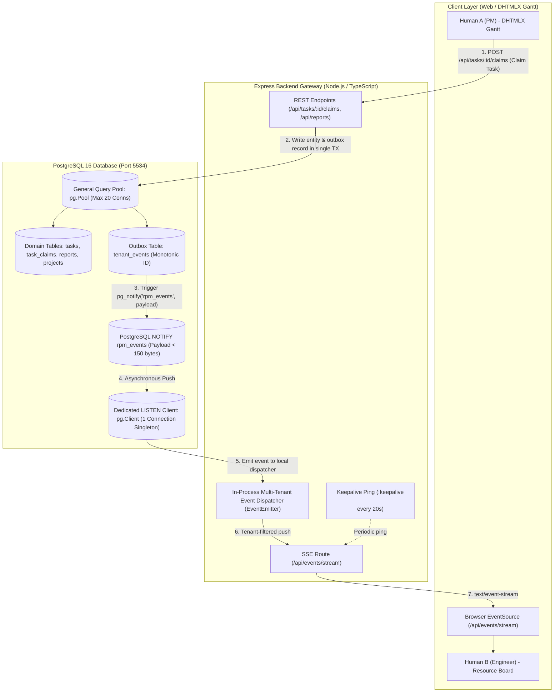
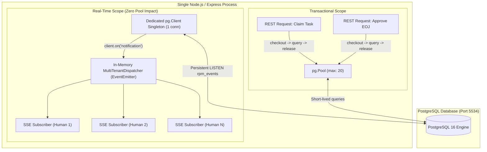

# Research: Server-Sent Events (SSE) & PostgreSQL LISTEN/NOTIFY Architecture for Task Claim & EOJ Events (`rpm_V1`)

- **Author**: AFK Research Subagent
- **Tracking Issue**: Fixes [#11](https://github.com/aubed9/gantt/issues/11)
- **Context**: Part of [[Wayfinder Map] rpm_V1 Platform Core Services, Real-Time Pipeline & Production Deployment (#9)](https://github.com/aubed9/gantt/issues/9)
- **Status**: Verified Architectural Specification
- **Domain Terminology**: Strictly conforms to [`GLOSSARY.md`](../../GLOSSARY.md) (`Tenant`, `Human`, `Project`, `Task`, `Task Claim`, `End-of-Job (EOJ) Report`, `Claim Review Window`, `Task State`, `Task Claim State`, `Report State`, `Knowledge Ingestion`).
- **Date**: November 2026

---

## 1. Executive Summary & Problem Formulation

The `rpm_V1` platform is an AI-augmented organizational management system coordinating concurrent **Humans** across **Projects**, **Tasks**, and **Events**. Its core workflows—such as submitting and reviewing **Task Claims** during pooled **Claim Review Windows**, approving **End-of-Job (EOJ) Reports**, rolling up project progress, and triggering **Knowledge Ingestion** into PostgreSQL `pgvector`—require real-time synchronization with connected frontend clients (DHTMLX Gantt timeline views and Resource Boards).

When multiple **Humans** collaborate within a **Tenant**, mutations performed by one member (e.g. a Project Manager approving a **Task Claim** or requesting revisions on an **EOJ Report**) must propagate to all relevant timeline clients sub-second without polling, without locking the Node.js event loop, and without exhausting PostgreSQL connection pools.

### Core Architectural Decisions & Invariants

1. **Unidirectional Server-Sent Events (SSE) over HTTP/2**: Client mutations travel via standard authenticated REST/JSON POST/PATCH endpoints. Push notifications travel down a persistent unidirectional `text/event-stream` connection (`/api/events/stream`). SSE eliminates the bidirectional state complexity, framing overhead, and proxy buffering traps of WebSockets while preserving native browser reconnection semantics.
2. **Dedicated Client Singleton for PostgreSQL `LISTEN`**: General application queries are served by a pooled database pool (`pg.Pool`, max 20 connections). In contrast, `LISTEN` commands are executed on **exactly one dedicated `pg.Client` instance** per Node.js process. This guarantees that long-lived pub/sub connections never starve the transactional query pool.
3. **Two-Step Event ID Fetch Pattern (Claim-Check / Notification-Pull)**: To respect PostgreSQL's hard 8000-byte `NOTIFY` payload limit, prevent sensitive data leakage across channels, and ensure message durability, `NOTIFY` emits only a compact JSON envelope (`event_id`, `tenant_id`, `entity_type`, `action`). The payload size is $< 150$ bytes. Full event data is either fetched on demand or retrieved from an append-only `tenant_events` outbox table.
4. **Guaranteed Delivery via `Last-Event-ID` Reconnection**: PostgreSQL `LISTEN`/`NOTIFY` is inherently ephemeral (fire-and-forget). By pairing the dedicated listener with a persistent `tenant_events` table indexed by monotonic integer IDs, clients reconnecting with the `Last-Event-ID` HTTP header automatically replay missed events before joining the live stream, ensuring at-least-once delivery.
5. **Robust Connection Lifecycle & Keep-Alive**: The Express streaming endpoint emits SSE comment heartbeats (`:keepalive\n\n`) every 20 seconds to prevent reverse proxy (Nginx, AWS ALB, Cloudflare) socket timeouts. Client disconnections are monitored via `req.on('close')`, immediately cleaning up interval timers, unregistering event listeners, and preventing memory leaks.



---

## 2. Primary Sources & Architectural Foundations

| Specification / Library | Canonical Reference | Architectural Significance |
| :--- | :--- | :--- |
| **W3C Server-Sent Events** | [W3C Recommendation 03 Feb 2015](https://www.w3.org/TR/eventsource/) / [WHATWG HTML §9.2](https://html.spec.whatwg.org/multipage/server-sent-events.html) | Wire protocol (`text/event-stream`), field formatting (`id`, `event`, `data`, `retry`), comment lines (`:`), and automatic `Last-Event-ID` reconnection. |
| **PostgreSQL 16 Documentation** | [`LISTEN`](https://www.postgresql.org/docs/16/sql-listen.html) & [`NOTIFY`](https://www.postgresql.org/docs/16/sql-notify.html) | Inter-process communication semantics, transactional commit triggers, channel identifier rules, and the 8000-byte payload limit. |
| **node-postgres (`pg`)** | [node-postgres.com Docs](https://node-postgres.com/features/notifications) | Native Node.js driver handling `client.on('notification')`, socket lifecycle, and distinct behavior between `pg.Pool` and `pg.Client`. |
| **`pg-listen`** | [GitHub: AndyBrummer/pg-listen](https://github.com/AndyBrummer/pg-listen) | Production abstraction over `pg.Client` providing automatic JSON deserialization, reconnect with exponential backoff, and channel re-subscription. |
| **RFC 7540 / RFC 9113 (HTTP/2)** | [RFC 9113: HTTP/2 Multiplexing](https://datatracker.ietf.org/doc/html/rfc9113) | Resolves the HTTP/1.1 6-connection per host browser limit by multiplexing unlimited concurrent SSE streams over a single TCP connection. |
| **Express & Node.js HTTP** | [Node.js `http.IncomingMessage`](https://nodejs.org/api/http.html#event-close) | Connection lifecycle events (`close`, `finish`, `error`), socket abort detection, and memory leak prevention. |

---

## 3. PostgreSQL LISTEN/NOTIFY Semantics & Constraints

### 3.1 Transactional Delivery Guarantees

PostgreSQL `NOTIFY` commands adhere to the following transactional mechanics:

1. **Commit Coupling**: If `NOTIFY` is issued within an open transaction block (`BEGIN ... COMMIT`), the notification is **not emitted immediately**. It is queued internally and transmitted to listening connections **only after the transaction successfully commits**.
2. **Clean Rollback**: If the transaction aborts or rolls back (`ROLLBACK`), all queued notifications are silently discarded. This guarantees that clients never receive notifications for dirty or rolled-back mutations (e.g. a failed **Task Claim** approval).
3. **Deduplication / Coalescing**: PostgreSQL can coalesce identical `NOTIFY` messages emitted within the same transaction to minimize network traffic.
4. **Ephemerality (The Fire-and-Forget Limitation)**: `LISTEN` and `NOTIFY` provide **at-most-once delivery**. PostgreSQL does not maintain an internal message queue or persistence buffer for notifications. If a Node.js process is restarting, or the dedicated listener connection drops for 50 milliseconds, any `NOTIFY` emitted during that window is permanently lost to that process.

### 3.2 The 8000-Byte Payload Limit

In PostgreSQL source code (`src/backend/commands/async.c`), the payload length for `NOTIFY` is constrained by a compile-time constant:

$$\text{MAX\_PAYLOAD\_SIZE} = 8000 \text{ bytes}$$

Attempting to emit a notification with a payload exceeding 8000 bytes raises an immediate database exception:
```
ERROR: payload string is too long for a notify payload
```

In `rpm_V1`, domain entities easily exceed this ceiling:
- An **End-of-Job (EOJ) Report** contains comprehensive markdown text detailing deliverables against success criteria (frequently 2 to 20 KB).
- A **Task Claim** evaluated by the Mastra AI Agent contains structured AI candidate assessments and semantic similarity scores.
- Attempting to serialize full entity JSON trees directly into `pg_notify` creates catastrophic edge-case failures when reports grow.

### 3.3 The Two-Step Event ID Fetch Pattern (Claim-Check Architecture)

To resolve the 8000-byte ceiling, eliminate ephemerality, and enforce multi-tenant security, `rpm_V1` adopts the **Two-Step Event ID Fetch Pattern**:

1. **Persistent Event Outbox**: When a mutation occurs, the transaction inserts a record into an append-only `tenant_events` table with a sequential `BIGSERIAL` ID (`event_id`).
2. **Compact Notification Envelope**: A PostgreSQL trigger emits `NOTIFY rpm_events` with an ultra-lightweight JSON envelope strictly under 150 bytes:
   ```json
   {
     "e_id": 48291,
     "t_id": "tn_alpha",
     "type": "task_claim:created",
     "ent_id": "TC-904",
     "ts": 1731000000000
   }
   ```
3. **Hydration & Delivery**: The dedicated listener receives the envelope. For real-time SSE push, the server can broadcast the lightweight envelope directly (enabling the client store to invalidate or fetch), or query the relational database via `pg.Pool` to hydrate the view model for authorized subscribers.
4. **Missed Event Catch-Up**: Upon connection or reconnection, clients provide `Last-Event-ID`. The server queries `tenant_events WHERE tenant_id = $1 AND id > $2 ORDER BY id ASC LIMIT 100`, providing deterministic replay.

#### Database DDL & Trigger Implementation

```sql
-- PostgreSQL 16 Migration: Tenant Events Outbox & Notification Trigger

CREATE TABLE IF NOT EXISTS tenant_events (
    id BIGSERIAL PRIMARY KEY,
    tenant_id VARCHAR(64) NOT NULL REFERENCES tenants(id) ON DELETE CASCADE,
    event_type VARCHAR(100) NOT NULL,
    entity_type VARCHAR(50) NOT NULL,
    entity_id VARCHAR(64) NOT NULL,
    payload JSONB NOT NULL DEFAULT '{}',
    created_at TIMESTAMPTZ NOT NULL DEFAULT NOW()
);

-- Index for fast sequential replay via Last-Event-ID
CREATE INDEX IF NOT EXISTS idx_tenant_events_tenant_replay 
ON tenant_events (tenant_id, id ASC);

-- Compact Notification Trigger Function (< 150 bytes payload)
CREATE OR REPLACE FUNCTION fn_notify_tenant_event() 
RETURNS TRIGGER AS $$
DECLARE
    v_notification JSON;
BEGIN
    v_notification := json_build_object(
        'e_id', NEW.id,
        't_id', NEW.tenant_id,
        'type', NEW.event_type,
        'ent_id', NEW.entity_id,
        'ts', (EXTRACT(EPOCH FROM NEW.created_at) * 1000)::BIGINT
    );

    -- Execute notification on the unified application channel
    PERFORM pg_notify('rpm_events', v_notification::TEXT);
    RETURN NEW;
END;
$$ LANGUAGE plpgsql;

DROP TRIGGER IF EXISTS trg_notify_tenant_event ON tenant_events;
CREATE TRIGGER trg_notify_tenant_event
AFTER INSERT ON tenant_events
FOR EACH ROW
EXECUTE FUNCTION fn_notify_tenant_event();
```

---

## 4. Connection Pool Management & The Dedicated Client Singleton

### 4.1 The Connection Starvation Trap

A critical vulnerability in Node.js applications using `LISTEN` / `NOTIFY` is **connection pool starvation**.

In `node-postgres`, `pg.Pool` manages an elastic pool of reusable connections (e.g. `max: 20`). Normal queries check out a connection, execute a statement, and immediately release it back:
```typescript
// Standard query pattern: connection is released in ~3ms
const client = await pool.connect();
try {
  const result = await client.query('SELECT * FROM tasks WHERE id = $1', [taskId]);
  return result.rows[0];
} finally {
  client.release();
}
```

However, `LISTEN` is **connection-bound**:
```typescript
// ANTI-PATTERN: NEVER DO THIS INSIDE A POOL CONNECTION
const client = await pool.connect();
await client.query('LISTEN rpm_events');
// If you release the client back to the pool, other queries will inherit the LISTEN state!
// If you DO NOT release it, 1 of your 20 pool connections is permanently locked!
// If 20 SSE clients trigger this, the entire pool is DEAD: zero API requests can run!
```

$$\text{Available Pool Conns} = \text{Max Conns} - \text{Active Long-Lived Listeners}$$

When $\text{Active Long-Lived Listeners} \ge \text{Max Conns}$, all incoming REST endpoints hang indefinitely until `connectionTimeoutMillis` trips, producing cascading HTTP 504 Gateway Timeouts.

### 4.2 The Dedicated Client Singleton Pattern

To prevent pool starvation, the architecture enforces strict physical separation between transactional queries and asynchronous event listening:

1. **Transactional Workloads (`pg.Pool`)**: A pool of up to 20 connections exclusively executes short-lived `SELECT`, `INSERT`, `UPDATE`, and `DELETE` operations.
2. **Notification Workloads (`pg.Client`)**: Exactly **one dedicated `pg.Client`** connection is created at server boot, outside the pool. It runs `LISTEN rpm_events` and remains open indefinitely.
3. **In-Process Fan-Out**: When the dedicated client receives a notification from PostgreSQL, it dispatches the event in memory to an internal Node.js `EventEmitter`. Hundreds or thousands of concurrent SSE HTTP requests subscribe to this in-process emitter.
4. **Horizontal Scaling Semantics**: When running multiple backend Node.js instances behind a reverse proxy (e.g. 4 instances in Docker Compose or Kubernetes):
   - Each instance maintains **1** dedicated `LISTEN` client (Total: 4 connections to PostgreSQL).
   - PostgreSQL multicasts `NOTIFY` to all 4 connected backend instances.
   - Each instance broadcasts the message to its locally connected SSE clients.
   - This provides horizontal scaling without requiring a separate Redis cluster for basic real-time fan-out.



---

## 5. Technical Implementation: Resilient Dedicated Listener

Below is the production TypeScript implementation for the dedicated PostgreSQL listener singleton. It supports automatic reconnection with exponential backoff and randomized jitter, channel re-subscription, and health check observability.

```typescript
// src/services/events/pg-listener.service.ts
import { Client, Notification } from 'pg';
import { EventEmitter } from 'events';

export interface PgNotificationEnvelope {
  e_id: number;
  t_id: string;
  type: string;
  ent_id: string;
  ts: number;
}

export class PgListenerService extends EventEmitter {
  private static instance: PgListenerService;
  private client: Client | null = null;
  private isConnected = false;
  private isConnecting = false;
  private reconnectAttempts = 0;
  private readonly maxReconnectDelayMs = 30000;
  private readonly channel = 'rpm_events';

  private constructor(private readonly connectionString: string) {
    super();
    // Allow up to 1000 internal tenant event listeners without warning
    this.setMaxListeners(1000);
  }

  public static getInstance(connectionString?: string): PgListenerService {
    if (!PgListenerService.instance) {
      if (!connectionString) {
        throw new Error('PgListenerService requires connectionString on initialization');
      }
      PgListenerService.instance = new PgListenerService(connectionString);
    }
    return PgListenerService.instance;
  }

  public async start(): Promise<void> {
    if (this.isConnected || this.isConnecting) return;
    this.isConnecting = true;

    try {
      this.client = new Client({
        connectionString: this.connectionString,
        keepAlive: true,
        statement_timeout: 0, // No query timeout for persistent LISTEN connection
      });

      this.client.on('notification', (msg: Notification) => {
        this.handleNotification(msg);
      });

      this.client.on('error', (err: Error) => {
        console.error('[PgListener] PostgreSQL connection error:', err.message);
        this.handleDisconnect();
      });

      this.client.on('end', () => {
        console.warn('[PgListener] PostgreSQL connection ended unexpectedly');
        this.handleDisconnect();
      });

      await this.client.connect();
      await this.client.query(`LISTEN ${this.channel}`);

      this.isConnected = true;
      this.isConnecting = false;
      this.reconnectAttempts = 0;
      console.log(`[PgListener] Successfully listening on PostgreSQL channel: "${this.channel}"`);
      this.emit('ready');
    } catch (err: any) {
      console.error('[PgListener] Connection initiation failed:', err.message);
      this.handleDisconnect();
    }
  }

  private handleNotification(msg: Notification): void {
    if (msg.channel !== this.channel || !msg.payload) return;

    try {
      const envelope: PgNotificationEnvelope = JSON.parse(msg.payload);
      // Emit event partitioned by tenant for isolated delivery
      this.emit(`event:${envelope.t_id}`, envelope);
      // Emit global event for monitoring / telemetry
      this.emit('event:all', envelope);
    } catch (parseErr: any) {
      console.error('[PgListener] Failed to parse JSON notification payload:', parseErr.message, msg.payload);
    }
  }

  private handleDisconnect(): void {
    this.isConnected = false;
    this.isConnecting = false;

    if (this.client) {
      this.client.removeAllListeners();
      this.client.end().catch(() => {});
      this.client = null;
    }

    // Exponential backoff with 10% - 25% randomized full jitter
    this.reconnectAttempts++;
    const baseDelay = Math.min(1000 * Math.pow(1.5, this.reconnectAttempts), this.maxReconnectDelayMs);
    const jitter = baseDelay * (0.1 + Math.random() * 0.15);
    const delay = Math.round(baseDelay + jitter);

    console.warn(`[PgListener] Reconnecting in ${delay}ms (attempt ${this.reconnectAttempts})...`);
    setTimeout(() => this.start(), delay);
  }

  public getStatus(): { isConnected: boolean; reconnectAttempts: number } {
    return {
      isConnected: this.isConnected,
      reconnectAttempts: this.reconnectAttempts,
    };
  }

  public async shutdown(): Promise<void> {
    if (this.client) {
      try {
        await this.client.query(`UNLISTEN ${this.channel}`);
        await this.client.end();
      } catch (e) {
        // Ignore errors during process exit
      }
      this.client = null;
    }
    this.isConnected = false;
  }
}
```

---

## 6. Express Server-Sent Events Endpoint (`/api/events/stream`)

### 6.1 Critical HTTP Headers & Reverse Proxy Safeguards

To maintain an unbuffered, uninterrupted SSE stream through Express and intermediate reverse proxies, the server must write specific HTTP headers:

```typescript
res.writeHead(200, {
  'Content-Type': 'text/event-stream; charset=utf-8',
  'Cache-Control': 'no-cache, no-transform',
  'Connection': 'keep-alive',
  'X-Accel-Buffering': 'no', // Disables response buffering in Nginx
  'Access-Control-Allow-Origin': '*',
});
```

- **`Content-Type: text/event-stream`**: Informs the browser `EventSource` client to interpret incoming chunks as SSE frames.
- **`Cache-Control: no-cache, no-transform`**: Prevents proxies from caching chunks or compressing/transforming the stream (which delays packet delivery).
- **`Connection: keep-alive`**: Keeps the underlying TCP socket open.
- **`X-Accel-Buffering: no`**: Crucial for Nginx. By default, Nginx buffers upstream responses until a 4KB/8KB buffer fills. Setting this header forces Nginx to flush each event to the client immediately.
- **Disabling Compression Middleware**: If Express uses `compression()`, SSE responses must bypass gzip/deflate buffering. This is achieved by checking `if (req.headers.accept === 'text/event-stream') return false;` in the compression filter.

### 6.2 Heartbeat / Keep-Alive Protocol

Intermediate network elements (firewalls, NAT gateways, AWS ALB, Cloudflare) close idle TCP connections if no packets traverse the socket within their timeout window (e.g. AWS ALB defaults to 60 seconds; Cloudflare drops idle connections at 100 seconds).

Per the W3C SSE specification, lines starting with a colon (`:`) are treated as **comments** and ignored by client-side event dispatchers:
```http
:keepalive

```

The Express endpoint schedules a timer every 20 seconds emitting `:keepalive\n\n`. This maintains TCP liveliness without firing synthetic `onmessage` events in the frontend JavaScript code.

### 6.3 Last-Event-ID Catch-Up Reconnection

When a browser `EventSource` connection drops (e.g. Wi-Fi blip or laptop sleep), the browser automatically reconnects and includes the `Last-Event-ID` HTTP header containing the last received frame `id`.

Upon connection:
1. The server reads `req.headers['last-event-id']` (or `req.query.last_event_id`).
2. If present, the server executes a query against `tenant_events`:
   ```sql
   SELECT id, event_type, entity_id, payload, created_at 
   FROM tenant_events 
   WHERE tenant_id = $1 AND id > $2 
   ORDER BY id ASC 
   LIMIT 100;
   ```
3. The server flushes these historical events in order.
4. The server then attaches the client to the live `PgListenerService` event stream.

This eliminates race conditions and ensures **at-least-once message delivery** across network disconnections.

### 6.4 Client Socket Cleanup & Leak Prevention

A major source of memory leaks in Node.js streaming servers is failing to clean up resources when the client disconnects. 

When a Human closes their browser tab or navigates away, Node.js emits the `'close'` event on `req` (and `res`). The endpoint handler must:
1. Clear the keep-alive `setInterval` timer.
2. Remove the listener callback from `PgListenerService`.
3. Decrement active connection metrics.

Failing to remove the listener causes Node's `EventEmitter` to retain references to `res`, triggering:
```
MaxListenersExceededWarning: Possible EventEmitter memory leak detected. 11 event:tn_alpha listeners added.
```

### 6.5 Complete Express Route Implementation

```typescript
// src/routes/events-stream.router.ts
import { Router, Request, Response } from 'express';
import { Pool } from 'pg';
import { PgListenerService, PgNotificationEnvelope } from '../services/events/pg-listener.service';

export function createEventsStreamRouter(pool: Pool, pgListener: PgListenerService): Router {
  const router = Router();

  /**
   * SSE Streaming Endpoint for Real-Time Domain Events
   * GET /api/events/stream?tenant_id=...&project_id=...
   */
  router.get('/stream', async (req: Request, res: Response): Promise<void> => {
    // 1. Authenticate Human & Resolve Tenant (TN) Boundary
    const tenantId = (req.query.tenant_id as string) || (req.headers['x-tenant-id'] as string);
    const humanId = (req.headers['x-human-id'] as string) || 'HM-ANONYMOUS';

    if (!tenantId) {
      res.status(400).json({ error: 'Missing mandatory tenant_id parameter' });
      return;
    }

    // 2. Set Unbuffered Streaming Headers
    res.writeHead(200, {
      'Content-Type': 'text/event-stream; charset=utf-8',
      'Cache-Control': 'no-cache, no-transform',
      'Connection': 'keep-alive',
      'X-Accel-Buffering': 'no',
    });

    // Send initial connection establishment frame with retry interval (5000ms)
    res.write('retry: 5000\n');
    res.write(':connected\n\n');

    // 3. Heartbeat / Keep-Alive Timer (every 20 seconds)
    const keepAliveTimer = setInterval(() => {
      res.write(':keepalive\n\n');
    }, 20000);

    // 4. Handle Last-Event-ID Replay for Guaranteed Delivery
    const lastEventIdHeader = req.headers['last-event-id'] || req.query.last_event_id;
    if (lastEventIdHeader) {
      const lastId = parseInt(lastEventIdHeader as string, 10);
      if (!isNaN(lastId) && lastId > 0) {
        try {
          const replayResult = await pool.query(
            `SELECT id, event_type, entity_id, payload 
             FROM tenant_events 
             WHERE tenant_id = $1 AND id > $2 
             ORDER BY id ASC 
             LIMIT 100`,
            [tenantId, lastId]
          );

          for (const row of replayResult.rows) {
            const frame = `id: ${row.id}\nevent: ${row.event_type}\ndata: ${JSON.stringify(row.payload)}\n\n`;
            res.write(frame);
          }
        } catch (dbErr: any) {
          console.error('[SSE] Failed to replay missed events:', dbErr.message);
        }
      }
    }

    // 5. In-Memory Event Listener Callback
    const onTenantEvent = async (envelope: PgNotificationEnvelope) => {
      try {
        // Query the full hydrated payload from outbox or entity table using general pool
        const eventRecord = await pool.query(
          `SELECT id, event_type, entity_id, payload 
           FROM tenant_events 
           WHERE id = $1`,
          [envelope.e_id]
        );

        if (eventRecord.rows.length > 0) {
          const row = eventRecord.rows[0];
          const frame = `id: ${row.id}\nevent: ${row.event_type}\ndata: ${JSON.stringify(row.payload)}\n\n`;
          res.write(frame);
        }
      } catch (err: any) {
        console.error('[SSE] Error dispatching live event:', err.message);
      }
    };

    // 6. Register Listener for this Tenant Boundary
    const eventChannel = `event:${tenantId}`;
    pgListener.on(eventChannel, onTenantEvent);

    // 7. Cleanup Socket on Disconnection
    req.on('close', () => {
      clearInterval(keepAliveTimer);
      pgListener.removeListener(eventChannel, onTenantEvent);
      res.end();
      console.log(`[SSE] Client disconnected: Human ${humanId} from Tenant ${tenantId}`);
    });
  });

  return router;
}
```

---

## 7. Domain Event Catalog & Lifecycle Serialization

All event structures conform strictly to [`GLOSSARY.md`](../../GLOSSARY.md) and established architecture decisions ([ADR 0001](../adr/0001-task-claim-lifecycle-and-governance.md) and [ADR 0002](../adr/0002-eoj-report-review-and-status-propagation.md)).

### 7.1 Event Catalog Matrix

| Event Name (`event:`) | Triggering Domain Operation | Source State $\to$ Target State | Payload Description |
| :--- | :--- | :--- | :--- |
| **`task_claim:created`** | A **Human** submits a formal claim for an open task. | `Task Claim State`: $\to$ `PENDING` | `claimId`, `taskId`, `humanId`, `matchScore`, `skills` |
| **`task:claim_review_started`** | The pooled **Claim Review Window** opens for PM/AI evaluation. | `Task State`: `OPEN_FOR_CLAIM` $\to$ `CLAIM_REVIEW` | `taskId`, `projectId`, `claimCount`, `reviewWindowClosesAt` |
| **`task_claim:approved`** | PM/PO approves one candidate; other claims rejected. | `Task Claim State`: `PENDING` $\to$ `APPROVED`<br>`Task State`: `CLAIM_REVIEW` $\to$ `ASSIGNED` | `claimId`, `taskId`, `approvedHumanId`, `rejectedClaimIds` |
| **`task_claim:rejected`** | PM explicitly rejects a single claim. | `Task Claim State`: `PENDING` $\to$ `REJECTED` | `claimId`, `taskId`, `humanId`, `reason` |
| **`report:submitted`** | Assigned Human submits an **End-of-Job (EOJ) Report**. | `Report State`: $\to$ `SUBMITTED`<br>`Task State`: `IN_PROGRESS` $\to$ `IN_REVIEW` | `reportId`, `taskId`, `projectId`, `authorHumanId`, `title` |
| **`report:approved`** | PM/CTO approves EOJ Report; marks task 100% complete. | `Report State`: `SUBMITTED` $\to$ `APPROVED`<br>`Task State`: `IN_REVIEW` $\to$ `COMPLETED` | `reportId`, `taskId`, `projectId`, `progress: 1.0`, `vectorIndexed: true` |
| **`report:revision_requested`** | PM requests deliverables revision. | `Report State`: $\to$ `REVISION_REQUESTED`<br>`Task State`: `IN_REVIEW` $\to$ `IN_PROGRESS` | `reportId`, `taskId`, `reviewerComments` |
| **`project:progress_updated`** | Recalculated duration-weighted progress roll-up on **Project**. | $\sum (\text{progress} \times \text{duration}) / \sum \text{duration}$ | `projectId`, `previousProgress`, `currentProgress` |

### 7.2 TypeScript Event Interfaces

```typescript
// src/types/events.ts

export type TaskState = 
  | 'DRAFT' | 'OPEN_FOR_CLAIM' | 'CLAIM_REVIEW' | 'ASSIGNED'
  | 'IN_PROGRESS' | 'IN_REVIEW' | 'COMPLETED' | 'BLOCKED' | 'CANCELLED';

export type TaskClaimState = 'PENDING' | 'APPROVED' | 'REJECTED' | 'WITHDRAWN';
export type ReportState = 'DRAFT' | 'SUBMITTED' | 'REVISION_REQUESTED' | 'APPROVED';

export interface BaseDomainEvent<T> {
  eventId: number;
  tenantId: string;
  eventType: string;
  timestamp: number;
  data: T;
}

export interface TaskClaimCreatedEvent {
  claimId: string;
  taskId: number;
  humanId: string;
  humanName: string;
  matchScore: number;
  skills: string[];
}

export interface TaskClaimApprovedEvent {
  claimId: string;
  taskId: number;
  approvedHumanId: string;
  taskState: 'ASSIGNED';
  rejectedClaimIds: string[];
}

export interface EojReportSubmittedEvent {
  reportId: string;
  taskId: number;
  projectId: string;
  authorHumanId: string;
  title: string;
  taskState: 'IN_REVIEW';
}

export interface EojReportApprovedEvent {
  reportId: string;
  taskId: number;
  projectId: string;
  taskState: 'COMPLETED';
  taskProgress: 1.0;
  projectProgress: number; // Duration-weighted roll-up
  vectorIndexed: boolean;
}
```

---

## 8. Frontend Integration: DHTMLX Gantt Real-Time Subscriber

The DHTMLX Gantt frontend (located in `apps/rpm_v1`) consumes the SSE stream via the native browser `EventSource` API. Upon receiving events, it performs in-place DOM and datastore updates without reloading the dataset.

```javascript
// apps/rpm_v1/src/services/realtime_sync.js
import { emit } from '../emit.js';

/**
 * Initializes real-time Server-Sent Events sync for DHTMLX Gantt.
 * @param {string} tenantId - Tenant identifier
 * @param {string} humanId - Authenticated Human identifier
 */
export function initRealtimeGanttSync(tenantId, humanId) {
  const url = `/api/events/stream?tenant_id=${encodeURIComponent(tenantId)}`;
  const eventSource = new EventSource(url);

  eventSource.onopen = () => {
    console.log('[SSE] Connected to real-time event stream');
    emit.signal('sse:connected', { tenantId, humanId });
  };

  eventSource.onerror = (err) => {
    console.warn('[SSE] Connection lost or reconnecting...', err);
    emit.signal('sse:reconnecting', { tenantId });
  };

  // 1. Task Claim Review Window Started
  eventSource.addEventListener('task:claim_review_started', (e) => {
    const data = JSON.parse(e.data);
    const task = window.gantt.getTask(data.taskId);
    if (task) {
      task.state = 'CLAIM_REVIEW';
      task.claim_count = data.claimCount;
      window.gantt.updateTask(task.id);
      emit.signal('gantt:task_updated', { taskId: task.id, state: 'CLAIM_REVIEW' });
    }
  });

  // 2. Task Claim Approved (Task Assigned)
  eventSource.addEventListener('task_claim:approved', (e) => {
    const data = JSON.parse(e.data);
    const task = window.gantt.getTask(data.taskId);
    if (task) {
      task.state = 'ASSIGNED';
      task.assignee_id = data.approvedHumanId;
      window.gantt.updateTask(task.id);
      window.gantt.render(); // Redraw grid and timeline bars
      emit.signal('gantt:task_assigned', { taskId: task.id, assigneeId: data.approvedHumanId });
    }
  });

  // 3. EOJ Report Submitted (Task In Review)
  eventSource.addEventListener('report:submitted', (e) => {
    const data = JSON.parse(e.data);
    const task = window.gantt.getTask(data.taskId);
    if (task) {
      task.state = 'IN_REVIEW';
      window.gantt.updateTask(task.id);
      emit.signal('gantt:task_in_review', { taskId: task.id });
    }
  });

  // 4. EOJ Report Approved (Task Completed & Progress Roll-up)
  eventSource.addEventListener('report:approved', (e) => {
    const data = JSON.parse(e.data);
    const task = window.gantt.getTask(data.taskId);
    if (task) {
      task.state = 'COMPLETED';
      task.progress = 1.0;
      window.gantt.updateTask(task.id);
    }

    // Update parent project progress indicator
    if (data.projectProgress !== undefined) {
      updateProjectProgressHeader(data.projectId, data.projectProgress);
    }
    window.gantt.render();
    emit.signal('gantt:task_completed', { taskId: data.taskId, projectProgress: data.projectProgress });
  });

  return () => {
    eventSource.close();
    console.log('[SSE] Closed EventSource connection');
  };
}

function updateProjectProgressHeader(projectId, progress) {
  const badge = document.getElementById(`project-progress-${projectId}`);
  if (badge) {
    badge.textContent = `${(progress * 100).toFixed(1)}%`;
  }
}
```

---

## 9. Architectural Alternatives & Trade-Off Matrix

| Evaluation Dimension | Server-Sent Events (SSE) + PG LISTEN/NOTIFY (Selected) | WebSockets (`ws` / `socket.io`) | Redis Pub/Sub + SSE | HTTP Short/Long Polling |
| :--- | :--- | :--- | :--- | :--- |
| **Protocol Directionality** | Unidirectional (Server $\to$ Client). Matches `rpm_V1` (mutations use REST). | Full-duplex (Bidirectional). | Unidirectional. | Request / Response pull. |
| **Infrastructure Overhead** | **Zero additional infrastructure**: Reuses PostgreSQL 16 substrate. | Zero additional infrastructure, but requires custom heartbeat & auth frames. | Requires provisioning and managing a Redis cluster. | Zero additional infrastructure. |
| **Reconnection & Replay** | **Native browser support**: `EventSource` automatically sends `Last-Event-ID`. | Custom application-level protocol required. | Requires custom application outbox logic. | Inefficient periodic database queries. |
| **Proxy / Firewall Traversal** | **Superior**: Standard HTTP/1.1 or HTTP/2 over port 443/80. | Often blocked by enterprise proxies; requires sticky sessions for upgrades. | Same as SSE. | High latency; high CPU waste. |
| **Connection Footprint** | Multiplexed over 1 TCP stream in HTTP/2. Dedicated PG listener: **1 conn**. | 1 TCP connection per client; high socket memory overhead. | 1 PG conn + 1 Redis connection. | High connection thrashing. |
| **Payload Constraints** | 8000-byte PG limit resolved via Two-Step Event ID Fetch Pattern. | No database limit, but requires custom DB sync. | 512 MB Redis string limit. | Subject to standard HTTP limits. |
| **Verdict** | **Recommended & Selected**: Simplest, most resilient, zero operational drift. | Rejected: Unnecessary protocol complexity for read-heavy timeline push. | Rejected: Avoids external Redis dependency when PostgreSQL handles load. | Rejected: Excessive latency and database query thrashing. |

---

## 10. Summary of Findings & Next Steps

| Area | Verified Finding | Implementation Target |
| :--- | :--- | :--- |
| **Database Trigger & Outbox** | Add append-only `tenant_events` table with monotonic `BIGSERIAL` ID and trigger emitting $< 150$-byte JSON to `rpm_events`. | Migration in `Phase 1: Database & Migrations`. |
| **Dedicated Client Singleton** | Allocate exactly 1 `pg.Client` for `LISTEN rpm_events` outside `pg.Pool`, protecting general pool capacity. | Implemented in `src/services/events/pg-listener.service.ts`. |
| **Express SSE Streaming Route** | Mount `/api/events/stream` with `text/event-stream`, `X-Accel-Buffering: no`, 20s `:keepalive\n\n` heartbeat, and `Last-Event-ID` catch-up replay. | Implemented in `src/routes/events-stream.router.ts`. |
| **Socket Cleanup** | Monitor `req.on('close')` to immediately clear timers and detach event listeners, preventing memory leaks. | Implemented in SSE router handler. |
| **Frontend Integration** | Connect DHTMLX Gantt via native `EventSource`, dynamically updating task states and progress bars on `report:approved` and `task_claim:approved`. | Implemented in `apps/rpm_v1/src/services/realtime_sync.js`. |
